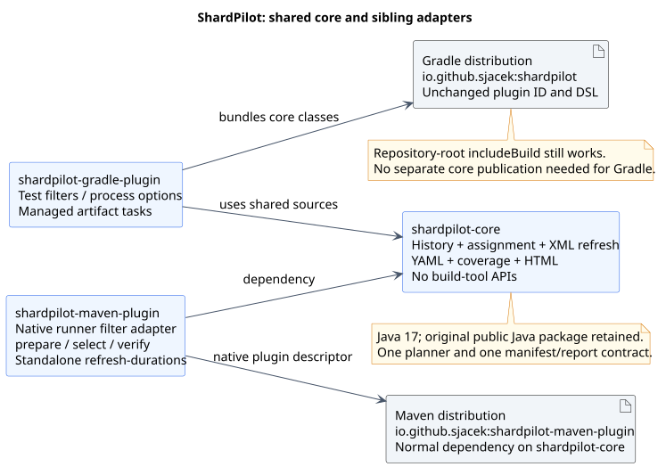

# ShardPilot

ShardPilot helps shorten CI feedback for large JVM unit and integration test suites by splitting
test classes into deterministic shards that run in parallel CI jobs. It provides a Gradle `Test`
adapter and a Maven Surefire/Failsafe adapter over one shared core. The Gradle adapter can also
configure per-task worker heap limits, parallel forks and process recycling.

Works with existing JUnit Jupiter, Spock and TestNG tasks, with no coordinator, CI vendor lock-in,
test-runner replacement or telemetry. YAML manifests use SnakeYAML Engine in the plugin classloader.

Plugin ID: `io.github.sjacek.shardpilot` · License: [MIT](LICENSE).

Maven coordinates: `io.github.sjacek:shardpilot-maven-plugin:0.3.1`. See the
[Maven setup guide](docs/maven.md) and [example POMs](examples/maven/README.md). Gradle users retain
the same plugin ID, public DSL, implementation coordinates and included-build entry point.

The Gradle Wrapper retains its upstream Apache 2.0 license; see [third-party notices](THIRD_PARTY_NOTICES.md).
The Maven Wrapper also retains its Apache 2.0 headers and verifies its pinned distribution checksum.

[Getting started](#getting-started) · [Configuration](#configuration) ·
[Timing history](#timing-history-and-assignment) · [Examples](examples/README.md) · [Documentation](docs/README.md) · [Changelog](CHANGELOG.md) ·
[Contributing](CONTRIBUTING.md)

## Why ShardPilot?

As a project grows, its test suite often becomes one of the longest stages in the CI pipeline.
Hundreds or thousands of unit and integration tests accumulate in a single job, delaying feedback,
slowing down merge requests and extending the time needed to deliver changes. A large test task
can become a bottleneck even when the project has only one module.

When testing becomes a bottleneck, split the suite into smaller subsets called **shards** and run
them as parallel CI jobs. Each job executes only its assigned tests. With sufficient runner capacity,
this reduces the duration of the testing stage and helps the entire pipeline finish sooner.

ShardPilot distributes **test classes**, rather than whole modules, across independent jobs.
It works with standard Gradle `Test` tasks and Maven Surefire/Failsafe executions without requiring
you to reorganize the project into artificial modules or replace your test framework.

### Duration-aware balancing

Dividing tests into equally sized groups does not necessarily produce equally fast jobs: a few
expensive integration tests can take longer than hundreds of lightweight unit tests.

ShardPilot uses historical execution times to balance recorded workloads between shards with
deterministic longest-processing-time-first assignment. Classes without timing history use
deterministic hash-based assignment, so you can start without measurements and improve balancing
as timing data becomes available.

Actual speedup depends on runner capacity, workload balance and test infrastructure startup costs.
Sharding does not reduce the total amount of test work, and one large test class is not split
between jobs.

### Keep your existing testing setup

- Works with standard Gradle `Test` tasks, including custom `integrationTest` tasks.
- Supports Maven Surefire/Failsafe with class-pattern selection, YAML manifests and JSON/HTML coverage reports.
- Tested with JUnit Jupiter, Spock and TestNG.
- Keeps nested tests with their enclosing class, preserving class-level test setup.
- Preserves existing file includes, excludes and framework discovery.
- Supports Gradle Configuration Cache.
- Opt-in configuration for each test task.
- CI-provider independent, with no coordinator service or replacement test runner.
- No telemetry or dependencies injected into consumer test workers.

Your build retains control over test frameworks, source sets, containers, retries and failure
handling. Optional [test-process settings](#optional-test-process-settings) use Gradle's existing
process controls; Maven consumers configure JVMs through Surefire/Failsafe. ShardPilot assigns test classes; your CI launches every shard and
collects the results. It does not create CI jobs or coordinate their completion.

## Status

This checkout prepares **[0.3.1](docs/releases/0.3.1.md)**, a metadata-only patch that declares
the project homepage directly in each Maven publication. Existing sharding configuration,
YAML manifests and JSON/HTML reports need no migration. The installation snippets target 0.3.1;
use the [explicit local development setup](#local-plugin-development) before publishing it.

Version **[0.3.0](docs/releases/0.3.0.md)** is available from both Gradle Plugin Portal and Maven Central.
It introduced opt-in [class-manifest verification](#optional-class-manifest-verification), standalone
HTML reports and the [Maven adapter](docs/maven.md). Version 0.1.0 does not provide `testProcesses`.

Versions [0.2.1](https://plugins.gradle.org/plugin/io.github.sjacek.shardpilot/0.2.1) and
[0.1.0](https://plugins.gradle.org/plugin/io.github.sjacek.shardpilot/0.1.0)
are available from the Gradle Plugin Portal.
The [publication workflow](.github/workflows/publish.yml) submits matching stable version tags
to the Gradle Plugin Portal after the complete compatibility gate succeeds. Maven Central publication
is started manually later from the same tag and reruns that gate without republishing Gradle;
see [release setup](docs/releases.md#configure-github-publication) for both environments and
[Central setup](docs/maven-central.md) for token/signing-key instructions.
The [compatibility matrix](docs/testing.md#gradle-and-jdk-matrix) defines eight Linux CI targets across
Gradle 9.0.0, 9.1.0 and 9.8.1 with JDK 17, 21 and 25, excluding Gradle 9.0.0/JDK 25.
For the 0.2.0 candidate, all eight pairs passed locally in Linux amd64 containers on 23 October 2026:
67 tests per pair, 536 executions, no failures or skips. The tag workflow reruns the matrix for the
release commit before publication. Plugin bytecode targets
Java 17; that alone is not a claim of compatibility with every Gradle/JDK combination.
Android, Kotlin Multiplatform and native-image test execution remain outside the verified scope.

ShardPilot works on standard Gradle `Test` tasks. It does not create source sets, choose a test
framework, add test dependencies, start containers, configure retries, or change failure policy.
Java JUnit Jupiter, nested Jupiter tests, Groovy Spock tests and native TestNG tasks are covered by
functional fixtures, including TestNG data-provider invocations.
Kotlin DSL build configuration has a separate fixture; Kotlin-authored test classes are not yet verified.

## Getting started

This section configures the Gradle adapter. For Maven, use the
[POM setup and lifecycle instructions](docs/maven.md#configure-a-native-runner).

The consumer needs an existing JVM project and a configured test framework. ShardPilot
does not replace the project's Gradle Wrapper or select its JDK. Normal builds use the published
plugin; a local checkout is only needed when developing ShardPilot itself.

### 1. Apply the published plugin

In the consumer's `build.gradle`:

```groovy
plugins {
    id 'java'
    id 'io.github.sjacek.shardpilot' version '0.3.1'
}
```

Or, in `build.gradle.kts`:

```kotlin
plugins {
    java
    id("io.github.sjacek.shardpilot") version "0.3.1"
}
```

The Plugin Portal is Gradle's default plugin repository. If settings declare custom plugin
repositories, retain `gradlePluginPortal()` in the existing `pluginManagement.repositories` block.
No `includeBuild` or Maven Local publication is required.

### 2. Opt in a test task

After applying the plugin, configure the existing task in `build.gradle`:

```groovy
tasks.named('test', Test) {
    useJUnitPlatform() // Your existing framework configuration remains yours.
    shardPilot {
        enabled = true
        durationsFile = layout.projectDirectory.file('test-durations.tsv')
    }
}
```

The same extension is available on custom `integrationTest` tasks, including tasks registered
after applying the plugin. Each task opts in separately; other tasks keep their original test set.
Apply the plugin in each participating subproject instead of configuring sibling projects implicitly.

### 3. Run the shards

Run each command in a separate CI job or isolated checkout, using one-based indices:

```shell
./gradlew test -Pshardpilot.count=2 -Pshardpilot.index=1
./gradlew test -Pshardpilot.count=2 -Pshardpilot.index=2
```

Both properties default to `1`, so ordinary local runs execute the full suite. DSL properties
`shardCount` and `shardIndex` can override the CLI defaults. Invalid settings fail rather than
silently selecting a different shard. CI is responsible for launching every index exactly once.

Both commands target the **same task**, but execute different class subsets. They must not run
concurrently against the same build directory because Gradle test outputs would share paths.

### Kotlin DSL task configuration

In `build.gradle.kts`:

```kotlin
import io.github.sjacek.shardpilot.ShardPilotExtension

plugins {
    java
    id("io.github.sjacek.shardpilot") version "0.3.1"
}

tasks.test {
    useJUnitPlatform()
    extensions.configure<ShardPilotExtension>("shardPilot") {
        enabled.set(true)
        durationsFile.set(layout.projectDirectory.file("test-durations.tsv"))
    }
}
```

## Configuration

The `shardPilot` extension belongs to each `Test` task, not to the root project.

| Setting | Default | Purpose |
| --- | --- | --- |
| `enabled` | `false` | Explicitly opts this task into sharding. |
| `shardCount` | `-Pshardpilot.count`, otherwise `1` | Total number of shards. Must be positive. |
| `shardIndex` | `-Pshardpilot.index`, otherwise `1` | One-based index, between `1` and `shardCount`. |
| `durationsFile` | Unset | Optional UTF-8 timing history; absent history uses hash-only assignment. |

### Optional test-process settings

Version **0.3.1** retains the explicit `testProcesses` block for Gradle's existing worker JVMs.
Set the plugin version in the installation examples above to `0.3.1`, or use the
[local development override](#local-plugin-development) to verify this checkout:

```groovy
tasks.named('integrationTest', Test) {
    shardPilot {
        enabled = true
        testProcesses {
            maxHeapSize = providers.gradleProperty('testHeap').orElse('2g')
            maxParallelForks = 1
            forkEvery = 50L
        }
    }
}
```

The block is independent of `enabled`, which controls only sharding. Without the block,
process settings remain untouched. Inside it, omitted properties retain the task's existing values.
Values and providers are resolved when the block finishes during task configuration; later native
`Test` assignments follow normal Gradle configuration order. No process settings are applied from
execution-time hooks. Supplied settings are also test-task inputs, including `forkEvery`.

`maxHeapSize` is a positive JVM size (bytes or a `k`/`m`/`g` suffix, case-insensitive),
`maxParallelForks` must be positive, and `forkEvery` must be nonnegative (`0L` keeps a process
for the whole task). The heap is **per JVM**, not the complete CI memory budget. CI still owns
capacity planning for build daemons, native memory, containers and other jobs.

Process replacement occurs between classes and adds startup cost. These limits do not guarantee
that an individual class fits its heap and do not hide failures, retry OOMs or monitor memory.

The Kotlin DSL equivalent is:

```kotlin
tasks.named<Test>("integrationTest") {
    extensions.configure<io.github.sjacek.shardpilot.ShardPilotExtension>("shardPilot") {
        testProcesses {
            maxHeapSize.set(providers.gradleProperty("testHeap").orElse("2g"))
            maxParallelForks.set(1)
            forkEvery.set(50L)
        }
    }
}
```

For an **already registered** integration test task, configure it independently:

```groovy
tasks.named('integrationTest', Test) {
    shardPilot {
        enabled = true
        durationsFile = layout.projectDirectory.file('integration-test-durations.tsv')
    }
}
```

Then use `./gradlew integrationTest -Pshardpilot.count=2 -Pshardpilot.index=1` and the equivalent
command for index `2`. Applying ShardPilot does not register an `integrationTest` task or add it
to `check`; those lifecycle decisions remain with the consumer.

To pin a task's settings in the DSL instead of using CLI defaults:

```groovy
tasks.named('test', Test) {
    shardPilot {
        enabled = true
        shardCount = 2
        shardIndex = 1
    }
}
```

Explicit DSL assignments take precedence over the CLI defaults. Do not hard-code an index in a
shared build when different CI jobs need to select different indices.

## Timing history and assignment

The UTF-8 file contains a binary class name, a **tab**, and seconds, one record per line:

```text
# Each gap below is a tab, not spaces.
example.SlowIntegrationTest	120.5
example.FastIntegrationTest	2.0
example.SlowIntegrationTest$Nested	8.5
```

Use one history file per independently planned test task. Missing or unset history is a supported
cold start. Malformed records, negative/non-finite durations and duplicate class records fail with
a line number; errors do not echo arbitrary file contents into CI logs.

Measured classes are sorted by descending duration, then ascending name. Each is assigned to the
least-loaded shard, with ties resolved by the lowest index. Unmeasured classes use Java's stable
string hash and `floorMod`. Nested classes are grouped with their outer class; their measured
durations are added together. Records for removed tests do not resurrect those tests, but may
distort balance until the history is refreshed.

All jobs **must use the same revision, history, shard count and test selection**. Do not rewrite
the history while shards are running. ShardPilot does not fetch data remotely or automatically
modify versioned history. Automatic JUnit XML history export is not part of this initial version.

Sharding intersects the task's original file includes/excludes; it never widens the suite.
Framework discovery and `--tests` still belong to Gradle. An explicit selection can match nothing
on a non-owning shard, and Gradle's usual no-matching-tests failure is intentionally not suppressed.
For focused local runs, omit sharding CLI arguments or set both count and index to `1`.

Only classes are distributed. Methods stay together, and framework parallelism is not
enabled or disabled. Startup, container reuse, Spring context locality and unknown classes can
affect wall-clock balance; recorded seconds are not a promise of a particular speedup.

## Optional class-manifest verification

Version **0.3.1** can prepare a common plan, record the real candidate
selection before each test task and verify the artifacts collected from every CI shard. Configure
it once on the owning `Test` task; existing builds gain no verification tasks or task dependencies until they opt in.

The [manifest guide](docs/shard-verification.md) includes task/CI diagrams, all configuration
options, the file/report formats and failure/cache boundaries.

```groovy
test {
    include '**/*Test.class', '**/*Spec.class'
    exclude '**/*$*.class'
    shardPilot {
        enabled = true
        durationsFile = layout.projectDirectory.file('durations.tsv')
        verification {
            // Explicitly describe the unsharded eligibility, including all application filters.
            eligibleClasses.from(sourceSets.test.output.classesDirs.asFileTree.matching {
                include '**/*Test.class', '**/*Spec.class'
                exclude '**/*$*.class'
            })
            shardCount = 3
        }
    }
}
```

For `test`, this registers `prepareTestShardManifests`, `writeTestActualShardManifest` and
`verifyTestShards`. For `integrationTest`, replace `Test` in those names with `IntegrationTest`.
The plugin creates no helper `Test` tasks and does not assume `IT`, `Test`, or Spock naming.
Nested binary names are supported. The baseline is explicit because Gradle does not expose
all custom discovery predicates as a reusable unsharded tree; reuse your own eligibility closure
for both the owning task and `eligibleClasses`, including any custom file specs.

For a lazily registered custom task, register verification outside its deferred configuration
action so its sibling tasks exist before Gradle selects their names:

```groovy
tasks.named('integrationTest', Test).get().shardPilot.verification {
    eligibleClasses.from(sourceSets.integrationTest.output.classesDirs.asFileTree.matching {
        include '**/*IT.class'
        exclude '**/*$*.class'
    })
    shardCount = 3
}
```

This realizes only the owning task during configuration, not its test workers or unrelated tasks.
Do not put sibling-task registration inside a deferred `tasks.register`/`tasks.named.configure`
action. Kotlin DSL uses the same explicit owner realization:

```kotlin
tasks.test.get().extensions.configure<io.github.sjacek.shardpilot.ShardPilotExtension>("shardPilot") {
    verification {
        eligibleClasses.from(sourceSets.test.get().output.classesDirs.asFileTree.matching {
            include("**/*Test.class")
        })
        shardCount.set(3)
    }
}
```

Defaults live under `build/shardpilot/<task-name>/`: `plan/baseline.yaml`,
`plan/planned-N.yaml`, `actual/actual-N.yaml`, `coverage.json` and `coverage.html`. Override `plannedDirectory`,
`actualDirectory`, `reportFile` and `htmlReportFile` with Gradle layout providers. The standalone HTML
report lists class-to-shard assignments and plan/actual differences, including partial evidence on
validation failure. It needs no scripts or external resources. `classDirectories` defaults to
the owning task's `testClassesDirs`. The verification `shardCount` defaults to that task's count;
set it explicitly when the preparation/aggregation job has no CI node properties.

Read the [HTML status reference](docs/shard-verification.md#reading-html-statuses) to distinguish
matching selections, plan-only inspection and unavailable evidence. The
[report configuration examples](docs/configuration.md#json-and-html-report-paths) show both DSLs;
the [GitLab example](docs/shard-verification.md#finding-a-class-assignment-in-gitlab) exposes a direct
merge-request link while retaining JSON separately. ShardPilot generates the file; CI owns its
publication, access control and retention.

1. Run `prepareTestShardManifests` once in a compile job; upload its whole plan directory.
   Preparation compiles eligible bytecode through its source-set dependencies, runs no tests and
   uses the exact same history/parser/planner as execution. A smaller count removes stale planned files.
2. Launch every normal test shard with identical history and plan inputs. The owning task depends
   on `writeTestActualShardManifest`, which records its actual candidate tree after native and
   ShardPilot exclusions. Upload each index-specific actual file together with the common plan.
3. In an aggregation job, download the plan and all actual files, then run `verifyTestShards`.
   This task never depends on preparation, compilation or test execution. It inspects evidence
   every time, writes JSON and HTML on success/failure and fails for missing, duplicated, foreign, stale
   or mismatched selections. It requires a nonempty baseline and, by default, nonempty shards.
   When explicitly selected in one local invocation, the verifier runs after preparation and
   actual-manifest tasks; ordering never adds those tasks to an aggregation-only invocation.

Set `requireNonEmptyShards = false` to allow empty individual shards, for example when a small
suite uses hash-only assignment. To inspect only a prepared plan before CI runs, pass
`-Pshardpilot.verifyActual=false` (or set `verifyActual = false` in the options).

These are **class-candidate** manifests. They do not prove execution of every test method or
model framework discovery, engine tags, `--tests` method filters, skipped tests or successful
CI completion. Keep normal Gradle/JUnit failure gates and require every shard in the CI DAG.
The application owns source sets, discovery rules, container lifecycle, worker diagnostics,
artifact transfer and CI job definitions. No Python interpreter or application `buildSrc` is required.

## Cache and safety

The enabled flag, shard count, index and history contents are explicit test task inputs, so cached
results from one shard cannot substitute for another. The filter and action capture no `Project`
or `Test` instance. Configuration-cache verification runs in strict failure mode.

ShardPilot does not make external-resource tests safe to cache. Consumers still own the
up-to-date/build-cache policy for tests that depend on databases, networks or other mutable state.
Test output is not parsed or uploaded, and the plugin never retries or forgives a test failure.

## Build and verify

The repository has three sibling source modules:

| Module | Build / responsibility |
| --- | --- |
| `shardpilot-core` | Gradle and Maven: shared planning, YAML manifests and JSON/HTML reports. |
| `shardpilot-gradle-plugin` | Gradle: native `Test` integration, DSL, process settings and Plugin Portal distribution. |
| `shardpilot-maven-plugin` | Maven: native Surefire/Failsafe integration through `prepare`, `select` and `verify`. |



Run both builds when changing the shared core:

```shell
./gradlew check assemble
./mvnw -B -ntp verify
```

On Windows, use `gradlew.bat`. Functional tests use Gradle TestKit and temporary projects with
JUnit/Spock/TestNG dependencies from Maven Central; the first run requires network access. Keep TestKit
execution sequential because it starts additional Gradle daemons and test workers.

PowerShell:

```powershell
.\gradlew.bat check assemble
.\mvnw.cmd -B -ntp verify
```

Verification covers the planner and parser, weighted and hash-only shards, JUnit Jupiter and
Spock and native TestNG execution, data-provider rows, nested classes, pre-existing filters,
custom tasks, empty-shard report cleanup,
failure propagation, Groovy/Kotlin DSL and configuration-cache reuse. Sources and Javadoc JARs
are built alongside the plugin JAR; each contains the MIT license.
The Maven build runs core/adapter unit tests and seven native Invoker/example projects in an isolated
repository. Root Gradle `check` does not run that Maven reactor. See the
[testing guide](docs/testing.md#local-verification) for module report paths and focused commands.

For publication changes, also run `bash scripts/verify-maven-release.sh` with GnuPG available.
It checks the complete signed Maven release bundle using a disposable key and never uploads it.
Ordinary Maven builds do not activate the release profile; see [release verification](docs/maven-central.md#verify-the-release-bundle-without-credentials).

See [CONTRIBUTING.md](CONTRIBUTING.md) for contribution requirements and
[CHANGELOG.md](CHANGELOG.md) for the unreleased feature history.

## Detailed documentation

The [documentation index](docs/README.md) links to configuration, architecture, CI integration,
testing, troubleshooting and release guides. Architecture and CI guides include rendered diagrams
with editable [PlantUML sources](docs/diagrams/README.md).

The runnable [JUnit Jupiter PostgreSQL and RabbitMQ example](examples/gradle/junit-jupiter/testcontainers/README.md) demonstrates
worker-local Testcontainers startup, isolated data and a two-shard integration suite. Its
[detailed guide](docs/testcontainers-example.md) explains lifecycle and CI resource boundaries.
The [Spock counterpart](examples/gradle/spock/testcontainers/README.md) adds specification-local database URLs
and data-table iterations; see its [guide](docs/spock-testcontainers-example.md).
The [TestNG counterpart](examples/gradle/testng/testcontainers/README.md) adds inherited class fixtures
and data-provider invocations; see its [guide](docs/testng-testcontainers-example.md).
The [example index](examples/README.md) groups scenarios by build tool: Gradle's three Testcontainers
examples are under `examples/gradle`, and Maven's Jupiter/parallel-reactor POMs are under `examples/maven`.

## Local plugin development

To test changes from a local ShardPilot checkout, add an explicit override to the consumer's
existing `pluginManagement` block in `settings.gradle`:

```groovy
pluginManagement {
    includeBuild('../shardpilot') // Replace with the path to the local checkout.
}
```

The Kotlin DSL equivalent is `includeBuild("../shardpilot")`. Keep existing plugin repositories
and other settings. The included build substitutes the plugin implementation; remove the override
when verifying resolution of a released version. The repository's standalone Gradle examples use this
mechanism deliberately so they exercise the checkout being developed.

Point `includeBuild` at the **repository root**, not `shardpilot-gradle-plugin`; root settings
include the adapter and core. The plugin ID `io.github.sjacek.shardpilot` and implementation artifact
`io.github.sjacek:shardpilot` are unchanged by the source-module move.

For Maven, run `./mvnw -B -ntp install -DskipITs` at the repository root, then build a consuming
POM with `io.github.sjacek:shardpilot-maven-plugin:0.3.1`. This installs the Maven parent, core and
adapter locally; it does not publish remotely. Maven does not use Gradle's `includeBuild`.
See the [runnable Maven commands](examples/maven/README.md) for both runners and the reactor.

For future releases, follow the [release guide](docs/releases.md): publish a new immutable version
after the full compatibility matrix. Do not republish `0.1.0` or broaden compatibility claims
without corresponding test results. Keep service-specific configuration out of the plugin.

## License

ShardPilot's original implementation is distributed under the [MIT license](LICENSE).
Third-party components retain their own licenses; the generated Gradle Wrapper is covered
separately in [THIRD_PARTY_NOTICES.md](THIRD_PARTY_NOTICES.md).
