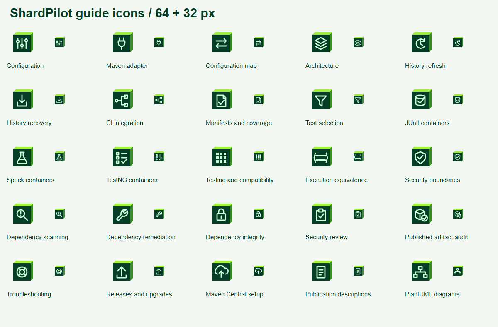

# Documentation guide icons

Each guide in the [documentation index](../../../docs/README.md) has a distinct
glyph on the same isometric panel used by the ShardPilot icon. The palette is
forest `#063D26`, lime `#A0EF3B`, side green `#388E24` and mint `#CDFFD8`.
The SVGs retain transparent surroundings and scale without external resources.

The index displays the icons at 32 px. Their empty HTML alternative text avoids
repeating the adjacent guide name to screen readers; individual SVGs have titles.
The framework examples use thematic test-fixture glyphs rather than vendor marks.



Regenerate the SVGs, mapping and self-contained preview from the repository root:

```powershell
node assets/branding/guide-icons/generate.mjs
.\assets\branding\export.ps1
```

Edit the glyph definitions in [generate.mjs](generate.mjs). The generated
[icons.json](icons.json) maps every icon to its guide destination.
