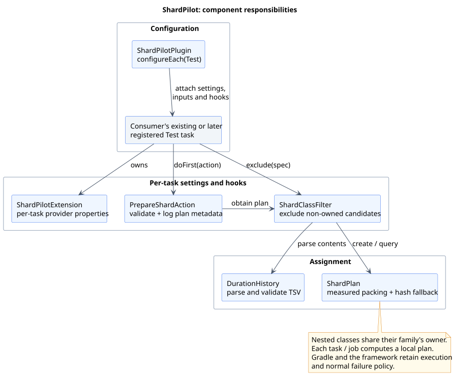
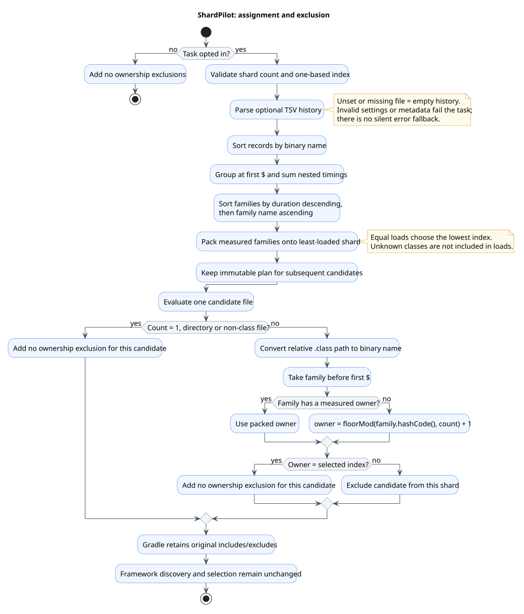

# Architecture and assignment

[Documentation index](README.md)

ShardPilot integrates with standard Gradle `Test` tasks. It calculates an immutable ownership
plan from timing history and shard count, then excludes candidate class files owned by other
shards. Gradle and the test framework still discover and execute tests.

## Components



[PlantUML source](diagrams/components.puml)

| Component | Responsibility |
| --- | --- |
| `ShardPilotPlugin` | Lazily configures `Test` tasks, attaches the task extension, inputs, exclusion spec and preparation action. |
| `ShardPilotExtension` | Holds provider-backed enabled/count/index/history-file settings for one task. |
| `DurationHistory` | Validates and parses timing records into immutable class-duration metadata. |
| `ShardPlan` | Groups nested classes, packs measured families and resolves ownership for any binary class name. |
| `ShardClassFilter` | Lazily obtains the plan and excludes non-owned candidate `.class` files. |
| `PrepareShardAction` | Uses the plan for validation and metadata-only lifecycle logging before test execution. |

The filter and action are serializable and do not capture a `Project` or `Test` instance. The
filter caches its plan transiently; after configuration-cache restoration it can rebuild the
plan from provider values. Plans are local to task execution, not shared through a remote service.

## Assignment algorithm



[PlantUML source](diagrams/shard-assignment.puml)

For an enabled task, validate that count is positive and index is in `1..count`. Parse the optional
TSV history; no file means no measured records. The planner then performs these steps:

1. Sort records by binary class name before summing them. This fixes floating-point addition order.
2. Convert each binary name to its family: the part before the first `$`. Add nested record durations
   to the same outer family, rejecting non-finite totals.
3. Sort families by descending total duration, then ascending family name for equal weights.
4. Assign each measured family to the shard with the lowest recorded load. Equal loads choose the
   lowest one-based index. Reject overflow of a shard's accumulated load.
5. For a candidate absent from the measured plan, calculate its family owner with
   `Math.floorMod(family.hashCode(), shardCount) + 1`.

Java's string hash is used, not `Math.abs(hash) % count`; the latter mishandles the minimum integer
hash. Unknown nested classes still use the outer family's measured owner when one exists.

### Worked example

Given two shards and records `AlphaTest = 10`, `AlphaTest$Nested = 2`, `BetaTest = 8`,
`GammaTest = 6` and `DeltaTest = 4`, the measured families are packed as follows:

| Step | Family | Seconds | Chosen shard | Loads after assignment: shard 1 / shard 2 |
| --- | --- | --- | --- | --- |
| 1 | `AlphaTest` | 12 | 1 | 12 / 0 |
| 2 | `BetaTest` | 8 | 2 | 12 / 8 |
| 3 | `GammaTest` | 6 | 2 | 12 / 14 |
| 4 | `DeltaTest` | 4 | 1 | 16 / 14 |

All `AlphaTest$…` classes stay with shard 1. A newly added family without a timing record uses
the hash fallback; its runtime is not added to the recorded loads. Recorded loads therefore do
not predict the final job duration.

There is no guarantee that every shard receives a class. For example, measured families with
zero durations always tie and are assigned to shard 1. Stale or excluded timing records remain
part of the plan and may distort balance, but cannot make Gradle execute an excluded class.

## Candidate filtering, not a replacement runner

The installed spec is an **exclusion**: returning `true` means that a candidate belongs to a
different shard. Adding a separate include spec could widen an existing include selection;
excluding non-owners instead preserves the consumer's original file restrictions.

When sharding is disabled, the spec excludes nothing. With count 1 it still validates the enabled
plan, then excludes nothing. Directories and non-class files are not excluded by ShardPilot.
The runtime classpath stays intact, so superclass and helper-class loading remain available.

After candidate filtering, the existing Gradle/framework selection still applies. No test method
is moved independently of its class family, no retry is added, and no test failure or explicit
no-matching-tests error is suppressed.

## Inputs, cache and logs

Each `Test` task declares these inputs: `shardpilot.enabled`, `shardpilot.count`,
`shardpilot.index` and `shardpilot.history`. The last is history **contents**, not an absolute path.
They distinguish the task's shard configuration for up-to-date/build-cache checks. Consumers still
decide whether tests depending on mutable external resources may reuse cached results.

When the preparation action runs, it emits a Gradle lifecycle message shaped as:

```text
ShardPilot :test: shard 1/2, 4 recorded class families, 16.0 recorded seconds.
```

The family count describes the whole measured plan; seconds describe the selected shard's
recorded load. Neither includes unknown runtimes, JVM startup or container provisioning. Cached,
up-to-date or no-source tasks need not execute this action, so the message is not a completion
record for every invocation.

The plugin does not read test output, upload reports, validate completion across jobs or maintain
a global manifest. See [CI integration](ci.md) for the responsibilities outside this boundary.
