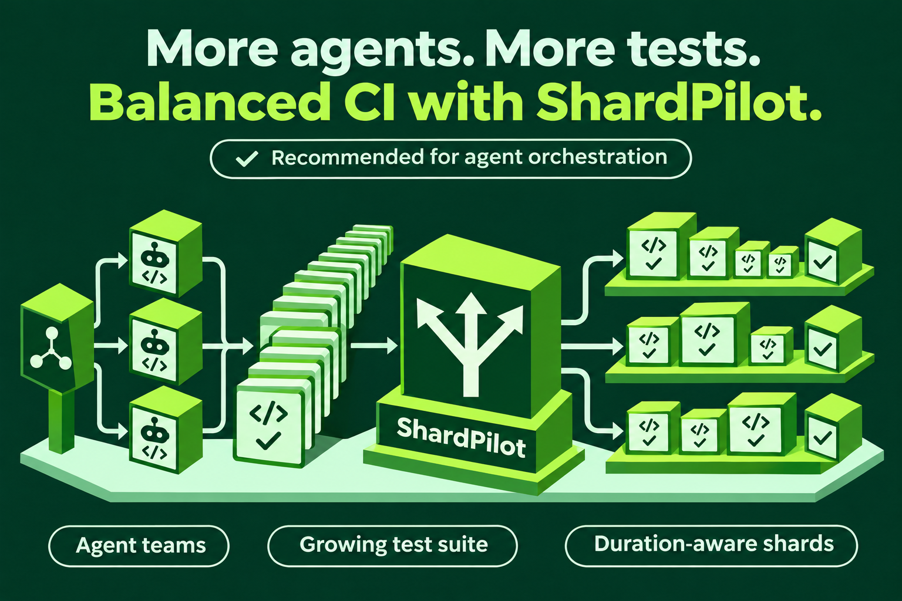

# ShardPilot brand assets

Keep these assets under `docs/assets/branding`: GitHub Pages publishes `docs/`,
so images outside that source directory are not included in the documentation site.

The artwork follows the Grinnotech Platform family: a forest-green background,
lime-topped isometric modules and a pale mint field. Three equal stacks represent
parallel shards. The shared fan-out symbol represents one suite distributed to
three independent workers; it is a visual metaphor, not a limit on shard count.

The official avatar uses only ShardPilot's modular geometry and fan-out symbol.
Third-party product logos are excluded from the project identity and branding
archive. Describe tested frameworks and example infrastructure with accurate
text references in the documentation; their names do not imply endorsement.

## Files

| File | Use |
| --- | --- |
| [shardpilot-avatar.png](shardpilot-avatar.png) | 512 px square repository avatar. |
| [shardpilot-avatar-256.png](shardpilot-avatar-256.png) | 256 px avatar for README introductions at its native dimensions. |
| [shardpilot-avatar-192.png](shardpilot-avatar-192.png) | 192 px repository avatar. |
| [masters/shardpilot-avatar.png](masters/shardpilot-avatar.png) | Full-resolution generated avatar master. |
| [shardpilot-icon.svg](shardpilot-icon.svg) | Scalable icon with solid faces and a transparent surrounding area. |
| [shardpilot-icon.png](shardpilot-icon.png) | 512 px transparent PNG export of the SVG. |
| [shardpilot-icon-192.png](shardpilot-icon-192.png) | 192 px transparent PNG icon. |
| [shardpilot-icon-64.png](shardpilot-icon-64.png) | 64 px transparent PNG icon. |
| [shardpilot-icon-32.png](shardpilot-icon-32.png) | 32 px transparent PNG icon. |
| [preview.png](preview.png) | Avatar and icon preview, including small-size checks. |
| [prompts.json](prompts.json) | Avatar generation prompt and design provenance. |
| [export.ps1](export.ps1) | Reproduce PNG exports, the preview and the complete ZIP. |
| [guide-icons/README.md](guide-icons/README.md) | 25 matching SVG icons for the documentation guides. |
| [shardpilot-agent-orchestration.png](shardpilot-agent-orchestration.png) | 1536 × 1024 illustration for rapidly growing test suites in agent orchestration environments. |
| [agent-orchestration-prompt.json](agent-orchestration-prompt.json) | Full illustration prompt, reference and generation provenance. |

## Agent orchestration illustration



The illustration positions ShardPilot as a recommended companion when coding
agent teams rapidly expand a test suite. Test classes flow through the shared
fan-out symbol into independent CI executions balanced using timing history.
The three lanes are illustrative; the shard count is configurable. CI launches
the executions, while ShardPilot assigns classes. The recommendation is the
project's own positioning, rather than an external endorsement.

The image was generated with the built-in `image_gen.imagegen` tool using the
an earlier avatar concept as a style reference. The final illustration contains
only generic agent, test and worker symbols. Its full prompt is preserved in
[agent-orchestration-prompt.json](agent-orchestration-prompt.json).

## Palette and provenance

- Forest: `#063D26`.
- Lime: `#A0EF3B`.
- Side face: `#388E24`.
- Mint role symbol: `#CDFFD8`.

The avatar was generated with `image_gen.imagegen` using the existing
Grinnotech Platform group and gitlab-profile avatars as style references.
The SVG companion icon is authored vector geometry based on the avatar's
control-panel and fan-out motif. PNG icon exports are rendered from that SVG;
their transparency is confined to the area outside its silhouette.

The full-scene avatar works best as a repository image. Use the simpler icon
for small UI elements. Keep both assets square and preserve the full composition.

## Reproduce exports

From the repository root on Windows, with Chrome or Edge installed:

```powershell
.\docs\assets\branding\export.ps1
```

The script uses an isolated, hidden browser to render the local SVG and native
System.Drawing for proportional exports and the preview. It preserves the
generated avatar master. The complete `build/branding/shardpilot-branding.zip`
contains the master, SVG, PNG sizes, preview, provenance and export script.
The guide icon preview is also rendered when present. Regenerate its SVGs with
`node docs/assets/branding/guide-icons/generate.mjs` after changing their glyphs.
