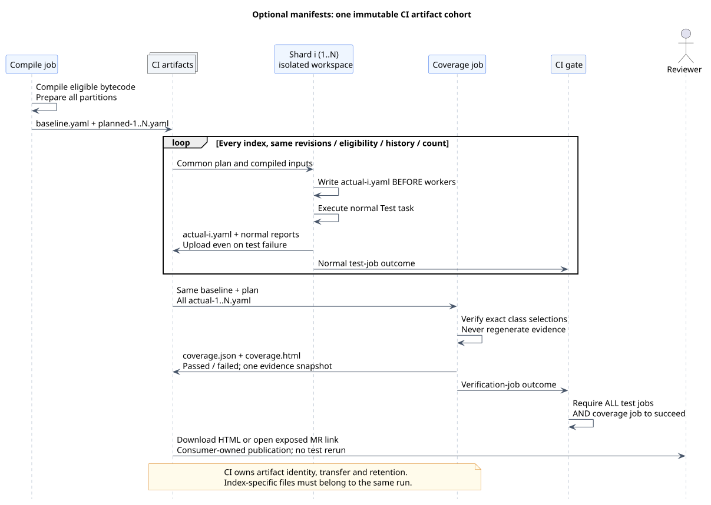
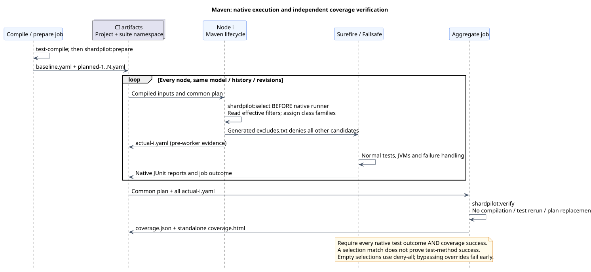

# CI integration

[Documentation index](README.md)

Treat every shard as an ordinary invocation of the same Gradle task or Maven lifecycle in an isolated workspace.
ShardPilot does not detect a CI vendor, create jobs or coordinate them. Each job independently
computes the same plan and keeps its own subset of candidate classes.

The Gradle commands below target opted-in `Test` tasks. The [Maven CI sequence](#maven-ci-sequence)
uses Surefire/Failsafe lifecycle bindings and separate unit/integration namespaces.

For publishing ShardPilot itself after its Gradle/JDK matrix, see the
[tag release workflow](releases.md#publish-from-a-version-tag). That workflow is separate from
the consumer-suite sharding described here.

For runnable Docker-backed suites, see the [JUnit Jupiter](testcontainers-example.md),
[Spock](spock-testcontainers-example.md) and [TestNG](testng-testcontainers-example.md)
PostgreSQL/RabbitMQ examples. All keep one fixture pair
per test worker, rather than sharing a broker/database instance between CI jobs.

[PlantUML source](diagrams/ci-execution.puml)

## Establish the shared inputs

Before fan-out, resolve one fixed set of inputs for the whole run:

- The consumer revision and immutable plugin version, available from the selected adapter's
  repository. Do not substitute a local checkout in release-resolution checks. For Gradle composite
  development, every job must use the same source revision and configured path; Maven jobs must
  resolve the same parent/core/adapter artifacts.
- The same task or runner/suite and original test selection, including file patterns and framework
  tags. Respect the adapter's supported command-line filters; Maven focused overrides are rejected.
- The same compiled test inputs and relevant build configuration.
- The same timing-history contents, or the same absence of history.
- The same positive shard count.

Only the one-based index varies between jobs. CI should record revision/history identity in its
metadata. Optional coverage reports include class-selection hashes, not history/bytecode checksums.
Do not update history between jobs or after some shards have begun.

## Create the matrix

For an opted-in `test` task and two shards, the logical matrix is:

| Job | Count | Index | Command, from that job's checkout |
| --- | --- | --- | --- |
| Test shard 1 | 2 | 1 | `./gradlew test -Pshardpilot.count=2 -Pshardpilot.index=1` |
| Test shard 2 | 2 | 2 | `./gradlew test -Pshardpilot.count=2 -Pshardpilot.index=2` |

Use `gradlew.bat` on Windows. Replace `test` with the exact task path, such as `:api:integrationTest`,
when needed. The task must already exist and opt in. Unit and integration suites can use separate
matrices, shard counts and timing files; they are not balanced together.

Make every index from 1 through count a required job. Missing an index omits its tests; running an
index twice repeats its tests. Core filtering cannot reconcile isolated processes. Optional manifest
aggregation detects missing/mismatched selection artifacts; it cannot identify repeated jobs whose
same-index downloads overwrite one another.
The pipeline succeeds only after all required jobs succeed under the consumer's normal policy.

## Optional class-selection gate (0.3.0 and later)

[PlantUML source](diagrams/manifest-ci.puml)

For a configured `integrationTest` verification block, add these responsibilities to the CI DAG:

| Job | Command | Artifact responsibility |
| --- | --- | --- |
| Compile / prepare | `./gradlew prepareIntegrationTestShardManifests` | Publish one `plan/` cohort containing baseline and all planned partitions. |
| Every test shard | `./gradlew integrationTest -Pshardpilot.count=N -Pshardpilot.index=I` | Use the same cohort/inputs; retain actual-I.yaml and normal reports, including on failure. |
| Aggregate coverage | `./gradlew verifyIntegrationTestShards` | Download all selection artifacts; retain coverage.json and coverage.html even on failure. |
| Packaging / completion | CI configuration | Require every test shard and the coverage job. |

The paths above use the default `build/shardpilot/integrationTest/` namespace. Set verification
`shardCount=N` explicitly in compile/aggregation jobs, which need no execution index. The verifier
does not run producers or need Docker; it only reads downloaded evidence. Do not enable plan-only
mode on this final gate. A green coverage report can coexist with failed test assertions.

See the [manifest guide](shard-verification.md) for exact paths, formats, empty-shard policy and
failure/cache behavior. The diagram above shows the opt-in flow; the earlier diagram shows core
execution without artifact verification.

The standalone HTML view includes class assignments, shard sizes and plan/actual differences.
For a direct merge-request link in GitLab, publish exactly that file with `artifacts:expose_as`;
keep the JSON artifact in the verification job. See the [publisher example](shard-verification.md#finding-a-class-assignment-in-gitlab)
and its GitLab Pages preview requirements. CI still requires every normal test result and the
verification outcome, independently of whether the presentation job succeeds.

The two `when: always` decisions have different purposes: scheduling the coverage/publisher jobs
after failed predecessors is separate from uploading artifacts after a failed script. Match both
jobs' branch/tag/MR rules to their producers. A publisher that only checks/downloads HTML does not
need to compile, rerun verification or launch Docker; a missing file is a failure to investigate.
Configure artifact permissions and expiry in CI. See
[HTML/GitLab troubleshooting](troubleshooting.md#html-report-and-gitlab-links) for missing links,
artifact-browser redirects, unavailable preview and early failures with no report.

## Maven CI sequence

[PlantUML source](diagrams/maven-execution.puml) · [Native runner configuration](maven.md#configure-a-native-runner)

The following commands run in a consuming Maven project with the adapter and native runner
configured. They use two shards and the default Surefire `unit` namespace. Pin a resolvable plugin
version in the POM; a development installation must be available identically to every job.

| Job | Command | Retain / download |
| --- | --- | --- |
| Compile / prepare | `./mvnw test-compile shardpilot:prepare -Dshardpilot.count=2` | Upload `target/shardpilot/unit/plan/`, containing baseline and both partitions. |
| Unit shard 1 | `./mvnw test -Dshardpilot.count=2 -Dshardpilot.index=1` | Same model/history/compiled inputs; upload `actual/actual-1.yaml` and native test reports. |
| Unit shard 2 | `./mvnw test -Dshardpilot.count=2 -Dshardpilot.index=2` | Same inputs; upload `actual/actual-2.yaml` and native test reports. |
| Aggregate unit selections | `./mvnw shardpilot:verify -Dshardpilot.count=2` | Download the common plan and both actual files; upload `coverage.json` and `coverage.html`. |

Preparation requires compiled test classes but does not run native test goals. `select` is bound
before Surefire and writes evidence before workers. A node recomputes ownership from its effective
filters/history; it does not read a downloaded plan to force its selection. Aggregation compares
that selection against the common plan, so immutable inputs remain necessary.

For a POM containing both Surefire and Failsafe, as in the [Jupiter example](../examples/maven/README.md),
add a second preparation command with `-Dshardpilot.runner=FAILSAFE`. Run each node through
`./mvnw verify -Dshardpilot.count=2 -Dshardpilot.index=I` to include both suites and Failsafe's
normal result gate. Aggregate each suite separately: the ordinary `shardpilot:verify` command
checks Surefire, and `shardpilot:verify -Dshardpilot.count=2 -Dshardpilot.runner=FAILSAFE` checks
Failsafe. Keep count identical in both commands. Each suite must have its own plan and actual cohort.

**`mvn verify` and `mvn shardpilot:verify` have different purposes.** The lifecycle invocation runs
normal build/test bindings; the plugin goal only checks downloaded class-selection evidence.
Calling the plugin goal cannot turn a failed native test run into a success. Require every native
job and every suite's coverage gate, including after assertion failures. Upload evidence/reports
after failure whenever the workspace survives.

Maven's default report locations are `target/surefire-reports` and `target/failsafe-reports`;
consumer configuration can relocate them. Give each downloaded shard's XML/logs a distinct
namespace, preserving every reactor module's path. The example uses index-specific report paths
for a sequential local demonstration. Maven `-T2` builds modules in parallel; `shardpilot.count=2`
splits classes within each module. These are independent forms of parallelism.

Run `shardpilot:verify` directly in aggregation; do not prepend `clean`, `test`, `verify` or
`shardpilot:prepare`. These can erase downloaded `target/` evidence or run producers again.
For an MR link, use the [existing HTML publisher pattern](shard-verification.md#finding-a-class-assignment-in-gitlab)
with a literal `target/shardpilot/<suite>/coverage.html` path. Preserve the same scheduling,
artifact retention and separate outcome gates as the Gradle flow.

## Isolate execution and outputs

Do not run concurrent shards in the same checkout/build directory. They use the same native runner
output paths and could overwrite reports or interfere with task state. Use separate checkouts or
worktrees with separate build outputs. Provision databases, ports, containers and other external
test resources with the isolation required by the suite.

For an unmodified standard `test` task, collect each job's own outputs, including on failure:

- JUnit XML: `build/test-results/test/TEST-*.xml`.
- HTML report: `build/reports/tests/test/`.
- The Gradle log and shard count/index used by the job.

Custom tasks, subprojects and consumer reporting configuration may change these paths. Store each
artifact under a unique job/shard name. If downloading all artifacts into one location, retain
separate directories rather than overwriting files with identical names. Report aggregation belongs
to CI tooling; ShardPilot does not merge XML or generate a combined test-execution report.

## History maintenance

A cold start is valid: omit `durationsFile` and the plugin uses deterministic hashing. To introduce
history, prepare the [TSV format](configuration.md#timing-history) outside the plugin, validate it
and make a fixed version available to all jobs in the next run.

If your own tooling derives history from JUnit XML, account for nested-class records and the
reporter's timing semantics. Adding an already aggregated outer duration to nested durations can
double-count work. ShardPilot adds the supplied records; it does not infer whether a value was
inclusive. Review outliers and stale classes before replacing the shared history snapshot.

Do not make a failing shard silently publish partial timing data as the next authoritative history.
Choose and document a retention/update policy in the consuming repository. Automatic XML import,
history export and remote history storage are not implemented in this version.

## Cache and parallelism

A configured Gradle build cache can be shared across jobs under the consumer's existing policy.
Shard count, index and history contents are task inputs, but this does not make database- or
network-dependent tests intrinsically cacheable. Do not share a writable project build directory
as a substitute for a build cache.

CI job parallelism and Gradle/framework parallelism multiply resource use. Since 0.2.1,
ShardPilot can explicitly configure per-task `maxHeapSize`, `maxParallelForks` and `forkEvery`
through the optional [test-process block](../README.md#optional-test-process-settings).
Without that block, native process settings remain unchanged. Framework threads, retry plugins,
container limits and the total runner budget remain consumer/CI responsibilities. Size the complete
matrix against available CPU, memory, database capacity and container startup cost; a per-JVM
heap limit does not include metaspace, native memory or service containers.

An empty shard can be legitimate and is not itself evidence of lost coverage. Conversely, an
explicit `--tests` selection on a non-owning shard may fail with Gradle's normal no-match error.
Do not globally disable that failure policy to hide an incorrectly configured matrix.
The optional coverage gate rejects empty partitions by default; set `requireNonEmptyShards=false`
only when the suite intentionally permits them. This does not alter Gradle's test failure policy.
