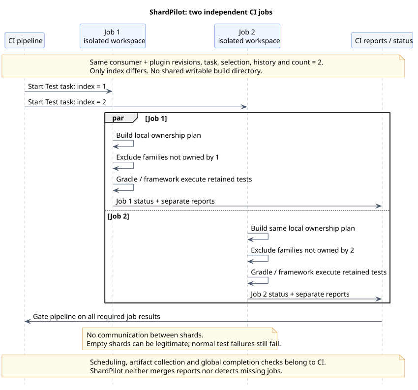

# CI integration

[Documentation index](README.md)

Treat every shard as an ordinary invocation of the same Gradle task in an isolated workspace.
ShardPilot does not detect a CI vendor, create jobs or coordinate them. Each job independently
computes the same plan and keeps its own subset of candidate classes.

For runnable Docker-backed suites, see the [JUnit Jupiter](testcontainers-example.md),
[Spock](spock-testcontainers-example.md) and [TestNG](testng-testcontainers-example.md)
PostgreSQL/RabbitMQ examples. All keep one fixture pair
per test worker, rather than sharing a broker/database instance between CI jobs.

[PlantUML source](diagrams/ci-execution.puml)

## Establish the shared inputs

Before fan-out, resolve one fixed set of inputs for the whole run:

- The consumer revision and plugin version/revision. For this unpublished version, every job must
  have the same included plugin build available at the path configured in settings.
- The same task and original test selection, including file patterns, framework tags and any
  command-line filters.
- The same compiled test inputs and relevant build configuration.
- The same timing-history contents, or the same absence of history.
- The same positive shard count.

Only the one-based index varies between jobs. A CI system may record a history checksum in its
own metadata to detect mismatches; ShardPilot currently does not emit a plan digest or checksum.
Do not update history between jobs or after some shards have begun.

## Create the matrix

For an opted-in `test` task and two shards, the logical matrix is:

| Job | Count | Index | Command, from that job's checkout |
| --- | --- | --- | --- |
| Test shard 1 | 2 | 1 | `./gradlew test -Pshardpilot.count=2 -Pshardpilot.index=1` |
| Test shard 2 | 2 | 2 | `./gradlew test -Pshardpilot.count=2 -Pshardpilot.index=2` |

Use `gradlew.bat` on Windows. Replace `test` with the exact task path, such as `:api:integrationTest`,
when needed. The task must already exist and opt in. Unit and integration suites can use separate
matrices, shard counts and timing files; they are not balanced together.

Make every index from 1 through count a required job. Missing an index omits its tests; running an
index twice repeats its tests. The plugin cannot detect either condition across isolated processes.
The pipeline succeeds only after all required jobs succeed under the consumer's normal policy.

## Isolate execution and outputs

Do not run concurrent shards in the same checkout/build directory. They use the same Gradle task
output paths and could overwrite reports or interfere with task state. Use separate checkouts or
worktrees with separate build outputs. Provision databases, ports, containers and other external
test resources with the isolation required by the suite.

For an unmodified standard `test` task, collect each job's own outputs, including on failure:

- JUnit XML: `build/test-results/test/TEST-*.xml`.
- HTML report: `build/reports/tests/test/`.
- The Gradle log and shard count/index used by the job.

Custom tasks, subprojects and consumer reporting configuration may change these paths. Store each
artifact under a unique job/shard name. If downloading all artifacts into one location, retain
separate directories rather than overwriting files with identical names. Report aggregation belongs
to CI tooling; ShardPilot does not merge XML or generate a combined report.

## History maintenance

A cold start is valid: omit `durationsFile` and the plugin uses deterministic hashing. To introduce
history, prepare the [TSV format](configuration.md#timing-history) outside the plugin, validate it
and make a fixed version available to all jobs in the next run.

If your own tooling derives history from JUnit XML, account for nested-class records and the
reporter's timing semantics. Adding an already aggregated outer duration to nested durations can
double-count work. ShardPilot adds the supplied records; it does not infer whether a value was
inclusive. Review outliers and stale classes before replacing the shared history snapshot.

Do not make a failing shard silently publish partial timing data as the next authoritative history.
Choose and document a retention/update policy in the consuming repository. Automatic XML import,
history export and remote history storage are not implemented in this version.

## Cache and parallelism

A configured Gradle build cache can be shared across jobs under the consumer's existing policy.
Shard count, index and history contents are task inputs, but this does not make database- or
network-dependent tests intrinsically cacheable. Do not share a writable project build directory
as a substitute for a build cache.

CI job parallelism and Gradle/framework parallelism multiply resource use. ShardPilot does not
change `maxParallelForks`, framework threads, retry plugins or memory limits. Size the complete
matrix against available CPU, memory, database capacity and container startup cost.

An empty shard can be legitimate and is not itself evidence of lost coverage. Conversely, an
explicit `--tests` selection on a non-owning shard may fail with Gradle's normal no-match error.
Do not globally disable that failure policy to hide an incorrectly configured matrix.
