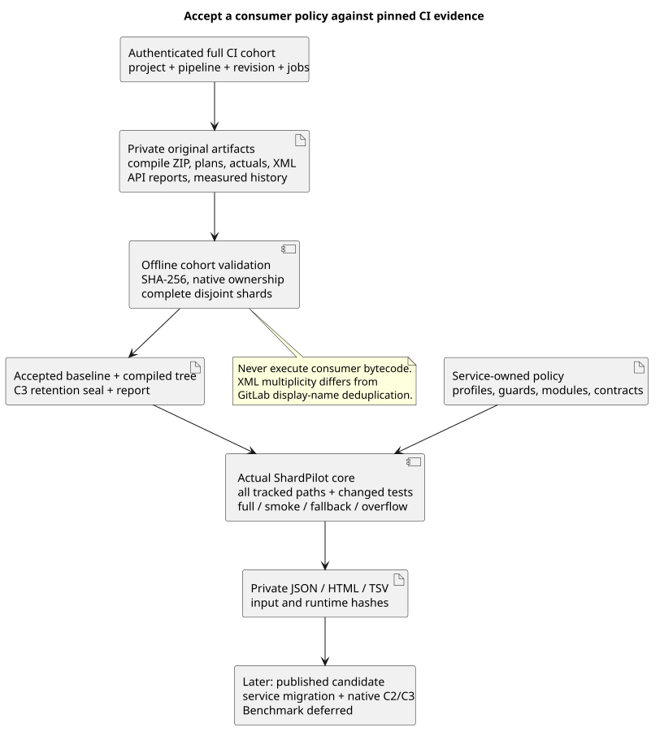

# Accept a selection policy against a full CI baseline

[Documentation index](README.md) · [Selection migration](selection-migration.md)

**Maintainer tooling, recorded on 17 November 2026.** These offline acceptance helpers are
maintained with ShardPilot's tests. Consumers configure the published
[0.6.0](releases/0.6.0.md) profiles, C2 bridge and C3 guards through Gradle/Maven parameters;
these helpers are separate acceptance tooling.

Before replacing a service's selector, retain a successful **full** pipeline for one exact
commit. A local directory of class files, a short pipeline and the GitLab test counter are
insufficient substitutes. Keep the original native full-suite gate and dedicated/library
suites independently owned.



[PlantUML source](diagrams/consumer-ci-baseline.puml)

## Capture the trusted cohort

Choose an immutable pipeline ID and full Git revision, not a moving branch name. Download
through the authenticated CI API and retain the original bytes privately:

- pipeline metadata and metadata for every selected job;
- the compile job's ZIP, including full eligibility and every planned shard;
- every full shard's ZIP, actual manifest and original native JUnit XML;
- the aggregate coverage report and newly measured timing TSV;
- the pipeline's complete test report and test-report summary, including job IDs;
- available archives for native unit, dedicated, module and consumer gates.

Store these as `pipeline.json`, `job-ID.json`, `job-ID.zip`, `native-test-report.json` and
`native-test-summary.json`. Review SHA-256 values after the authenticated download; do not
approve a checksum copied solely from a restored cache. Do not forward API tokens to an
artifact storage redirect. Do not execute downloaded consumer code. Restrict retention and
access: XML output, test names, resources and bytecode can contain private application data.

When job records are serialized from a jobs-list response, retain that source snapshot too.
The reviewed hashes pin the retained metadata bytes, including their formatting; they do not
promise that a future live API response will be byte-identical. Keep versioned policy and
capture-contract files in the repository's required LF format before recording their hashes.

Maintain a `ci-baseline.json` contract **in the service repository**. It supplies:

| Field | Reviewed expectation |
| --- | --- |
| `schemaVersion` | `1` |
| `project`, `pipeline`, `revision` | Exact CI identity; the current collector accepts successful scheduled full cohorts. |
| `pipelineSha256`, `testReportSha256`, `testSummarySha256` | Hashes of retained API documents. |
| `jobs` | Unique IDs, names, roles, ZIP byte counts, ZIP hashes and job metadata hashes. Roles include `compile`, `history`, `coverage` and `shard-N`. |
| `reportJobs` | Every native report job's ID, name, suite and metadata hash, including separately owned gates. |
| `baseline`, `planned`, `actual`, `coverage`, `history`, `xml` | Literal archive paths; the shard templates use `{index}`. |
| `shards` | Complete full-suite shard count. |
| `eligibilityRoots`, `dedicatedClasses` | Native candidate ownership, independently copied from the reviewed task configuration. |
| `requiredDirectories` | Compilation trees that must contain nonempty files. |
| `legacyManifest`, `legacyRoots` | Optional existing producer seal and exact roots; absence is reported explicitly. |

Never construct E from XML alone. The collector compares compiled candidate ownership with
the compile job's full native baseline, verifies disjoint complete plans, checks every actual
manifest and matches original XML classes to the correct shard. It also verifies the native
coverage report's semantic class hashes. ZIP extraction rejects traversal, aliases, linked or
special files, duplicate names, file/directory collisions and excessive expanded size.

Run the [offline collector](https://github.com/sjacek/shardpilot/blob/main/scripts/collect_ci_baseline.py)
from the ShardPilot checkout, using a fresh private output directory:

```shell
python -B scripts/collect_ci_baseline.py \
  --contract /private/service/gradle/shardpilot/ci-baseline.json \
  --downloads /private/downloads \
  --output /private/accepted-baseline
```

It writes the verified `baseline.yaml`, `history.tsv`, complete extracted `compiled/` tree,
native observations and `report.json`. An interrupted or failed capture has no success report;
start again with a fresh output. Keep archives and metadata together so artifact expiry in CI
does not invalidate the retained evidence.

## Preserve execution multiplicities

GitLab deduplicates native test display identities. Compare its full report with original
XML using `(class, name, result)` identities, retaining XML multiplicities separately.
The 17 November capture contains 20 repeated display occurrences for one service and 30 for
the other. The distinct identity sets agree exactly; this is not missing shard coverage.

The collector validates API suite totals and binds their job IDs to the same pipeline and
revision. Unit/module/dedicated results available only through report artifacts remain API
observations; the collector does not invent unavailable original XML counts for those gates.
Report-tool checks such as Checkstyle remain distinguishable by their native suite name.

**These historical observations are not C2 v2 evidence.** Do not create fake invocation IDs
from XML row positions, or claim that a historical pipeline ran the new policy. The
[execution-selection bridge](execution-selection.md) binds genuine new producer evidence
when the service is migrated.

## Seal and verify the retained compilation

Build the current, checksum-verified core and acceptance bridge:

```shell
./gradlew :shardpilot-core:jar :shardpilot-gradle-plugin:testClasses
```

`ACCEPTANCE_CP` below contains the acceptance probe test classes (or an immutable JAR made
from them), the current core JAR and its reviewed `snakeyaml-engine` JAR. Use `:` between
classpath entries on POSIX and `;` on Windows. Freeze the runtime before evaluating policies;
do not rebuild its class directories concurrently. Retain runtime hashes with the results.

```shell
java -cp "$ACCEPTANCE_CP" io.github.sjacek.shardpilot.testing.ConsumerBaselineProbe \
  seal /private/accepted-baseline/compiled /private/compiled-artifacts.json \
  FULL_CI_COMMIT full-integration-testdata build

java -cp "$ACCEPTANCE_CP" io.github.sjacek.shardpilot.testing.ConsumerBaselineProbe \
  verify /private/accepted-baseline/compiled /private/compiled-artifacts.json \
  FULL_CI_COMMIT full-integration-testdata REVIEWED_MANIFEST_SHA256 build
```

This inventories and checks every transferred compilation file using the actual C3 core.
It loads no application classes. A manifest sealed **after download** establishes retention
integrity; it does not retrospectively prove a producer-side C3 guard before historical tests.
An existing consumer seal, when declared, is additionally checked against its original roots.
In production, use the [native Gradle/Maven C3 configuration](compiled-artifacts.md) to seal
in compilation and verify before tests, with the expected revision and digest supplied
independently by CI.

## Accept complete service policies

Keep business probes and module ownership in the service, not in generic open-source fixtures.
Maintain three profiles: `daily-testdata`, `smoke-testdata` and `full-testdata`. Daily selects
mandatory smoke coverage, changed eligible tests, shared guards and bounded optional domain
probes. Explicit module edges protect host boundaries. JSON/YAML contract rules declare their
format and watched pointers. Full selects independently supplied E without short-profile limits.

All matching rules contribute. A documentation ignore never vetoes a shared guard. A broad
domain and a deeper domain rule can both propose probes; this deliberately gives stronger
coverage than a legacy longest-match selector. Directly changed eligible tests are protected
even when legacy nightly preferences would omit them. Protected budget overflow fails planning;
unknown ownership or unavailable semantic impact requests an explicit full fallback. Do not
reuse a short shard count or stale manifest after that fallback.

Run the [policy acceptance sweep](https://github.com/sjacek/shardpilot/blob/main/scripts/verify_consumer_policy.py)
against a checkout at the captured CI revision:

```shell
python -B scripts/verify_consumer_policy.py \
  --checkout /private/service \
  --capture /private/accepted-baseline \
  --policy /private/service/gradle/shardpilot/selection-policy.yaml \
  --classpath "$ACCEPTANCE_CP" --java java \
  --output /private/policy-acceptance
```

The actual core evaluates one hypothetical edit for **every tracked path**, all changed
eligible test sources, full/smoke/empty-diff profiles, unknown ownership, policy changes and
protected overflow. It retains compact per-path decisions plus full JSON/HTML for reviewed
scenarios. Input hashes and runtime hashes bind the result. This matrix tests configuration
coverage; it is neither a real MR diff, new native test execution nor a benchmark.

See the [17 November evidence report](reports/consumer-ci-baseline-2026-11-17.md). Publishing
and checking the development candidate from both registries, replacing service selectors,
and native C2/C3 production wiring remain separate steps. Performance measurement stays deferred.
