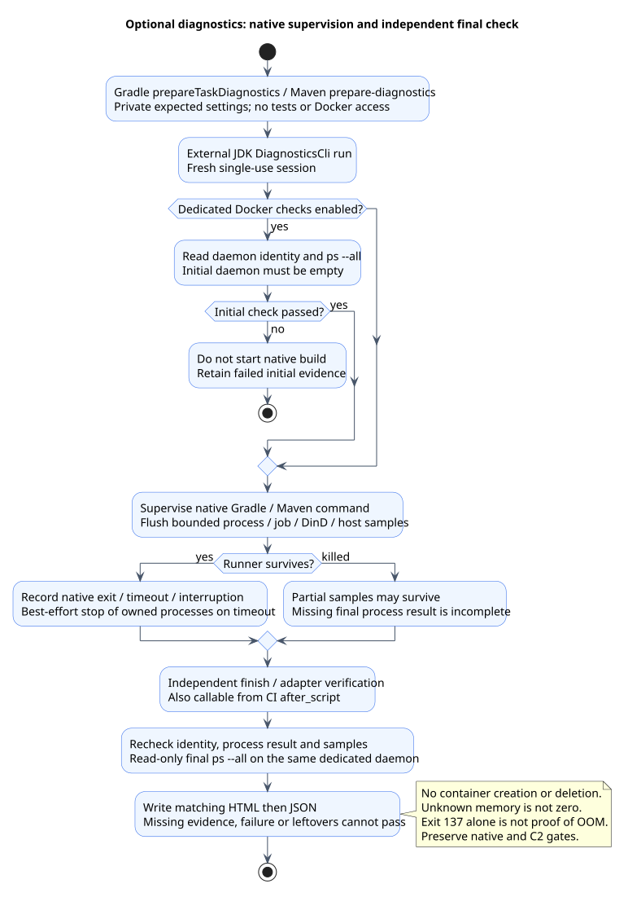

# Optional execution diagnostics

Diagnose test timeouts, interrupted builds, memory pressure and containers left on a dedicated
Docker daemon. This is a **development feature**, absent from the published 0.5.0 release. Use
the [local development setup](https://github.com/sjacek/shardpilot/blob/main/README.md#local-plugin-development)
for both adapters and a matching, verified ShardPilot core or Gradle plugin JAR.

Diagnostics are disabled until configured. They do not change test selection, heap settings,
test engines, retries or container lifecycle. Keep the native build result and
[C2 execution evidence](execution-evidence-contract.md) as required gates: diagnostics do not
establish which tests executed.

## Three independent steps

1. Prepare a private JSON configuration using Gradle or Maven. This does not run tests, create
   the session directory or contact Docker.
2. Use the JDK-only `DiagnosticsCli` to supervise the native build **from outside that build**.
   It flushes bounded memory samples, records the native result and evaluates diagnostics.
3. Recheck with `finish`, a Gradle verification task or a Maven verification goal. This reads the
   retained evidence and queries Docker again. Run this step even after a failed or killed build.

The runner is included in the existing core JAR and bundled into the Gradle plugin JAR; no
additional service or shell helper is required. It needs JDK 17 or newer. The adapter tasks do
not recursively launch Gradle/Maven or depend on test/compile tasks. A Gradle finalizer alone
cannot survive the death of the Gradle process.



[Editable PlantUML source](diagrams/execution-diagnostics.puml).

## Gradle configuration

Configure once per `Test` task, outside a deferred owner configuration action, as with the other
ShardPilot artifact helpers. Sharding itself need not be enabled:

```groovy
tasks.named('test', Test).get().shardPilot.diagnostics {
    timeoutMillis = 1_800_000L
    sampleIntervalMillis = 1000L
    maxSamples = 3600
    // Optional: explicitly scoped paths visible to this runner.
    // jobCgroup = file('/sys/fs/cgroup/my-job')
    // dindCgroup = file('/sys/fs/cgroup/my-dind')
    // hostMemory = true
}
```

Equivalent Kotlin DSL:

```kotlin
import io.github.sjacek.shardpilot.ShardPilotExtension

tasks.named<Test>("test").get().extensions.getByType<ShardPilotExtension>().diagnostics {
    timeoutMillis.set(1_800_000L)
    sampleIntervalMillis.set(1000L)
    maxSamples.set(3600)
}
```

For a task named `test`, this registers `prepareTestDiagnostics` and `verifyTestDiagnostics`.
An `integrationTest` task gets `prepareIntegrationTestDiagnostics` and
`verifyIntegrationTestDiagnostics`. Nothing is added merely by applying the plugin.

Supply the full lowercase Git revision and a unique run, positive attempt and job/shard identity:

```shell
./gradlew --no-daemon prepareTestDiagnostics \
  -Pshardpilot.diagnosticsRevision="$CI_COMMIT_SHA" \
  -Pshardpilot.diagnosticsRunId="$CI_PIPELINE_ID" \
  -Pshardpilot.diagnosticsAttempt=1 \
  -Pshardpilot.diagnosticsNode="$CI_JOB_ID"

java -cp "$SHARDPILOT_DIAGNOSTICS_JAR" io.github.sjacek.shardpilot.DiagnosticsCli \
  run build/shardpilot/test/diagnostics-config.json -- ./gradlew --no-daemon test
```

`SHARDPILOT_DIAGNOSTICS_JAR` is a local verified JAR supplied by your build installation, not a
URL downloaded by diagnostics. On Windows pass the command vector to `gradlew.bat` through the
appropriate shell, for example `-- cmd.exe /d /c gradlew.bat --no-daemon test`.

Use `--no-daemon` for the observed Gradle invocation: a pre-existing detached daemon is outside
its process tree. Run `clean` **before** preparing diagnostics, never inside the observed command;
deleting its output directory destroys evidence. Give each parallel job its own workspace.

## Maven configuration

Add to the development ShardPilot Maven plugin configuration, alongside any existing selection
or sharding parameters:

```xml
<configuration>
  <diagnosticsRevision>${env.CI_COMMIT_SHA}</diagnosticsRevision>
  <diagnosticsRunId>${env.CI_PIPELINE_ID}</diagnosticsRunId>
  <diagnosticsAttempt>1</diagnosticsAttempt>
  <diagnosticsSuite>integration</diagnosticsSuite>
  <diagnosticsNode>${env.CI_JOB_ID}</diagnosticsNode>
  <diagnosticsTimeoutMillis>1800000</diagnosticsTimeoutMillis>
  <diagnosticsSampleIntervalMillis>1000</diagnosticsSampleIntervalMillis>
  <diagnosticsMaxSamples>3600</diagnosticsMaxSamples>
</configuration>
```

```shell
./mvnw -B shardpilot:prepare-diagnostics
java -cp "$SHARDPILOT_DIAGNOSTICS_JAR" io.github.sjacek.shardpilot.DiagnosticsCli \
  run target/shardpilot/diagnostics-config.json -- ./mvnw -B verify
# Separate invocation, including after an unsuccessful native build:
./mvnw -B shardpilot:verify-diagnostics
```

The goals have no default lifecycle binding and require no project dependency resolution. They
do not run test producers. In a reactor configure separate module/session directories and
identities; do not let parallel modules share a directory. Maven `-o` controls Maven resolution,
not the explicitly enabled Docker checks.

## Shared parameters

Maven property names use the `shardpilot.diagnostics` prefix followed by the capitalized name
below, for example `-Dshardpilot.diagnosticsTimeoutMillis=600000`. Gradle exposes the listed
properties through its `diagnostics { }` block. Its four identity CLI properties are shown above;
other settings are DSL properties, not automatic project-property mappings.

| Gradle property | Maven suffix | Meaning/default |
| --- | --- | --- |
| `revision` | `Revision` | Required full 40/64-character lowercase Git hash. |
| `runId` | `RunId` | Required run identity. |
| `attempt` | `Attempt` | Required positive attempt. |
| `suite` | `Suite` | Gradle task name; required in Maven. |
| `node` | `Node` | Required job/shard identity. |
| `directory` | `Directory` | Fresh session: Gradle `build/shardpilot/TASK/diagnostics`; Maven `target/shardpilot/diagnostics`. |
| `configurationFile` | `ConfigurationFile` | Private config outside the session: adjacent `diagnostics-config.json`. |
| `timeoutMillis` | `TimeoutMillis` | `0` disables the native deadline; maximum 86,400,000 ms. |
| `sampleIntervalMillis` | `SampleIntervalMillis` | `1000`; range 50–60,000 ms. |
| `maxSamples` | `MaxSamples` | `10000`; range 1–10,000. Collection stops growing at this limit; timeout supervision continues. |
| `jobCgroup` | `JobCgroup` | Optional explicitly scoped cgroup directory. |
| `dindCgroup` | `DindCgroup` | Optional separate DinD cgroup directory. |
| `hostMemory` | `HostMemory` | `false`; opt in to host/visible `/proc/meminfo` counters. |
| `dockerCommand` | `DockerCommand` | Empty disables checks; otherwise an executable/argument list such as `['docker']`. |
| `dockerHost` | `DockerHost` | Explicit `tcp:`, `unix:` or `npipe:` endpoint; no embedded credentials/query/fragment. |
| `dedicatedDocker` | `DedicatedDocker` | `false`; must explicitly be `true` when enabling Docker. |

Maven configuration element names are `diagnostics` plus the suffix, such as `diagnosticsJobCgroup`.
Configure its executable list using `<diagnosticsDockerCommand><arg>docker</arg></diagnosticsDockerCommand>`.
Run/suite/node accept 1–128 ASCII letters, digits, dots, underscores and hyphens, starting with a
letter or digit. Counter trees, output session and private config must not overlap.

## Memory measurements

| Scope | Source | Interpretation |
| --- | --- | --- |
| Process | Linux `/proc/PID/status` for the supervised child and its visible descendants | Aggregate RSS of that process tree; shared pages can be counted more than once. Other platforms report unavailable. |
| Job | Explicit job cgroup v1/v2 | Current usage, limit and optional OOM-kill counter; not inferred from the host. |
| DinD | Separately configured cgroup v1/v2 | Daemon/container cgroup usage, never added to the job value. |
| Host | Optional `/proc/meminfo` | Visible machine/namespace totals; not the job's allowance. |

No host PID namespace, root privileges or Docker container images are assumed. Missing, denied,
malformed, overflowed or unsupported measurements are **unavailable**, never zero. An unlimited
cgroup limit is `null`. Reports retain peak sampled usage and unavailable-sample counts separately
for each scope; these are sampled peaks, not guaranteed lifetime maxima. No per-container
`docker stats` sampling is performed.

`oomKillsDelta` is only known when both endpoint counters are available in the same cgroup
version and the final counter has not decreased. A positive delta reports an OOM kill in that
declared cgroup; it does not identify a specific test. Exit code **137 alone is not proof of OOM**.
Memory counters are explanatory: a counter increase does not independently fail a successful
native process. Timeout, interruption, missing evidence, native failure and enabled Docker
checks determine the diagnostics gate.

## Read-only container checks

Enable checks only for a daemon dedicated to this job. Add these properties to the existing
Gradle `diagnostics { }` block (the task context is shown below):

```groovy
tasks.named('test', Test).get().shardPilot.diagnostics {
    dockerCommand = ['docker']
    dockerHost = 'tcp://dedicated-dind:2376'
    dedicatedDocker = true
}
```

TLS/authentication remains the consumer's Docker configuration. The flag is your ownership
assertion; ShardPilot cannot establish exclusivity or provision a secure daemon. It never picks
an arbitrary daemon from `DOCKER_HOST` or a default Docker context.

The only Docker operations issued are `info` (formatted to read only the daemon ID) and
`ps --all --quiet --no-trunc`, each with the configured `--host`. Queries have a five-second
process timeout and a bounded 64 KiB response. At most 256 full container IDs are accepted.
Duplicate, truncated or malformed IDs, an unavailable endpoint and a changed daemon fail closed.

The initial daemon must be empty before tests start. The final check includes **stopped containers**,
and every container counts, including a lingering Testcontainers resource reaper. No container
names, labels, logs, mounts or application payloads are read. Reports contain container IDs and
a SHA-256 of the daemon ID; they do not reveal its endpoint.

There are no diagnostic probe containers, image pulls or probe exemptions. Consequently no
consumer image is needed for this implementation. ShardPilot never creates, stops, removes or
prunes containers. A failed cleanup check reports leftovers and leaves them intact for inspection.

## Timeout, interruption and CI final checks

`run` returns the native nonzero result, `124` for a timeout, `130` for interruption, or `1` when
the native process succeeded but diagnostics failed. The deadline measures supervised native
execution; Docker query time is separately bounded. On timeout/interruption the runner attempts
to stop its child and visible descendants. This is best effort, not process containment; detached
processes and container cleanup remain the consumer/CI runtime's responsibility.

If only the observed build dies, the runner records its nonzero exit. If the runner itself is
forcibly killed, flushed samples can survive but `process.json` may be absent. A fresh `finish`
then reports `incomplete` and fails. A shutdown hook helps with graceful termination but cannot
run after SIGKILL. Samples do not substitute for a final process result.

Use the same independently retained configuration for a final check, for example in GitLab
`after_script`:

```shell
java -cp "$SHARDPILOT_DIAGNOSTICS_JAR" io.github.sjacek.shardpilot.DiagnosticsCli \
  finish build/shardpilot/test/diagnostics-config.json
```

Or run `verifyTestDiagnostics` with the **same** expected identity/settings as preparation.
Maven exposes `verify-diagnostics`. Rechecking queries the live dedicated daemon again, so a
container appearing after an earlier successful evaluation is detected too. The consumer must
keep the daemon available until the final check completes.

GitLab `after_script` failure alone does not make a successful script fail. Use the runner's
result as the primary job result and run verification on the required job path as well. An
`after_script` check provides additional evidence after cancellation; preserve its failed or
missing report in your required aggregate/CI policy. Never turn the native result into success
with `|| true`, and never treat an absent final report as a passed check.

## Retention and trust boundary

Each session directory is single-use and exclusively owned by one job/attempt. Existing output
is rejected, not deleted or repaired. Use a fresh workspace/path for a retry. The configuration
fingerprint and independently supplied revision/run/attempt/suite/node bind retained process
evidence to the expected invocation. They do not authenticate files against a malicious producer.

| File | Purpose |
| --- | --- |
| `diagnostics-config.json` (outside session) | **Private** settings containing absolute paths and executable arguments; do not publish. |
| `started.json` | Initial identity, Docker state and scoped counters. |
| `samples.jsonl` | Incrementally flushed bounded memory samples with elapsed time. |
| `process.json` | Native state, exit, elapsed time and remaining-descendant indicator. |
| `report.html` | Static escaped human-readable evaluation. |
| `report.json` | Matching machine-readable evaluation; written last as completion marker. |

Retain the report pair and samples even after failure. Public reports omit command arguments,
environment variables, local paths, Docker endpoint and stderr. Native output remains attached
to CI stdout/stderr and follows the consumer's existing log policy. Do not publish private settings
or add secrets to run/suite/node identities.

Malformed/truncated samples and missing process/initial evidence fail verification. Rechecking
revokes the earlier report pair before evaluation. Inputs are size bounded; reports use fixed
filenames and reject symlink/reparse paths. This is not an adversarial filesystem sandbox: the
consumer owns the executable, configuration channel, workspace permissions, counter mounts and
dedicated daemon declaration. Concurrent or hostile writers are outside that trust model.

## Validation and references

Core tests execute real JVMs for exit, timeout, interruption and killed-supervisor scenarios.
Docker contract tests use a controlled CLI double to check exact read-only commands, initial/final
state, changed daemon, malformed output and preserved containers. Gradle TestKit covers both DSLs,
configuration cache and producer independence; Maven unit/descriptor and Invoker tests cover
preparation, failed native execution, wrong attempts and repeated independent checks. These tests
do not claim acceptance on a real remote DinD deployment.

Local acceptance on 14 November 2026 additionally used a disposable Docker 29.9.3 DinD daemon,
without host mounts or registry pulls. An empty daemon passed; created/stopped and running
containers were detected and their states remained unchanged; a dirty initial daemon blocked
the native command. This local check does not replace consumer-runner acceptance or the CI matrix.

See the [testing guide](testing.md#extending-coverage) for commands. Implementation references:
[Docker container listing](https://docs.docker.com/reference/cli/docker/container/ls/),
[Linux cgroup v2 memory counters](https://docs.kernel.org/admin-guide/cgroup-v2.html),
[JDK process control](https://docs.oracle.com/en/java/javase/17/docs/api/java.base/java/lang/Process.html).
