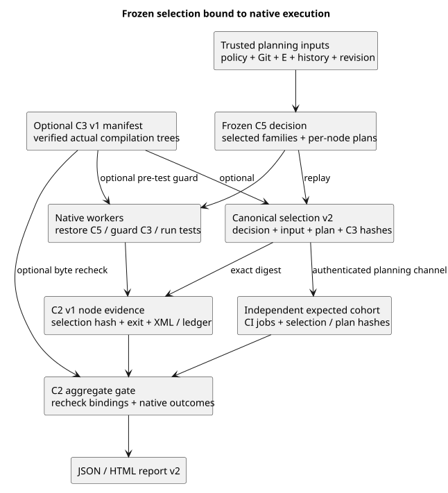

# Bind selection to execution evidence

Prepared for [0.6.0](releases/0.6.0.md); publication and registry acceptance are pending.

**Development feature, 15 November 2026. Not available in published 0.5.0.**

An automatic selection can choose the same classes for different reasons. Class coverage alone cannot
tell whether results belong to the current policy, Git changes, duration history or compiled files.
The optional execution-selection bridge binds those inputs to the existing [C2 gate](execution-evidence-contract.md)
in both Gradle and Maven. Consumers configure plugin parameters; no custom selector is required.



## What is checked

`prepareTestExecutionSelection` / `prepare-execution-selection` reads a **complete retained C5 snapshot**,
replays the pure selection engine against your independently supplied policy, native eligibility,
original history and optional explicit requests, and writes canonical UTF-8 selection JSON v2.
It never runs Git, discovery, compilation, tests or C3 sealing. A missing or corrupt snapshot fails;
it cannot cause a new selection or full-run fallback.

The document records only selected outer families, safe identifiers and digests:

- Source revision, suite, profile/mode, engine version and common shard count.
- Decision identity and policy-semantic digest; original Git snapshot, history, eligibility and selected-manifest digests.
- Existing selected-cohort identity and the **exact v1 YAML digest for every planned node**, including nested classes.
- Optionally, the exact [C3 v1 manifest](compiled-artifacts.md) digest, after checking its actual file trees.

`sourceManifestSha256` hashes `decision/selected.yaml`, including its decision/Git comments;
`cohortSha256` is the existing `selection.id`. The outer `selected.yaml` keeps its current plain manifest format.

C2's existing `selection.sha256` now covers this entire document. Changing an input can therefore reject
old nodes even when the chosen families are identical. The trusted expected-cohort request must also
match its revision, suite, shard count, baseline and every plan hash. Another partition of the same
classes is rejected. Native process, XML/ledger, coverage, failure and skip gates still apply independently.

## Artifact flow

1. A trusted planning job prepares the profile selection and common shard plans once. Retain the complete
   `selection/` snapshot, reviewed policy, exact history, original explicit requests if used, and full native baseline.
2. Optionally compile once and [seal C3 inputs](compiled-artifacts.md). Use the same trusted revision and suite.
   Keep the manifest outside the inventoried roots. Enable the existing C3 pre-test guard on **each** worker.
3. Run the new execution-selection producer against those retained inputs. Retain its JSON and SHA-256
   through an authenticated CI channel, together with the plan hashes and expected CI job identities.
4. Workers restore the same frozen C5 snapshot and plans, run the native test command, and retain C2 v1
   evidence. Their `selection.sha256` is the new **execution-selection JSON** digest, not `selected.yaml`,
   `selection.id`, `decision.id`, or C3's manifest digest. Existing C2 wrappers need no additional JSON fields.
5. Aggregate with `verifyTestExecutionEvidence` / `verify-executions`, supplying trusted expected metadata
   separately from producer-node artifacts. With C3 enabled, supply the retained actual trees and independent
   roots/requirements/revision/suite too; the aggregate gate rehashes their bytes against the bound manifest.

The new producer and aggregate tasks do not depend on one another or on native tests. CI controls ordering,
requires the native jobs and authenticates artifacts to jobs/attempts. Never copy the expected selection digest,
plan hashes or job identities from an untrusted node document. Hashes detect changed bytes, not a compromised
producer. Aggregation cannot prove that a worker used particular files merely because it retained their manifest;
the C3 pre-test guard and trusted artifact/job association remain required for that assurance.

## Gradle

Configure outside a deferred `TaskProvider.configure` callback. For another owner, `integrationTest` for example,
the generated names are `prepareIntegrationTestExecutionSelection` and `verifyIntegrationTestExecutionEvidence`.
Call `executionSelection` after `selection` to inherit its policy/profile/suite/snapshot conventions.
All paths below are illustrative consumer paths, not directories created automatically by these gates.

```groovy
def pilot = tasks.named('test', Test).get().shardPilot
pilot.executionSelection {
    snapshotDirectory = layout.projectDirectory.dir('downloaded/selection')
    policyFile = layout.projectDirectory.file('policy.yaml')
    eligibilityFile = layout.projectDirectory.file('trusted/baseline.yaml')
    historyFile = layout.projectDirectory.file('durations.tsv') // unset means empty history
    profile = 'affected-testdata'
    suite = 'profile-affected-testdata'
    revision = providers.environmentVariable('CI_COMMIT_SHA')
    shardCount = 2
    selectionFile = layout.buildDirectory.file('evidence/execution-selection.json')
    compiledArtifacts { // optional: omit this entire block when C3 is not bound
        baseDirectory = layout.projectDirectory.dir('downloaded/compiled')
        manifestFile = layout.projectDirectory.file('trusted/compiled-manifest.json')
        roots = ['classes', 'resources']
        requiredDirectories = ['classes']
        requiredFiles = ['resources/test.properties']
        // Producer defaults C3 revision/suite to its independently configured values above.
    }
}
pilot.executionEvidence {
    expectedRequest = layout.projectDirectory.file('trusted/expected.json')
    eligibilityFile = layout.projectDirectory.file('trusted/baseline.yaml')
    selectionFile = layout.projectDirectory.file('trusted/execution-selection.json')
    nodesDirectory = layout.projectDirectory.dir('downloaded/nodes')
    compiledArtifacts { // configure independently on the aggregate gate when C3 was bound
        baseDirectory = layout.projectDirectory.dir('downloaded/compiled')
        manifestFile = layout.projectDirectory.file('trusted/compiled-manifest.json')
        revision = providers.environmentVariable('CI_COMMIT_SHA')
        suite = 'profile-affected-testdata'
        roots = ['classes', 'resources']
        requiredDirectories = ['classes']
        requiredFiles = ['resources/test.properties']
    }
}
```

Kotlin uses the same managed properties and `.set(...)`:

```kotlin
import io.github.sjacek.shardpilot.ShardPilotExtension

val pilot = tasks.named<Test>("test").get().extensions.getByType<ShardPilotExtension>()
pilot.executionSelection {
    snapshotDirectory.set(layout.projectDirectory.dir("downloaded/selection"))
    policyFile.set(layout.projectDirectory.file("policy.yaml"))
    eligibilityFile.set(layout.projectDirectory.file("trusted/baseline.yaml"))
    profile.set("affected-testdata")
    suite.set("profile-affected-testdata")
    revision.set(providers.environmentVariable("CI_COMMIT_SHA"))
    shardCount.set(2)
}
```

Standalone `PrepareExecutionSelection` and `VerifyExecutionEvidence` tasks also work in an artifact-only project
without the Java plugin or a `Test` task. Both revalidate every invocation, including Configuration Cache reuse;
neither up-to-date state nor a restored build cache can replace byte verification. Configure them with existing
retained paths, not output providers carrying implicit producer dependencies.

## Common producer parameters

Gradle properties use `-P`, Maven uses `-D`. Explicit DSL/POM configuration can override conventions.

| Property | Meaning |
| --- | --- |
| `shardpilot.selectionSnapshotDirectory` | Complete retained C5 selection snapshot; never regenerated by this operation. |
| `shardpilot.selectionPolicyFile` | Current reviewed policy, schema v1 or v2. |
| `shardpilot.selectionProfile` | Profile ID from that policy. |
| `shardpilot.selectionSuite` | Suite identity; defaults to `profile-PROFILE`. |
| `shardpilot.executionRevision` | Required full 40/64-character lowercase source revision from trusted CI metadata. A nonempty frozen Git HEAD must match it. |
| `shardpilot.count` | Common shard count, default 1; must match the frozen snapshot. |
| `shardpilot.executionEligibilityFile` | Separately retained complete native baseline, including eligible nested classes. |
| `shardpilot.executionHistoryFile` | Original timing bytes; unset means empty. Gradle owner DSL can inherit `durationsFile`. |
| `shardpilot.selectionManifestFile` | Original explicit requests for an explicit profile; otherwise unset. |
| `shardpilot.executionSelectionFile` | Maven output path; default `target/shardpilot/execution-selection.json`. Gradle uses `selectionFile` on the producer task. |

Full and smoke profiles still do not require Git, but the source revision must be supplied independently.
A full profile writes mode `full`; smoke, affected (including a full fallback) and explicit profiles write mode
`explicit` with their selected families. The recorded profile mode preserves that distinction.

## Maven

The new `prepare-execution-selection` goal has no default phase, lifecycle fork or dependency resolution.
For project-free calls, pass explicit input/output locations. In a project, add configuration to the existing
development ShardPilot plugin declaration:

```xml
<!-- In the project's properties: allow the aggregate job to select its trusted input path. -->
<properties>
  <shardpilot.executionSelectionFile>${project.build.directory}/execution-selection.json</shardpilot.executionSelectionFile>
</properties>
```

```xml
<configuration>
  <snapshotDirectory>${project.basedir}/downloaded/selection</snapshotDirectory>
  <policyFile>${project.basedir}/policy.yaml</policyFile>
  <eligibilityFile>${project.basedir}/trusted/baseline.yaml</eligibilityFile>
  <historyFile>${project.basedir}/durations.tsv</historyFile>
  <profile>affected-testdata</profile><suite>profile-affected-testdata</suite>
  <revision>${env.CI_COMMIT_SHA}</revision><shardCount>2</shardCount>
  <selectionFile>${shardpilot.executionSelectionFile}</selectionFile>
  <expectedRequest>${project.basedir}/trusted/expected.json</expectedRequest>
  <nodesDirectory>${project.basedir}/downloaded/nodes</nodesDirectory>
  <!-- Optional C3 configuration, shared by the producer and aggregate goal: -->
  <compiledManifestFile>${project.basedir}/trusted/compiled-manifest.json</compiledManifestFile>
  <compiledBaseDirectory>${project.basedir}/downloaded/compiled</compiledBaseDirectory>
  <compiledRevision>${env.CI_COMMIT_SHA}</compiledRevision><compiledSuite>profile-affected-testdata</compiledSuite>
  <compiledRoots><root>classes</root><root>resources</root></compiledRoots>
  <compiledRequiredDirectories><directory>classes</directory></compiledRequiredDirectories>
  <compiledRequiredFiles><file>resources/test.properties</file></compiledRequiredFiles>
</configuration>
```

Run the producer in the trusted planning flow and the verifier in the aggregation flow:

```shell
./mvnw shardpilot:prepare-execution-selection
./mvnw shardpilot:verify-executions -Dshardpilot.executionSelectionFile=trusted/execution-selection.json
```

The property-backed POM path above can be overridden with the shown CLI property. With a literal POM path,
use goal-specific execution configuration instead. Supply the trusted document path; never regenerate
it in the aggregate job. Surefire and Failsafe keep separate expected cohorts, suites and node evidence.

Optional C3 properties use `shardpilot.executionCompiled` followed by `ManifestFile`, `BaseDirectory`, `Revision`,
`Suite`, `Roots`, `RequiredDirectories`, `RequiredFiles` or `ManifestSha256`. The pin is optional; the independently
trusted selection digest already binds the manifest bytes. Roots/requirements remain independent configuration,
not values inferred from that manifest. Lists can use comma-separated CLI values or POM lists.
The producer can default C3 revision/suite from its trusted selection inputs; the aggregate requires both explicitly.

C3 limits are the existing lowerable ceilings: `MaxFiles=100000`, `MaxEntries=200000`, `MaxDepth=64`,
`MaxFileBytes=1073741824`, `MaxTotalBytes=8589934592`, `MaxManifestBytes=33554432`, with the same property prefix.
Gradle exposes the corresponding `CompiledArtifactOptions` properties inside `compiledArtifacts`.

## Formats, failures and compatibility

| Artifact | Version / behavior |
| --- | --- |
| Existing class manifests and frozen C5 snapshot | Unchanged; retained outputs are never rewritten. |
| Expected cohort, per-node evidence, invocation ledger | Existing v1; selection digest covers the new document. |
| C3 compiled manifest | Existing v1. Binding does not change roots or inventory format. |
| Canonical selection | Existing v1 remains accepted. New opt-in [v2 schema](schemas/execution-selection-v2.schema.json) adds provenance. |
| Aggregate report | Existing v1 stays unchanged for legacy inputs. Recognized v2 selections or configured C3 produce [v2](schemas/execution-report-v2.schema.json) with `selectionProvenance`, null if validation could not establish it. |

Keep v1 while existing wrappers migrate, then produce v2 and update the trusted expected selection digest and
every worker's corresponding claim together. There is no automatic upgrade, fallback to v1, or partial binding.
Consumers reading aggregate JSON should accept report v2 before opting into this bridge. If a selection cannot
be recognized or its independently pinned digest fails first, a v1 failure report can still be emitted without C3.

`SELECTION_PROVENANCE_MISMATCH` identifies a frozen decision/identity/plan mismatch.
`COMPILED_ARTIFACT_MISMATCH` identifies missing C3 configuration, identity/pin mismatch or changed actual files.
An old node selection digest fails with the existing `SELECTION_MISMATCH`; malformed shapes and resource limits
retain their existing codes. Configuring C3 for a legacy v1 selection also fails rather than ignoring it.

New selection JSON is capped at 1 MiB; its original policy/manifest/snapshot files at 1 MiB each and Git/history
at 8 MiB each. Existing C2/C3 limits remain enforced. Keep generated selection and JSON/HTML reports outside
retained snapshots and compiled roots. Symlink, ancestor and hard-link aliases are rejected before touching inputs.
A replay that rejects retained evidence removes its prior owned selection output; aggregate evidence failures
replace old success reports with failed reports and unknown totals. Configuration errors, including unsafe
output locations, can fail before input or report invalidation. Always require the current task/goal outcome.

The [synthetic two-node fixture](examples/execution-selection-testdata/selection.json) includes the complete frozen
decision, v1 C3 manifest, v1 nodes and a [v2 aggregate report](examples/execution-selection-testdata/report.html).
It is reproducible test data, not an application execution or a benchmark. Consumer migrations and the postponed
performance measurement remain separate work.
