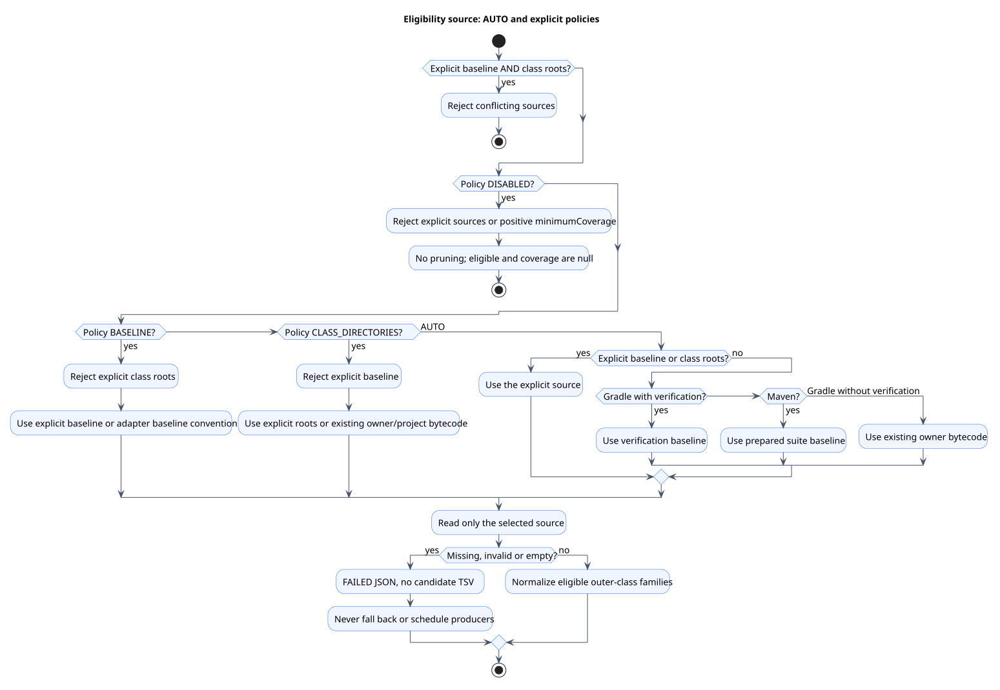
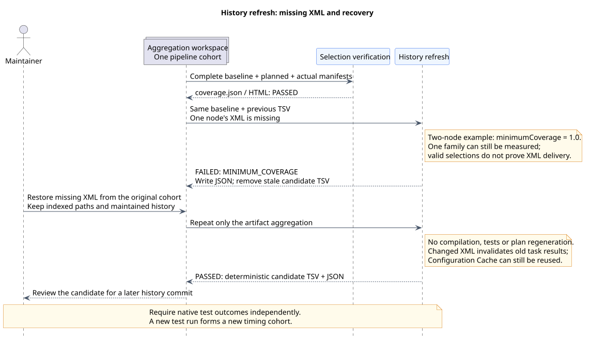

# Refresh duration history

[Documentation index](README.md) · [CI collection](ci.md#refresh-history-from-collected-reports) ·
[Gradle example](../examples/gradle/junit-jupiter/duration-history/README.md) ·
[Maven example](../examples/maven/README.md#refresh-both-suite-histories)

Version 0.4.0 can read **existing** JUnit XML and create a candidate UTF-8 TSV plus diagnostic JSON.
It never runs tests, compiles classes, fetches remote artifacts or overwrites maintained history.
Collect one project/suite/revision cohort, inspect the report and diff, then adopt the candidate
in a separate consumer change. Keep the old history immutable until every shard has finished.


[PlantUML source](diagrams/history-refresh.puml)

## Gradle configuration

Register the block once on the existing owner, outside a deferred `tasks.named.configure` or
`tasks.register` action. This realizes the owner so the sibling refresh task exists when Gradle
selects task names. Verification may be configured before or after history.

Groovy DSL, for an already configured `test` task and immutable `durationsFile`:

```groovy
import io.github.sjacek.shardpilot.ShardHistoryOptions
import io.github.sjacek.shardpilot.DurationHistoryRefresh

tasks.named('test', Test).get().shardPilot.history {
    // setFrom replaces the default report root; from would add another root.
    reports.setFrom(layout.projectDirectory.dir('collected/test'))
    pruning = ShardHistoryOptions.Pruning.BASELINE
    baselineFile = layout.projectDirectory.file('collected/plan/baseline.yaml')
    minimumSeconds = 0.1
    precision = 1
    minimumCoverage = 0.8
    duplicates = DurationHistoryRefresh.Duplicates.FAIL
}
```

Kotlin DSL equivalent:

```kotlin
import io.github.sjacek.shardpilot.DurationHistoryRefresh
import io.github.sjacek.shardpilot.ShardHistoryOptions
import io.github.sjacek.shardpilot.ShardPilotExtension

tasks.test.get().extensions.configure<ShardPilotExtension>("shardPilot") {
    history {
        reports.setFrom(layout.projectDirectory.dir("collected/test"))
        pruning.set(ShardHistoryOptions.Pruning.BASELINE)
        baselineFile.set(layout.projectDirectory.file("collected/plan/baseline.yaml"))
        minimumSeconds.set(0.1)
        precision.set(1)
        minimumCoverage.set(0.8)
        duplicates.set(DurationHistoryRefresh.Duplicates.FAIL)
    }
}
```

Invoke `./gradlew refreshTestShardDurations -Pshardpilot.count=3`. A custom `integrationTest`
owner registers `refreshIntegrationTestShardDurations`. The history block is independent of
`enabled`; there is no refresh task before opt-in and no automatic dependency on `check`.

| History property | Gradle type | Default / meaning |
| --- | --- | --- |
| `reports` | `ConfigurableFileCollection` | Owner's `reports.junitXml.outputLocation`; recursively reads `TEST-*.xml`. |
| `outputFile` | `RegularFileProperty` | `build/shardpilot/<task>/durations.tsv`; distinct from maintained `durationsFile`. |
| `reportFile` | `RegularFileProperty` | `build/shardpilot/<task>/durations.json`; distinct from TSV and protected inputs. |
| `minimumSeconds` | `Property<Double>` | `0.1`; finite, positive floor applied once per accepted family. Groovy accepts numeric literals. |
| `precision` | `Property<Integer>` | `1`; fractional digits `0..6`. The rounded floor must stay positive. |
| `minimumCoverage` | `Property<Double>` | `0.0`; eligible-family fraction `0..1`. Zero still rejects no measurements. |
| `includeFailedSuites` | `Property<Boolean>` | `false`; permits non-retried failures only. |
| `duplicates` | `Property<DurationHistoryRefresh.Duplicates>` | `FAIL`; `SUM` is explicit opt-in. |
| `pruning` | `Property<ShardHistoryOptions.Pruning>` | `AUTO`; source rules below. |
| `baselineFile` | `RegularFileProperty` | Unset explicit override; verification's baseline is a separate lazy convention. |
| `classDirectories` | `ConfigurableFileCollection` | Unset explicit override; owner bytecode is a separate fallback. |

Previous history comes from the owner's `durationsFile`. Report `shardCount` comes from
verification when configured, otherwise the owner's count. Use the same actual partition count
as the measured cohort. Refresh has `mustRunAfter` the owner if both are explicitly selected;
it has no dependency on tests, compilation or manifest preparation. Supply all evidence first.
The cacheable task snapshots input contents/options and supports Configuration Cache. A valid
unchanged request can be up-to-date or restored from the build cache; failed execution is not cached.

## Maven configuration

Declare `io.github.sjacek:shardpilot-maven-plugin:0.4.0` in the consuming POM; retain the
[native runner wiring](maven.md#configure-a-native-runner). Invoke only the standalone goal:

```shell
./mvnw shardpilot:refresh-durations -Dshardpilot.count=3
./mvnw shardpilot:refresh-durations -Dshardpilot.runner=FAILSAFE -Dshardpilot.count=3
```

No default phase, lifecycle fork or dependency resolution is requested. POM-only parents are
skipped; parallel reactors have independent project-local inputs/outputs. The goal uses existing
artifacts and does not invoke native discovery. It shares normalization with Gradle, but has no
Gradle task or build cache. Explicit goals use plugin-level configuration, not a named `select`
execution. Keep runner/suite overrides consistent for preparation and refresh.

Every parameter below has the CLI prefix `shardpilot.` (for example `-Dshardpilot.precision=3`):

| Parameter | Default / contract |
| --- | --- |
| `reports` | File array: `target/surefire-reports` or `target/failsafe-reports` according to `runner`. Custom native report paths require an override. |
| `outputFile` | `target/shardpilot/<suite>/durations.tsv`. |
| `reportFile` | `target/shardpilot/<suite>/durations.json`; the same property name means coverage JSON for `verify`. |
| `baselineFile` | `<plannedDirectory>/baseline.yaml`, unless explicitly overridden. |
| `classDirectories` | Explicit file array; CLASS_DIRECTORIES falls back to the project's existing test output directory. |
| `pruning` | `AUTO`; enum values and source rules below. |
| `minimumSeconds` / `precision` | `0.1` / `1`; same validation as Gradle. |
| `minimumCoverage` | `0.0`; range `0..1`. |
| `includeFailedSuites` / `duplicates` | `false` / `FAIL`. |
| `durationsFile` | Optional previous maintained TSV; missing means cold start. |
| `runner` / `suite` | `SUREFIRE` / `unit`; FAILSAFE defaults to `integration`. |
| `count` | `1`; use the measured cohort's partition count for the load comparison. |
| `directory` / `plannedDirectory` | `target/shardpilot/<suite>` / `<directory>/plan`. |

For multiple report roots, use POM configuration (or a comma-separated CLI file-array property):

```xml
<configuration>
  <durationsFile>${project.basedir}/test-durations.tsv</durationsFile>
  <reports>
    <report>${project.basedir}/collected/test/shard-1</report>
    <report>${project.basedir}/collected/test/shard-2</report>
  </reports>
  <pruning>BASELINE</pruning>
  <baselineFile>${project.basedir}/collected/plan/baseline.yaml</baselineFile>
  <minimumCoverage>0.8</minimumCoverage>
</configuration>
```

Apply that block to the refresh invocation/profile, preserving the plugin's other common settings.
Avoid one explicit `reportFile` for both refresh and verification. In Maven Invoker's
`invoker.goals`, commas delimit arguments: configure multiple roots in a POM/profile instead.
Use `mvnw.cmd` and quote dotted `'-Dshardpilot.count=3'` arguments in PowerShell.

## Eligibility and pruning

Eligibility is a set of **families**, keyed by the binary outer name before the first `$`.
A prepared baseline best preserves the suite's explicit filters. Bytecode scanning reads class
names without loading them, includes all supplied compiled classes and cannot infer native
tags, groups or method-level selection. It can therefore include helper classes in coverage.

| Policy | Gradle | Maven |
| --- | --- | --- |
| `AUTO` | Explicit baseline **or** explicit class roots; otherwise verification baseline; otherwise owner bytecode. | Explicit baseline **or** explicit class roots; otherwise prepared suite baseline. |
| `BASELINE` | Explicit baseline or verification baseline; rejects explicit class roots. | Explicit baseline or prepared suite baseline; rejects explicit class roots. |
| `CLASS_DIRECTORIES` | Explicit roots or existing owner bytecode; rejects explicit baseline. | Explicit roots or existing project test bytecode; rejects explicit baseline. |
| `DISABLED` | No eligibility pruning; explicit sources and positive coverage thresholds rejected. | Same policy. |



[PlantUML source](diagrams/history-pruning.puml)

Both explicit sources together are invalid in AUTO. A selected missing, unreadable or invalid
source fails; it never falls back to a different source. An empty selected set fails with
`EMPTY_ELIGIBILITY`; it does not disable pruning. DISABLED retains old foreign records and accepts
all otherwise valid measured families; `eligible` and `coverage` are `null`.

## Timing and merge policies

- Read local files named `TEST-*.xml` recursively, deduplicating repeated normalized file paths.
  Separate files containing the same raw suite name default to
  `DUPLICATE_SUITE`, even if that suite would later be filtered. `SUM` combines repeated suite
  measurements explicitly; it can double-count a rerun copied into the cohort.
- Use suite time, not the sum of testcase times. Gradle can emit disjoint outer/nested suites;
  Surefire/Failsafe can emit one inclusive outer measurement with nested testcase identities.
  Normalize these to one complete family record and reject overlapping measurements.
- Testcase execution/skipping determines whether a suite ran; header counts are a fallback if
  there are no testcase records. A header `tests=0` does not discard executed nested testcases.
- Exclude all-skipped, retried (`flakyFailure`, `flakyError`, `rerunFailure`, `rerunError`),
  repeated testcase identity and otherwise ambiguous measurements. Failed/error suites are
  excluded unless `includeFailedSuites=true`; that flag never permits retries/ambiguity.
- If an excluded member makes a family incomplete, retain its previous family records rather
  than replacing them with a partial measurement. Families with accepted zero time receive the
  positive floor. Sum a family first, then apply the floor and HALF_UP precision once.
- Replace previous outer/nested records only for newly measured complete families. Retain
  eligible unmeasured records; drop old records outside selected eligibility. No smoothing,
  percentile calculation or history of multiple runs is maintained.

## Candidate TSV and diagnostic JSON

TSV uses the [existing history format](configuration.md#timing-history), sorted by binary class
name with a literal tab and configured decimal precision. Newly measured families use outer
names; retained old nested records can remain. The candidate may change class assignments in
the **next** run. Every shard must use one identical history snapshot.

JSON is separate from manifest `coverage.json` / `coverage.html`; history refresh produces no
HTML. The standalone selection HTML report remains available through manifest verification.
An illustrative success report (counts and loads vary by cohort) is:

```json
{"status":"PASSED","measured":2,"measuredSuites":3,"kept":1,"dropped":1,"replaced":2,"foreign":0,"ignored":{"skipped":1,"retried":0,"ambiguous":0,"failed":0},"eligible":3,"pruning":"baseline","coverage":0.6666666666666666,"shardCount":2,"recordedLoad":{"previous":[12.0,8.0],"refreshed":[9.0,8.0]},"imbalance":{"previous":1.2,"refreshed":1.0588235294117647},"diagnostics":{}}
```

| Field | Unit / interpretation |
| --- | --- |
| `status`, `reason`, `detail` | `PASSED` or `FAILED`; stable failure reason and safe detail appear on failure. |
| `measured` / `measuredSuites` | New complete family records / accepted source suites after duplicate handling. |
| `kept`, `dropped`, `replaced` | Old TSV records retained, pruned or replaced by a measured family. On success old count = their sum; output count = kept + measured. |
| `foreign`, `ignored.*` | Suite counts outside eligibility or excluded as skipped/retried/ambiguous/failed. Incomplete members contribute to ambiguous with an additional diagnostic. |
| `eligible`, `pruning`, `coverage` | Family count, resolved source (`baseline`, `classDirectories`, `disabled`) and measured/eligible ratio. |
| `recordedLoad.previous/refreshed` | One-based shard order, recorded seconds from the old/candidate histories, using the shared planner. Unknown families are not estimated. |
| `imbalance.previous/refreshed` | Maximum recorded load / mean recorded load; all-zero loads yield `1.0`. Not a wall-clock speedup prediction. |
| `diagnostics` | Additional stable exclusion reasons, such as `INCOMPLETE_FAMILY`. |

Counts unavailable because a phase did not finish are `null`, not zero. XML failures can retain
counts from completely parsed files while clearing candidate-dependent values. Payloads, test
names, XML properties and failure output are not copied into refresh JSON/lifecycle diagnostics.
Raw XML artifacts can contain sensitive data; apply the consuming repository's access/retention policy.

## Failure and adoption contract

| Outcome | Candidate TSV | JSON / build outcome |
| --- | --- | --- |
| Accepted evidence | Written | `PASSED`; task/goal succeeds. |
| Data failure | Previous candidate removed | `FAILED`; task/goal fails. Reasons include `INVALID_BASELINE`, `EMPTY_ELIGIBILITY`, `INVALID_HISTORY`, `INVALID_XML`, `DUPLICATE_SUITE`, `OVERLAPPING_FAMILY`, `NO_MEASUREMENTS`, `MINIMUM_COVERAGE`, `INVALID_DATA`. |
| Invalid configuration | No refresh action write | Rejected before parsing; no new report. Existing artifacts must not be treated as evidence for this attempt. |
| I/O failure | May be absent or partially written | Build fails; multi-file writes are not an atomic transaction. Check the exit status, not just an existing JSON. |

Gradle owns task output preparation as well as cache restoration; do not rely on preservation of
old task outputs after a rejected Gradle invocation. Maven validates output aliases including
links/input trees before reading. In both adapters keep TSV/JSON paths distinct from maintained
history and all inputs. Invalid `precision=0` with the default `minimumSeconds=0.1` is rejected;
set a floor that remains positive at that precision (for example `1`).

Inspect coverage, exclusions, removed records and recorded-load changes before adopting a
candidate. A zero minimum coverage does not prove all shard artifacts arrived: provenance and
complete cohort collection belong to CI. Require native test outcomes and selection verification
independently. Commit history only after review; never copy the candidate back during a running
matrix or automatically treat partial failed-pipeline evidence as authoritative.

## Recover a missing shard download

There are three independent outcomes to inspect before adopting a candidate:

| Outcome | What it establishes | Evidence it does not replace |
| --- | --- | --- |
| Native test jobs | Assertions and framework execution for every required node succeeded. | Whether every report reached the aggregation workspace. |
| Selection verification | Baseline, planned partitions and actual selections agree. | Whether all selected tests executed successfully or their XML arrived. |
| History refresh | Accepted measurements meet the configured family policies and coverage threshold. | Native success, artifact provenance or reviewed adoption. |

In the [two-node Gradle example](../examples/gradle/junit-jupiter/duration-history/README.md),
`minimumCoverage=1.0`. Removing one node's XML after a successful run leaves its actual manifest
intact: selection verification still passes, but refresh fails with `MINIMUM_COVERAGE`, writes
FAILED JSON and removes the old successful candidate TSV. This is covered by the automated
consumer test; [test responsibilities](testing.md#history-refresh-integration-coverage) describe
the exact scope. Lower thresholds can accept partial measurements and do not prove complete transport.



[PlantUML source](diagrams/history-recovery.puml)

To recover an aggregation job:

1. Identify the original pipeline, revision, task/module, suite, plugin version, history snapshot
   and shard count. Compare the downloaded plan and node directories with that cohort.
2. Restore the missing XML from that same pipeline into its original indexed directory. Preserve
   the baseline, actual manifests and maintained history. If the original evidence is unavailable,
   run a complete new cohort in fresh workspaces and review that run on its own.
3. Repeat the artifact-only command for the configured suite. The three-node CI examples use:

   ```shell
   ./gradlew verifyTestShards refreshTestShardDurations -Pshardpilot.count=3
   ./mvnw shardpilot:refresh-durations -Dshardpilot.count=3 -Dshardpilot.reports=collected/unit
   ```

   Choose the matching adapter; the Gradle command requires both opt-in blocks and the collected
   report root from the CI example. Maven selection verification remains a separate
   `shardpilot:verify` invocation. Use `runner=FAILSAFE` and the integration report root for Failsafe.
   Producer goals or `clean` would change/delete the evidence being diagnosed.
4. Check the new process exit status, JSON status and TSV diff before adoption. Restored XML is a
   changed Gradle task input, so refresh is evaluated again even when Configuration Cache is reused.
   A repeated run over the same complete evidence yields the same candidate TSV/JSON.

The recovery test proves determinism within the original cohort. Test times from a newly executed
pipeline can differ; neither a rerun nor a successful refresh overrides a failed native job.
