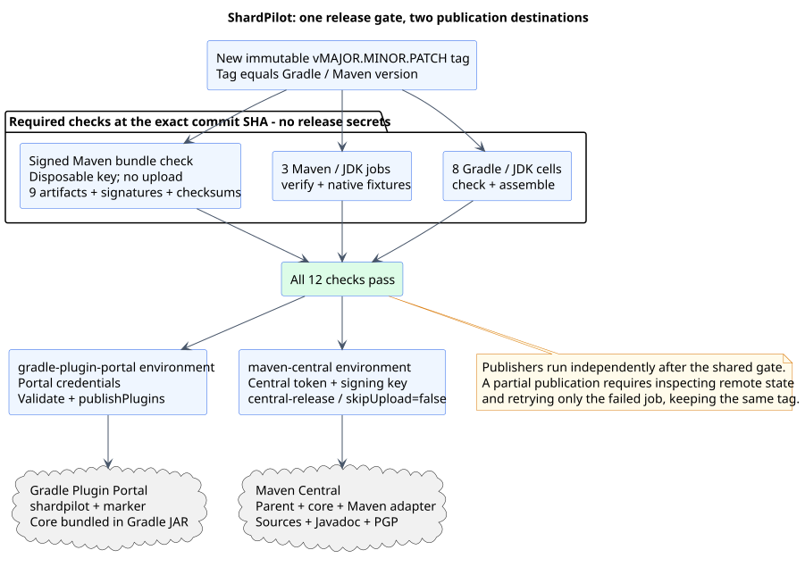

# Maven Central publication setup

[Documentation index](README.md) · [Release procedure](releases.md)

ShardPilot uses the existing **`io.github.sjacek` namespace**, already verified for Asyncwright.
Sign in to the Central Publisher Portal with the account that owns that namespace; no second
namespace registration is needed for ShardPilot. Namespace ownership, a publishing token and a
PGP signing key are separate prerequisites. Existing publisher keys can be reused if still valid
and available; this guide also covers creating a key.

The [publication workflow](../.github/workflows/publish.yml) publishes Gradle automatically on a
release-tag push. Its later manual run from that same tag publishes the parent POM, shared core
and Maven adapter together. Each destination uses its own job, credentials and complete release gate.

The [publication descriptions](publication-descriptions.md) contain the full user-facing listing
text for the adapter, core and parent, alongside the verified Gradle Portal description.



## Create a Central token

Open the [Portal user-token page](https://central.sonatype.com/usertoken) using the namespace
owner's account. Choose **Generate User Token**, give it a recognizable name such as
`shardpilot-github`, choose its expiry and save the generated username/password pair in your
password manager. They are the publishing credentials, rather than a GitHub PAT or your account
login password. The Portal displays the token only once; see the
[official token instructions](https://central.sonatype.org/publish/generate-portal-token/).

## Create and publish a signing key

Use GnuPG locally (for example, Git Bash with GnuPG or Gpg4win on Windows). Run these interactive
commands outside the repository. If reusing an existing release key, start with the listing command:

```shell
gpg --full-generate-key
gpg --list-secret-keys --keyid-format LONG --fingerprint
```

For a new key, choose RSA and RSA, 3072 or 4096 bits, an expiry you can maintain and a public
identity suitable for a release signature. Set a strong passphrase in the interactive prompt.
Copy the full primary-key fingerprint from the listing. Replace `YOUR_FULL_FINGERPRINT` below
with that value; fingerprints and the public identity are public information.

```shell
gpg --keyserver keyserver.ubuntu.com --send-keys YOUR_FULL_FINGERPRINT
```

Only the public key is sent to the keyserver. Central needs it to validate signatures; allow
time for keyserver availability before releasing. See
[Sonatype's signing and keyserver guide](https://central.sonatype.org/publish/requirements/gpg/).

Export the passphrase-protected private key to a private directory outside the checkout:

```shell
gpg --armor --output shardpilot-signing-key.asc --export-secret-keys YOUR_FULL_FINGERPRINT
```

GnuPG asks for the passphrase interactively. Keep a protected backup of the key and its revocation
certificate. Use the entire exported file, including its BEGIN/END lines, as the GitHub secret
below; remove the temporary export after saving it securely. Never commit the export, print it in
CI or put the passphrase in a shell command. Renewal of the key expiry requires updating its public
key on the keyserver; rotating the private key requires updating the GitHub secrets too.

## Configure the GitHub environment

In the ShardPilot repository, open **Settings → Environments**, create **`maven-central`** and
add these **environment secrets**:

| Secret | Content |
| --- | --- |
| `MAVEN_CENTRAL_USERNAME` | Username generated with the Central token. |
| `MAVEN_CENTRAL_PASSWORD` | Password generated with the same token. |
| `MAVEN_GPG_KEY` | Complete ASCII-armored private-key export. |
| `MAVEN_GPG_PASSPHRASE` | Passphrase protecting that signing key. |

Retain the separate `gradle-plugin-portal` environment and its `GRADLE_PUBLISH_KEY` and
`GRADLE_PUBLISH_SECRET`. Gradle can be published before Central credentials are configured.
Apply the [release tag restrictions](releases.md#configure-github-publication)
to both environments. Do not paste secret values into issues, documentation or chat.

The workflow checks out the tested commit and makes the four secrets available only to the final
Maven publishing step. `setup-java` creates private settings with server ID `central` and references
to the credential environment variables. The Maven GPG plugin's BC signer reads the key/passphrase
from the environment without importing them into a shared keyring. Credentialed jobs use no shared
build cache. See [the GPG plugin configuration](https://maven.apache.org/plugins/maven-gpg-plugin/sign-mojo.html).

## Verify the release bundle without credentials

With Bash, GnuPG and JDK 17 or later, run from the repository root:

```shell
bash scripts/verify-maven-release.sh
```

The script generates a disposable signing identity, builds the production `central-release`
profile and verifies all nine artifacts, signatures, checksums, POM metadata and JAR contents.
It writes `build/release-verification/report.json` and deletes its temporary keyring on exit.
Dependencies may be downloaded, but nothing is uploaded. Its output bundle uses a **test key**
and must never be published. The same check is required in the compatibility workflow.

The profile is inactive during ordinary Maven builds. Explicit activation adds source/Javadoc
JARs and signing; `central.skipUpload=true` is its default, even for `deploy`. The bundle is written
to `target/central-publishing/central-bundle.zip`. Only the credentialed manual Maven job passes
`-Dcentral.skipUpload=false`. When uploading, the publisher automatically publishes after Central
validation and waits up to 30 minutes for `published`, within a 45-minute job timeout. See the
[Central Maven plugin guide](https://central.sonatype.org/publish/publish-portal-maven/).

## Release and recover a partial publication

Follow the [version-tag procedure](releases.md#publish-from-a-version-tag) to publish Gradle first.
When Central credentials are ready, start **Publish ShardPilot** manually from the existing tag:

```shell
gh workflow run publish.yml --repo sjacek/shardpilot --ref v0.3.0
```

The CLI selects the existing `v0.3.0` tag, rather than `main`; no separate tag input is used. Branch refs are
rejected. The workflow must be present on the default branch and in that release tag. The manual
run uses the tag's commit SHA, reruns eight Gradle/JDK cells, three Maven/JDK jobs and the signed-bundle
check, then publishes only Maven. See the [manual publication procedure](releases.md#publish-maven-later-from-the-same-tag).

The two portals are independent: publication cannot be atomic across them. If a publication fails,
inspect the remote deployment state and rerun **only the failed job** in that destination's run. A
timeout may occur after a remote upload was accepted; check the Portal before retrying. Do not
move the tag or republish a version already accepted by either portal. Once published, verify a
fresh Maven consumer without Maven Local candidate installations; the parent, core and adapter
must all resolve. The Gradle consumer must resolve its unchanged plugin marker separately.
