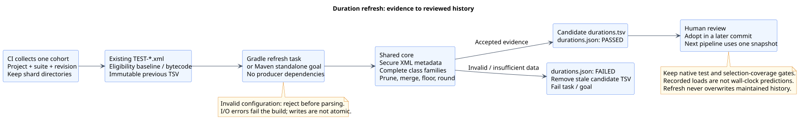

# ShardPilot 0.4.0

[Release guide](../releases.md) · [Changelog](../../CHANGELOG.md) · [Previous release](0.3.1.md)

Project version: `0.4.0`. Intended release tag: `v0.4.0`.
This checkout prepares the release; no tag or publication is performed by preparation checks.

## Refresh timings without rerunning tests

Generate a candidate history from reports your CI already collected. The Gradle adapter adds
opt-in `history {}` and `refresh<Task>ShardDurations`; Maven adds standalone
`shardpilot:refresh-durations` for Surefire/Failsafe. Both use one shared normalization core and
write candidate TSV plus diagnostic JSON, without rerunning tests, compiling missing evidence
or modifying maintained history. Review the diff and adopt it for a later pipeline.

Refresh understands complete outer/nested class families and native XML timing differences.
It excludes skipped, retried and ambiguous samples, retains eligible unmeasured history, prunes
removed families and reports coverage plus before/after recorded shard loads. Duplicate suite
names fail by default. Eligibility, coverage thresholds, precision, the positive family-time
floor and failure handling are explicit policies; see the [complete reference](../history-refresh.md).
The report describes recorded weights, not predicted job duration or proof that tests passed.



Run the [Docker-free Gradle example](../../examples/gradle/junit-jupiter/duration-history/README.md)
or [two-suite Maven example](../../examples/maven/README.md#refresh-both-suite-histories).
[CI examples](../../examples/ci/README.md) show three isolated nodes, distinct collected XML paths,
required native/coverage outcomes and candidate artifacts retained after failure.

The [recovery guide](../history-refresh.md#recover-a-missing-shard-download) explains why selection
coverage can pass with missing XML, how failed refresh removes a stale candidate, and how to
restore the original cohort without rerunning producers. Both adapters' CI examples have
structural regression checks; the actual Gradle consumer runs through TestKit, including
missing-node rejection/recovery. Maven's runnable hook compares candidate values with native XML.

## Fixes included

- Recorded shard loads are summed in stable family-name order, so identical timing inputs yield
  identical refresh JSON across JVMs. This removes intermittent floating-point report differences.
- Maven Central publishing retries transient status-check failures without uploading again.
  Maintainers can resume an accepted deployment by ID and retain its release/status evidence.
  This concerns the maintainer workflow; consumers need no credentials or publication profile.

The checked-in build Wrapper is upgraded to Gradle 9.8.2, with the official distribution checksum
and regenerated Wrapper files. The TestKit matrix replaces its three 9.8.1 cells with 9.8.2
on JDK 17/21/25 and retains eight combinations in total, selected independently from the build runtime; see the
[Wrapper verification scope](../testing.md#gradle-982-wrapper-verification).

## Upgrade and opt in

Gradle Groovy DSL:

```groovy
plugins {
    id 'io.github.sjacek.shardpilot' version '0.4.0'
}
// After configuring the existing test task and immutable durationsFile:
tasks.named('test', Test).get().shardPilot.history { }
```

Kotlin DSL retains `id("io.github.sjacek.shardpilot") version "0.4.0"`; configure the typed
history action as shown in the [Groovy/Kotlin reference](../history-refresh.md#gradle-configuration).
For Maven, update the existing build plugin version:

```xml
<plugin>
  <groupId>io.github.sjacek</groupId>
  <artifactId>shardpilot-maven-plugin</artifactId>
  <version>0.4.0</version>
</plugin>
```

Retain existing `select` bindings and exclusions. Invoke refresh after all reports and the
prepared baseline have arrived, using the same runner/suite and count as the cohort.
AUTO differs between adapters: Gradle uses verification's baseline or existing task bytecode;
Maven defaults to the prepared baseline and never silently falls back to bytecode.

Existing sharding configuration, `testProcesses`, native runner behavior, YAML schemaVersion=1,
selection JSON/HTML and implementation coordinates remain compatible. No task/goal runs refresh
automatically; without opt-in the history path is unchanged. The refresh candidate can move
families when adopted, so every node of the next pipeline must use that same history/version.
No smoothing or automatic adoption is included. No consumer service migration is part of this release.

## Local release checks

With a compatible JDK, run from the repository root:

```shell
./gradlew clean check assemble verifyReleaseTag -PreleaseTag=v0.4.0
./mvnw -B -ntp verify
bash scripts/verify-maven-release.sh
python3 -B -m unittest discover -s scripts -p 'test_central_publication*.py' -v
```

The bundle check creates a disposable signing identity, validates all nine artifacts/checksums/
signatures and passes `central.skipUpload=true`. It never publishes remotely or needs real
publisher credentials. Metadata tasks validate local implementation/marker POMs; Portal
`publishPlugins --validate-only` is a separate credentialed check when credentials are available.
On 29 October 2026, local preparation passed 268 Gradle/core cases, 250 Maven/core cases,
9 Invoker projects, 2 Maven examples, strict Javadoc, the nine-signature bundle check and Portal
`--validate-only` on Windows/Temurin 25.0.4.1. The Docker-free Gradle flow and strict Configuration
Cache reuse, 33 Central-recovery cases, diagrams/links/CI YAML and wiki validation also passed.
Shared core cases are counted in both build totals. See
[verification scope](../testing.md#040-release-verification) for the detailed boundaries.

The release commit must additionally pass all **12 required CI checks**: eight Gradle/JDK pairs,
Maven 3.9.16 on JDK 17/21/25 and signed-bundle verification. A previous green main or a local
JDK 25 run does not establish the release revision's matrix. Wrapper uses Gradle 9.8.2;
plugin bytecode targets Java 17. Native Maven fixtures cover Jupiter/Surefire/Failsafe 3.5.4;
Gradle also covers Spock and TestNG. The required consumer matrix uses 9.0.0, 9.1.0 and 9.8.2,
with Gradle 9.0.0/JDK 25 excluded. Required status names must match the
[ruleset checklist](../releases.md#keep-required-checks-aligned-with-the-matrix).

## Maintainer steps after review

The maintainer signs, commits and pushes the release branch, opens a PR and waits for required CI.
After merge and green main, create the immutable signed `v0.4.0` tag on that tested commit.
Tag creation starts Gradle Plugin Portal publication. Confirm normal resolution, then manually
start Maven Central publication from the **same** tag with the existing workflow.
Follow the [release procedure](../releases.md) and [Central recovery guide](../maven-central.md).
Neither step is run during release preparation. Existing published versions/tags stay unchanged.

After both portals are available, verify fresh Gradle/Maven consumers, including partitions,
YAML manifests, selection HTML and candidate TSV/JSON. Then create the GitHub Release for this
tag with these user-facing changes. Consumer migration and the comparison with the old Python
producer remain follow-up work; adopt only after comparing the same artifact cohort.
