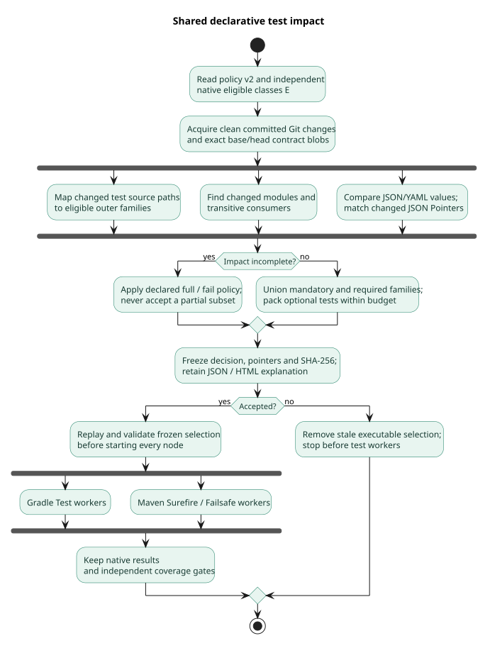

# Changed tests, modules and structured contracts

[Documentation index](README.md) · [Profiles and plugin parameters](selection-policy.md)

**Development checkout, 14 November 2026.** These additions are not in published 0.5.0.
Use the candidate built from this checkout. Existing policy v1 and explicit class manifests
keep their behavior. Set `schemaVersion: 2` to opt into the shared impact rules below;
Gradle and Maven read the same file, without a consumer selector script or callback.

ShardPilot starts with independently discovered eligible test classes **E**. It adds mandatory
tests, directly changed eligible tests, tests of affected modules and tests matching contract
changes. Required families survive budget packing. Optional contract/path targets share the
existing priority and duration budget. Sharding partitions the accepted selection afterward.



[PlantUML source](diagrams/selection-impact.puml)

## Configure a shared policy

Paths are relative to the **Git repository root**, including when the plugin runs inside a
subproject. Module IDs and profiles are consumer-defined configuration, not inferred build names.
This example uses conventional source/package layouts and independently eligible test classes:

```yaml
schemaVersion: 2
profiles:
  affected-testdata:
    mode: affected
    mandatory:
      classes: [example.LoginTest]
    onUnknownChanges: full
    onUnknownImpact: full
    onUnmatchedChanges: full
    onEmptySelection: fail
    budget:
      maxFamilies: 20
      maxSeconds: 180
      overflow: keep-required
    rules:
      - {id: build, changes: ['build.gradle', 'pom.xml'], action: full}
      - {id: docs, changes: ['docs/**', '*.md'], action: ignore}
    impact:
      changedTests:
        - path: app/src/test/java
          extensions: [java]
        - path: app/src/test/groovy
          extensions: [groovy]
      modules:
        - id: library
          changes: ['library/src/**']
          tests: {patterns: ['example.library.**.*Test']}
        - id: app
          changes: ['app/src/main/**']
          dependsOn: [library]
          tests: {patterns: ['example.app.**.*Test']}
      contracts:
        - id: payments
          files: ['contracts/*.yaml']
          format: yaml
          pointers: ['/paths/~1payments']
          action: require
          tests: {classes: [example.PaymentContractTest]}
        - id: descriptive-contract-fields
          files: ['contracts/*.yaml']
          format: yaml
          pointers: ['/info']
          action: ignore
```

The `impact` sections are independently optional and default to empty. `onUnknownImpact`
defaults to `full`; allowed values are `full` and `fail`. Only `affected` accepts impact rules.
Every exact target and class pattern must match E, even in an inactive module or contract rule.
Invalid graphs, unknown fields, duplicate IDs, stale targets and malformed pointers fail validation.
The same `mandatory`, `budget`, path rules and fallback parameters from
[policy v1](selection-policy.md#policy-parameters) remain available.

## Include changed tests automatically

For a source root `app/src/test/java`, changing
`app/src/test/java/example/LoginTest.java` protects eligible `example.LoginTest` and its
eligible nested members. `packagePrefix` optionally prepends a package to the relative path.
Default extensions are `java`, `groovy`, `kt`; set them explicitly for other supported layouts.

Roots are literal directories, not globs. ShardPilot uses path-to-binary-name mapping; it does
not parse package declarations, infer Kotlin file facades, or discover tests outside native E.
Use explicit path/module rules for nonconventional layouts and changed test helpers.
Deleted sources cannot resurrect removed bytecode. Old/new rename paths are both considered,
but a path that maps to no eligible family still needs a path/module rule or triggers
`onUnmatchedChanges`. A broad `ignore` path rule never vetoes a directly changed eligible test.
Native filters remain authoritative: deliberately excluded tests cannot be added by impact rules.

## Propagate module changes

`app.dependsOn: [library]` means **app consumes library**. A library change protects tests
configured for library and app, including further consumers transitively. An app-only change
does not select providers' tests. Overlapping paths union affected modules; diamonds do not
duplicate family cost or execution. A module may have empty `tests`, useful for a library
represented by its consumers. Every referenced module must exist and cycles are rejected.

This is an explicit application dependency graph. ShardPilot does not inspect Gradle dependency
resolution, Maven reactor ordering, production call graphs or framework annotations to infer it.
Keep shared test helpers and build settings covered by module rules or a `full` path rule.

## Match JSON/YAML contract changes

Each contract rule declares file globs, `format: json` or `yaml`, and nonempty `pointers` using
RFC 6901 JSON Pointer. `''` watches the whole document; `/paths/~1payments` watches the key
`/payments` under `paths`. Escape `~` as `~0` and `/` within keys as `~1`. Pointers identify
subtrees; they are neither JSONPath nor wildcard expressions.

ShardPilot compares committed base/head Git blobs semantically. Map key order, YAML comments
and equivalent decimal spellings do not count as changes. Numbers retain decimal precision.
Any array element/order change marks the entire array. Added/removed properties mark that
subtree; added/deleted files or replacement of a complete document mark the root pointer.
An absent file/property differs from an explicit `null` value.

All intersecting rules contribute. `require` protects test families; `optional` accepts a
nonnegative `priority` and uses available budget; `full` requests E; `ignore` classifies a
known area without vetoing other rules. Tests are required for `require`/`optional` and must
be empty for `full`/`ignore`. Smaller optional priority is considered first, then cost/name.

Every changed subtree must have complete coverage. Watching a child reacts to a replaced
parent, but cannot classify unknown siblings in that parent. For example, deleting the whole
contract with only `/paths/~1payments` configured leaves unknown impact. Configure a deliberate
root rule or accept the declared full/fail fallback. Uncovered fields, missing observations,
conflicting formats, malformed documents, unsupported YAML or exceeded limits trigger
`onUnknownImpact` **even if a broad path rule ignores the file**. An activated `full` rule is
a safe override. A semantic no-op selects no contract target; mandatory tests and the normal
`onEmptySelection` policy still apply.

Supported YAML values are JSON-compatible maps with string keys, sequences, strings, booleans,
null and finite decimal numbers. Aliases, custom tags, duplicate/complex keys and unsupported
numeric spellings are rejected. Format conflicts are explicit; filename suffixes do not override
the configured format. Only regular Git blobs are read, never symlink targets or worktree content.

## Use the same parameters in both plugins

Keep the normal native framework/filters and independent eligibility configured as shown in
the [Gradle/Maven profile guide](selection-policy.md#gradle-and-maven-parameters-development-checkout).
Choose v2 through that same `selectionPolicyFile`; there is no second set of adapter-specific
module or contract settings.

```shell
./gradlew test -Pshardpilot.selectionPolicyFile=policy.yaml -Pshardpilot.selectionProfile=affected-testdata -Pshardpilot.gitBase=main
./mvnw test -Dshardpilot.selectionPolicyFile=policy.yaml -Dshardpilot.selectionProfile=affected-testdata -Dshardpilot.gitBase=main
```

For Maven, configurable defaults must be referenced as properties in the POM, as in the
[runnable example](https://github.com/sjacek/shardpilot/blob/main/examples/maven/selection-impact/README.md).
Failsafe retains explicit `integration-test` and `verify` bindings, runner-specific eligibility
and report paths. A class absent from the selected runner's E is an invalid configured target.

Only committed changes in a clean checkout are supported. Base inference, merge-base selection,
bounded optional fetching and offline behavior follow the existing
[Git acquisition contract](selection-policy.md#git-acquisition-and-safe-fallback).
Preparing several nodes freezes one selection. Transport its entire `selection/` and `plan/`
directories as CI artifacts, download input into a separate ignored directory and supply
`selectionSnapshotDirectory` to every worker. Do not recompute impact per node.

## Evidence and limits

`selection/decision/git.json` records changed paths, exact base/head IDs and, when contracts are
observed, schema v2 metadata: declared format, changed pointers, before/after raw SHA-256 and
stable failure codes. No contract values or parser payloads are retained. Snapshots without
contract observations retain schema v1. Decision JSON/HTML record family reasons
`CHANGED_TEST`, `CHANGED_MODULE`, `DEPENDENT_MODULE`, `REQUIRED_CONTRACT`,
`OPTIONAL_CONTRACT`, or fallback `UNKNOWN_IMPACT`, with source IDs such as `module:app`.

The decision identity includes policy semantics and frozen contract metadata. Workers replay
the pure engine, validate identity, current E/policy/history and checkout HEAD, without diffing
or rereading base blobs. Tampered snapshots fail before test execution; they do not request
a fresh/full selection. The outer manifest protocol and decision JSON version remain compatible.
The opt-in [execution-selection bridge](execution-selection.md) now binds this decision and its plans to
[C2 execution evidence](execution-evidence-contract.md), optionally including [C3 compiled inputs](compiled-artifacts.md).
Selection consistency alone is not proof that native test invocations passed.

Bounds: at most 64 unique source roots, 256 modules, 256 contract rules, 256 patterns/dependencies
per module, 256 file patterns/pointers per contract rule and 4,096 changed pointers per file.
Acquisition retains at most 32 changed contract files and reads at most 8 MiB of their blobs
in total, with 1 MiB per blob. Remaining observations are unknown, never silently accepted.
Parsing/comparison bounds include depth 32, 100,000 YAML events/JSON values and 500,000
comparison/normalization steps. Existing policy, eligible-class and matcher bounds still apply.
Do not put secrets or personal data in paths, keys, pointers, policy IDs or test names.

## Runnable examples and verification

- [Gradle impact selection](https://github.com/sjacek/shardpilot/blob/main/examples/gradle/junit-jupiter/selection-impact/README.md)
- [Maven impact selection](https://github.com/sjacek/shardpilot/blob/main/examples/maven/selection-impact/README.md)
- [Testing guide](testing.md): core edge cases, real Git object acquisition, Gradle TestKit
  and native Maven Surefire/Failsafe across two nodes, independently checked through XML.

The examples default to a Git-independent smoke profile. Their synthetic impact policy must
be adapted to repository-root paths and the application's dependency/contract knowledge before use.
