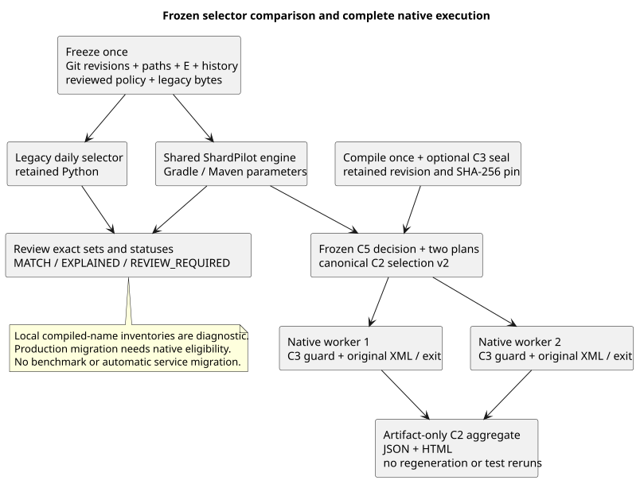

# Compare selectors and run the complete workflow

[Documentation index](README.md)

**Available in published [0.6.0](releases/0.6.0.md).** The profiles, execution-selection v2
and compiled-artifact guards below are opt-in. Source-mode examples use an explicit included
build/local Maven installation; the [fresh-consumer release gate](release-consumers.md) resolves
packaged artifacts. Dated comparison reports retain their original versions and inputs.
The current [published audit baseline](published-artifact-audit.md#published-060-baseline-18-november-2026) is 0.6.0.

Before replacing an existing selector, compare it with a reviewed declarative policy on the
same changes, complete eligibility and history. Matching plans establish selection compatibility;
native results and independently supplied CI metadata establish execution success. Neither is
a performance measurement.



[PlantUML source](diagrams/selection-migration.puml)

## Freeze and review the comparison

The [comparison harness](https://github.com/sjacek/shardpilot/blob/main/scripts/compare_selectors.py)
captures an explicitly trusted consumer's `integration_short.py`, its timing helper, mandatory
core, timing TSV, compiled class-name inventory, exact Git revisions, a candidate policy and
scenario paths. Copies and hashes are retained in a fresh private directory. The harness imports
and executes the captured Python selector: hashing is not sandboxing or a review of that code.
Do not run it on an untrusted repository.

The capture's `compiled-name-inventory-not-native-discovery` label is deliberate. Existing local
bytecode may be stale or include abstract/disabled classes. Before production migration, capture
the full native eligible baseline from a trusted compile/planning job for the exact revision.
An inventory of filenames or a partial set of successful XML files cannot replace that baseline.

The [full CI baseline acceptance](consumer-ci-baseline.md) now captures that boundary for
exact successful scheduled revisions, validates transferred compilation bytes and exercises
complete service-owned policies. Its [17 November report](reports/consumer-ci-baseline-2026-11-17.md)
supersedes the local-name inventory for native eligibility; the original frozen comparison
remains a separate diagnostic record.

From the repository root, prepare a reviewed policy and a JSON scenario list such as:

```json
[
  {"id": "documentation-testdata", "paths": ["docs/guide.md"]},
  {"id": "changed-test-testdata", "paths": ["src/integrationTest/java/example/PaymentIT.java"]}
]
```

Then capture the actual complete two-commit diff as well as those explicitly synthetic cases:

```shell
python -B scripts/compare_selectors.py freeze \
  --consumer /private/service --base BASE_COMMIT --head HEAD_COMMIT \
  --policy /private/policy.yaml --scenarios /private/scenarios.json \
  --output /private/selection-snapshot
```

Compile the current core and comparison probe with the reviewed dependency policy:

```shell
./gradlew :shardpilot-core:jar :shardpilot-gradle-plugin:testClasses
```

Replay with a classpath containing the probe's test classes, the current core JAR and the
reviewed `snakeyaml-engine` JAR. Use `:` between POSIX classpath entries and `;` on Windows.
The [harness tests](https://github.com/sjacek/shardpilot/blob/main/scripts/test_compare_selectors.py)
exercise this exact entry point against the real core.

```shell
python -B scripts/compare_selectors.py compare \
  --snapshot /private/selection-snapshot --output /private/first-replay \
  --classpath "$REVIEWED_COMPARISON_CLASSPATH"
```

A result is `MATCH`, `EXPLAINED` or `REVIEW_REQUIRED`. The last outcome makes the command fail.
Review the exact `legacyOnly`/`shardPilotOnly` sets, both planning statuses, original decision
JSON/HTML, deferred families and estimated costs. Supply a separate expectations JSON keyed by
scenario ID only after review. Each entry contains those exact four fields plus a nonempty
`explanation`; a changed set or status requires another review. Replay into another fresh output
using `--expectations /private/expectations.json`. A generic explanation never approves a wildcard
of future differences.

The harness preserves failed planning as failed, records only a stable legacy rejection code,
and never executes service tests, refreshes timings or changes consumer configuration. The
[dated service report](reports/selection-migration-2026-11-15.md) records the actual inputs,
coverage limits and four explained differences.

## Verify adapter parity on retained inputs

The [Gradle and Maven adapter fixtures](https://github.com/sjacek/shardpilot/tree/main/testing/selection-migration/adapters)
invoke only `PrepareExecutionSelection` / `prepare-execution-selection`. They have no consumer
Java plugin, compilation, Git acquisition, test runner or lifecycle binding. The
[adapter checker](https://github.com/sjacek/shardpilot/blob/main/testing/selection-migration/verify_adapters.py)
accepts one passed replay case and requires **byte-identical canonical selection v2** from both
adapters, including policy/history/Git identities and both plan hashes.

```shell
python -B testing/selection-migration/verify_adapters.py \
  --case /private/first-replay/changed-test-testdata --output /private/adapter-check \
  --gradle-command-json '["bash", "./gradlew"]' \
  --maven-command-json '["bash", "./mvnw", "-B", "-ntp"]' \
  --repository "$VERIFIED_LOCAL_CANDIDATE_REPOSITORY"
```

The repository must contain this checkout's installed Maven candidate. The checker uses the
existing strict consumer checksum extension, adding only the exact five local reactor artifacts.
Third-party checksum enforcement stays enabled. Adapter parity proves a common planning contract;
it does not turn the source inventory into native eligibility or prove service execution.

## Complete Gradle and Maven examples

Both [Gradle](https://github.com/sjacek/shardpilot/tree/main/examples/gradle/junit-jupiter/selection-workflow)
and [Maven](https://github.com/sjacek/shardpilot/tree/main/examples/maven/selection-workflow) examples
contain identical policies, timing bytes and three ordinary JUnit tests. The smoke profile selects
Login and Payment; Unrelated remains in full eligibility. Each selected class has one unique
ordinary invocation. Repeated/parameterized tests require a native invocation ledger as described
in the [C2 contract](execution-evidence-contract.md).

The example configuration also includes an affected profile with changed-test mappings, a
provider/consumer module relationship and a scoped JSON contract. Use `selectionProfile` and
`gitBase` as documented in [selection profiles](selection-policy.md) and [impact rules](selection-impact.md)
for a clean, committed consumer checkout. The executable smoke demonstration needs no fabricated
Git changes or new commits and isolates the execution/evidence flow from Git acquisition tests.

The [development example driver](https://github.com/sjacek/shardpilot/blob/main/scripts/run_selection_workflow.py)
copies an example to fresh output, invokes normal plugin parameters and records actual native
process outcomes. It contains **no selector or sharding algorithm** and is a test/CI illustration,
not another script required by plugin consumers. Real CI supplies its own job metadata and
transfers the artifacts between isolated jobs.

| Stage | Gradle | Maven |
| --- | --- | --- |
| Compile and plan once | `testClasses prepareTestShardManifests` | `test-compile shardpilot:prepare` |
| Seal existing bytecode | `sealTestCompiledArtifacts` | `shardpilot:seal-compiled-artifacts` |
| Freeze the complete source selection | Copy to a separate retained directory | Same |
| Bind selection and optional C3 manifest | `prepareTestExecutionSelection` | `shardpilot:prepare-execution-selection` |
| Run each of two workers | `test -Pprecompiled`, frozen snapshot, count/index | Direct `verify-compiled-artifacts select surefire:test`, frozen snapshot, count/index |
| Aggregate original results | `verifyTestExecutionEvidence` | `shardpilot:verify-executions` |

Keep the independently supplied revision, suite, complete eligibility, selection hash and C3
manifest pin. Retain each worker's own original plan/XML/process outcome; use separate directories
per index. Workers cannot regenerate the source snapshot. Aggregation cannot compile, plan or rerun
tests to repair missing evidence. Require native worker success **and** aggregate success.

Run the examples from the repository root on POSIX, after installing the development Maven candidate:

```shell
python -B scripts/maven_verification.py run -- -B -ntp -DskipITs=true -DskipTests install
python -B scripts/run_selection_workflow.py --tool gradle \
  --output build/workflow-gradle --command-json '["bash", "./gradlew"]'
python -B scripts/run_selection_workflow.py --tool maven \
  --output build/workflow-maven --command-json '["bash", "./mvnw", "-B", "-ntp"]'
```

On Windows use absolute `gradlew.bat` / `mvnw.cmd` paths in the JSON command arrays, for example
`["C:/workspace/shardpilot/gradlew.bat"]`. The Maven driver enables the existing reviewed extension
and exact local-candidate baseline itself; pass the native launcher, not a second verification wrapper.
Use `--repository` when candidates are installed outside the default local Maven repository.

The Gradle fixtures declare Maven Central in `pluginManagement.repositories` as well as keeping
Plugin Portal available. Plugin runtime dependencies must resolve through the repository warmed
by CI; a cached Central artifact does not imply cached Portal metadata in offline mode. The
drivers preserve the checked-in settings and pass the fixture-only `example.pluginSourceDirectory`
property to relocate the included build. This is not a published plugin parameter. Strict checksum
verification and offline execution remain enabled.

Outputs include `evidence/report.json`, standalone `report.html`, retained C5/C2/C3 inputs, original
node XML/evidence, command logs and `workflow.json` with observed exits/timestamps. Local job IDs
are explicitly synthetic; they are not proof that a live CI provider ran these jobs. C3 is enabled
in these examples; production use may omit it on both sides as documented in the
[selection/evidence bridge](execution-selection.md).

## Rejection and migration gates

Repeat into fresh directories with `--corrupt bytes` or `--corrupt revision`. The example must
observe nonzero worker exits, **no native XML**, and a failing aggregate gate. Only the test harness
reports `EXPECTED_REJECTION`; it never converts the native process result or C2 failure to success.
CI retains both happy-path and rejected-run reports. These checks complement the existing
Gradle/Maven C2/C3 regression tests; they do not replace independent full-suite gates.

Before deleting a service selector: review a complete declarative policy for its entire supported
path space, obtain exact native eligibility, accept protected-test and optional-budget differences,
preserve separate library/dedicated suites and full-run scheduling, publish the new plugin version,
then verify fresh registry consumers. The service scripts have **not** been removed or changed.
Benchmarking remains deferred until the intended dev infrastructure is ready.
