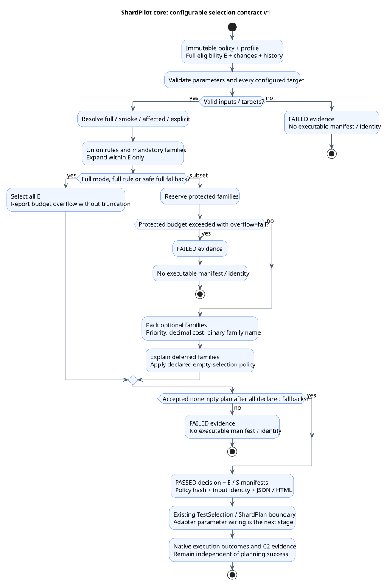

# Configurable selection: core contract v1

[Documentation index](README.md)

**Development checkout, 14 November 2026.** The shared Java engine is implemented in
`shardpilot-core`. Gradle/Maven profile properties and automatic Git acquisition are the next
integration stage; they are not present in published **0.5.0**. Existing
[explicit-manifest selection](test-selection.md) keeps its current behavior.

The core takes immutable inputs, evaluates configured application knowledge and returns a
decision. It invokes no Git command, build tool, test runner, remote service or consumer callback.
Required Java parameters use JSpecify non-null contracts. Construct configuration with
`SelectionPolicy` records or parse the same versioned configuration with `SelectionPolicyYaml`.



[PlantUML source](diagrams/selection-policy.puml)

## Policy parameters

This is a shortened version of the
[executable policy fixture](https://github.com/sjacek/shardpilot/blob/main/shardpilot-core/src/test/resources/selection-policy-testdata.yaml).
Profile names are consumer-defined; `daily-testdata` is a synthetic fixture profile.

```yaml
schemaVersion: 1
profiles:
  full-testdata:
    mode: full
  smoke-testdata:
    mode: smoke
    mandatory:
      classes: [example.LoginIT]
  explicit-testdata:
    mode: explicit
    mandatory:
      classes: [example.LoginIT]
  daily-testdata:
    mode: affected
    mandatory:
      classes: [example.LoginIT]
    budget:
      maxFamilies: 3
      maxSeconds: 90
      unknownSeconds: 30
      overflow: fail
    onUnknownChanges: full
    onUnmatchedChanges: full
    onEmptySelection: fail
    rules:
      - id: payments
        changes: ['src/payments/**', 'contracts/payments/**']
        action: require
        tests:
          patterns: ['example.payments.**.*IT']
      - id: compatibility-probes
        changes: ['src/payments/**']
        action: optional
        priority: 10
        tests:
          classes: [example.CompatibilityIT]
      - id: build
        changes: ['build.gradle', 'pom.xml']
        action: full
      - id: documentation
        changes: ['docs/**', '*.md']
        action: ignore
```

| Parameter | Contract / default |
| --- | --- |
| `schemaVersion` | Required integer `1`. Unknown versions fail. |
| `profiles` | Required map of 1–64 independent profiles. IDs use ASCII letters/digits, dot, underscore or hyphen; start with a letter/digit; maximum 80 characters. Rule IDs use the same syntax. |
| `mode` | Required: `full`, `smoke`, `affected` or `explicit`. |
| `mandatory` | Protected `classes` and/or `patterns`; defaults to empty. |
| `rules` | Only `affected` accepts rules. Empty by default; maximum 256, with unique IDs. |
| Rule `changes` | Required nonempty sequence of repository-relative path globs; maximum 256. Any matching pattern activates the rule. |
| Rule `action` | Required: `require`, `optional`, `full` or `ignore`. |
| Rule `tests` | Required nonempty targets for `require`/`optional`; empty for `full`/`ignore`. |
| Rule `priority` | Nonnegative integer, default `0`. Only `optional` permits a nonzero value; smaller values are considered first. |
| `budget.maxFamilies` | Nonnegative integer; `0` means unlimited. Counts outer families, not nested members. |
| `budget.maxSeconds` | Finite nonnegative estimate; `0` means unlimited. |
| `budget.unknownSeconds` | Finite positive substitute per unmeasured family; default `60`. |
| `budget.overflow` | `fail` (default) or `keep-required`. Never removes protected targets. |
| `onUnknownChanges` | `full` or `fail` when change acquisition is unavailable. |
| `onUnmatchedChanges` | `full` or `fail` when at least one changed path has no rule. |
| `onEmptySelection` | `full` or `fail` when a nonempty eligible suite would produce no selected tests. |

All three fallbacks default to `full` in `affected` and `fail` in other modes. The Java factory
methods `Profile.full()`, `.smoke(...)`, `.affected(...)` and `.explicit(...)` use these defaults.
No profile inheritance or executable expressions are supported. Unknown fields, duplicate keys
or sequence values, collection aliases, unsafe tags and incorrect scalar types fail parsing.
The parser bounds input to 1,048,576 UTF-16 characters, 100,000 events and 16 collection levels.

Targets accept at most 4,096 exact binary names and 256 class patterns. Each name/pattern is
bounded to 512 characters. Exact names must occur in full eligibility **E**; every configured
pattern must match at least one member of E, even in a rule not activated by the current diff.
Stale configuration fails instead of silently reducing intended coverage.

## Matching and precedence

Paths use `/` and class patterns use `.` as segment separators. `*` matches zero or more
characters inside one segment, `?` matches one Unicode code point, and a whole `**` segment
matches zero or more segments. Thus `**/*.md` matches `README.md`, and
`example.**.*IT` matches both `example.TransferIT` and `example.payments.TransferIT`.
Other characters are literal; patterns are not regular expressions. Nested binary names use `$`.
Absolute paths, backslashes, empty/dot/parent segments, colons and control characters are rejected.
Actual paths may contain spaces and Unicode; each path is bounded to 4,096 characters.

1. Validate the selected profile, all its targets and all history records against input contracts.
2. Add mandatory families. `full` selects all E; `smoke` uses mandatory targets;
   `explicit` adds the supplied exact names, all protected.
3. In `affected`, union **all** matching rules. `require` protects targets; `optional` proposes
   budget-limited targets. `ignore` classifies a path without suppressing overlapping rules.
4. An activated `full` rule selects all E and takes precedence over unmatched-path fallback.
   Otherwise apply declared unknown/unmatched-change policies before budget packing.
5. Reserve all protected families. Consider optional families by priority, cost, then binary
   outer name. Shared optional targets use the smallest matching priority. Required membership
   always wins over optional membership. Every excluded optional family is reported as deferred.
6. If nothing remains, apply `onEmptySelection`. Empty eligibility, an unknown profile, an empty
   explicit request or a foreign explicit name always fails; these never produce empty success.

A family includes **only existing eligible members**. Selecting `Outer$Nested` also selects
eligible siblings/outer members, without inventing an absent `Outer.class`. Full runs and full
fallbacks intentionally bypass budget truncation and report any exceeded limit.

## Timing budgets

Costs sum history records belonging to each outer family, including nested timing records,
using deterministic decimal arithmetic. All supplied history values must be finite and nonnegative,
including records outside E. Missing families use `unknownSeconds` once per family and are marked
`UNKNOWN_ESTIMATE`. Eligibility, explicit requests and history each allow at most 100,000 records;
change sets allow at most 20,000 paths. The matcher has a per-decision 20-million-step ceiling;
exhaustion produces a failed decision, never a truncated successful subset.

With `overflow: fail`, protected tests that exceed a budget produce failed evidence and no
executable subset. With `keep-required`, all protected families remain and the overflow is explicit.
Optional work fits only when **both** configured limits permit it. Family/selected-cost overflow
beyond finite double reporting fails. These estimates are not wall-clock timeouts: startup,
containers, workers and concurrency remain native runner responsibilities.

## Java API and adapter boundary

```java
SelectionPolicy policy = SelectionPolicyYaml.parse(policyText);
SelectionContext inputs = new SelectionContext(
    "daily-testdata",
    eligibleBinaryNames,                 // full E, independently discovered
    SelectionContext.ChangeSet.known(changedRepositoryPaths),
    DurationHistory.parse(historyTsv),
    Set.of());                           // exact requests for explicit mode only
SelectionDecision decision = SelectionEngine.select(policy, inputs);
decision.write(outputDirectory);         // dedicated generated directory
if (decision.status() == SelectionDecision.Status.FAILED) {
    throw new IllegalStateException("Selection planning failed; inspect decision.json");
}
```

`ChangeSet.unknown()` represents unavailable acquisition, which differs from a known empty diff.
Adapters supply both old/new paths for renames/deletions. The core does not infer them. A `ChangeSet`
can retain full lowercase 40/64-character Git commit IDs; known Git changes require both IDs,
while non-Git path sets can omit both. Unavailable acquisition can retain whichever ID is known.

`SelectionEngine.select` has no I/O or mutable global state. Shape violations throw
`IllegalArgumentException`; valid-shaped inputs that cannot produce an accepted selection return
`FAILED` with stable reasons. A successful decision has immutable S, with **S ⊆ E**, ready for
the existing explicit manifest boundary. Core regression tests read that manifest through
`TestSelection` and partition it with `ShardPlan` into 1, 2 and 4 non-overlapping shards.
This establishes contract compatibility, not new native adapter parameter wiring.

## Decision artifacts and identity

`write(directory)` produces `decision.json`, an escaped standalone `decision.html` and
`eligible.yaml`. Success also writes `selected.yaml` (existing class-manifest v1) and `decision.id`.
It removes any previous `selected.yaml`/`decision.id` before writing, so failure cannot leave an
older executable subset. Use a dedicated generated directory, separate from maintained inputs;
artifact publication and native build failure handling belong to the future adapters.

JSON schema/engine versions are `1`. Families carry eligible members, selected/deferred/unrelated/
blocked disposition, protected status, measured/substituted cost, matching rules and reason codes.
The report retains unmatched paths and invalid target names. Failed plans have no selected tests
and a null accepted cost. Failure may stop classification early; `NOT_SELECTED` then also includes
families not yet evaluated. Do not put secrets or personal data in policy IDs, paths or test names.

`policySha256` hashes canonical semantic YAML: map/list ordering and comments do not matter;
changing any profile, including an unused one, changes the policy hash. `identity` additionally
binds profile, E, change availability/paths/base/head, explicit requests and complete history using
sorted, length-framed values. It is independent of shard count, which belongs to downstream plans.
This is a new planning identity, separate from the 0.5.0 raw-manifest hash and `selection.id`.
It proves repeatable planning, not execution. The
[C2 execution-evidence contract](execution-evidence-contract.md) still needs its own implementation
and reviewed binding to automatic-selection provenance.
