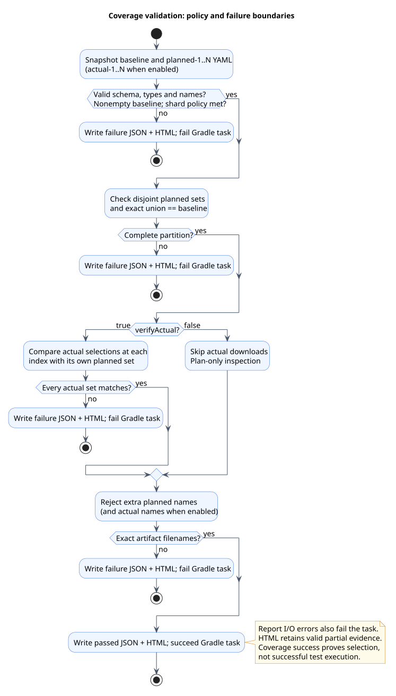
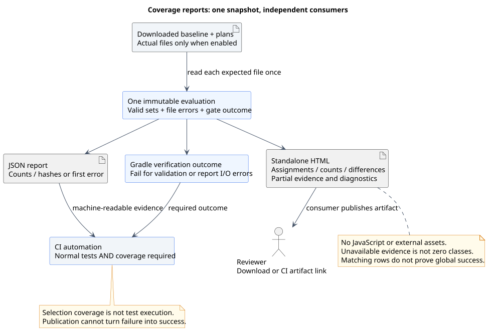

# Class manifests and coverage verification

[Documentation index](README.md) · [Configuration examples](../README.md#optional-class-manifest-verification)

The optional `shardPilot.verification` API records class selection and verifies artifacts collected
from every CI shard. The consumer supplies unsharded eligibility and owns CI scheduling, artifact
transfer and normal test-result gates. The plugin creates no coordinator or helper `Test` tasks.

The task/DSL sections below describe Gradle. Maven uses `prepare`, `select` and `verify` goals,
with the [same YAML/report contract](#manifest-format) and separate per-module `target/` namespaces;
see the [Maven lifecycle guide](maven.md#goals-and-artifact-flow). It derives eligibility from native
runner filters instead of Gradle's explicit `eligibleClasses` tree. Artifact equality describes
candidate selection for one adapter/project/suite, not cross-run provenance or framework execution.

## Tasks and dependencies

For an owning task named `integrationTest`, opting in registers:

| Task | Reads | Writes | Runs tests? |
| --- | --- | --- | --- |
| `prepareIntegrationTestShardManifests` | Unsharded eligible bytecode, roots, history and planned count. | `baseline.yaml` and every `planned-N.yaml`. | No; source-set dependencies compile bytecode. |
| `writeIntegrationTestActualShardManifest` | The owner's actual candidate tree after native and ShardPilot exclusions, plus its execution count/index. | One `actual-N.yaml`. | No; the owning test task depends on this writer. |
| `verifyIntegrationTestShards` | The downloaded baseline, all planned partitions and, by default, all actual selections. | JSON and standalone HTML reports; invalid evidence fails the task. | No; it never schedules compilation, preparation or execution. |

For `test`, the corresponding names are `prepareTestShardManifests`,
`writeTestActualShardManifest` and `verifyTestShards`. Each owning task has its own namespace.


[PlantUML source](diagrams/manifest-tasks.puml)

Register verification once, outside a deferred `TaskProvider.configure`/`tasks.register` action:
realize the owner explicitly, then configure its task extension. See the
[Groovy and Kotlin examples](../README.md#optional-class-manifest-verification). This makes sibling
task names available during selection without creating workers or realizing unrelated test tasks.

`mustRunAfter` orders producers before verification when explicitly requested together locally.
It adds no dependency to an aggregation-only invocation. Missing CI downloads therefore remain
an error instead of being silently replaced by a fresh plan or another test run.

## Configuration reference

| Option | Gradle type | Default / contract |
| --- | --- | --- |
| `eligibleClasses` | `ConfigurableFileCollection` | Required, nonempty unsharded bytecode tree. Include every application file restriction and custom spec. |
| `classDirectories` | `ConfigurableFileCollection` | Owner's `testClassesDirs`; roots for deriving binary names. |
| `shardCount` | `Property<Integer>` | Owner's count; set explicitly for compile/aggregation jobs without CI node properties. |
| `plannedDirectory` | `DirectoryProperty` | `build/shardpilot/<task>/plan`. Task-owned output of preparation. |
| `actualDirectory` | `DirectoryProperty` | `build/shardpilot/<task>/actual`. Download all index-specific actual files here. |
| `reportFile` | `RegularFileProperty` | `build/shardpilot/<task>/coverage.json`. Written on validation success or failure. |
| `htmlReportFile` | `RegularFileProperty` | `build/shardpilot/<task>/coverage.html`. Standalone assignment view, written on validation success or failure. Independent of `reportFile`. |
| `verifyActual` | `Property<Boolean>` | `shardpilot.verifyActual` project property, otherwise `true`. `false` checks only the plan. |
| `requireNonEmptyShards` | `Property<Boolean>` | `true`; opt out explicitly when legitimate empty shards are expected. The baseline must always be nonempty. |

Use distinct output directories for independently planned tasks/projects. Custom layout providers
and paths containing spaces are supported and covered by Configuration Cache tests.

The baseline is explicit rather than inferred from task filename patterns: Gradle does not expose
every custom predicate as a reusable unsharded tree. Reuse the same application eligibility closure
for the owner and `eligibleClasses`. Framework discovery, tags and CLI method filters remain with
Gradle/the test engine and are outside candidate manifests.

## CI artifact flow


[PlantUML source](diagrams/manifest-ci.puml)

1. A compile job prepares one plan using fixed consumer/plugin revisions, eligibility, count and
   timing history. Upload the whole plan directory as an immutable artifact cohort.
2. Each isolated shard uses the same inputs and a different one-based index. The writer runs
   before its test workers. Upload `actual-N.yaml` and normal JUnit/HTML/log evidence, including
   after test failure whenever the job container survives.
3. An aggregation job downloads the same plan and every actual file into their configured
   directories and runs only `verifyIntegrationTestShards`. It inspects evidence every time.
4. CI requires both coverage verification and successful completion of every normal test job.

Keep node-specific artifact names. Do not mix files from different pipelines or reuse a writable
build directory between concurrent shards. A repeated upload of the same index can overwrite a
file; class manifests are not a run-identity or duplicate-job detector. CI owns artifact provenance.

For a plan-only local inspection, run preparation and then:

```shell
./gradlew verifyIntegrationTestShards -Pshardpilot.verifyActual=false
```

Use `gradlew.bat` and quote dotted project-property arguments in PowerShell:

```powershell
.\gradlew.bat verifyIntegrationTestShards '-Pshardpilot.verifyActual=false'
```

Do not set plan-only mode on the final CI coverage gate.

## Manifest format

Manifests are UTF-8 YAML 1.2 documents with exactly two fields. `schemaVersion` is the integer
`1`; `classes` is a sequence of strings. Class names are binary names rather than filenames:
packages use dots and nested names use `$`, without a `.class` extension. There is no required
`IT`, `Test` or `Spec` suffix; default-package and Unicode identifiers are supported. For example:

```yaml
schemaVersion: 1
classes:
  - example.AlphaTest
  - example.AlphaTest$Nested
  - example.BetaSpec
```

Writers emit fields in the order above, sort names and use LF endings. A permitted empty shard
is still a complete YAML document:

```yaml
schemaVersion: 1
classes: []
```

Readers support YAML comments, block/flow sequences, CRLF and a missing final newline. They
require one document, reject duplicate keys, unknown fields and unsupported/noninteger schema
versions, and require every class entry to be a string. Duplicate class names, empty class names,
leading/trailing whitespace in names and malformed identifiers fail rather than being trimmed or
deduplicated. Empty files and missing files/directories cannot stand in for empty shards.

SnakeYAML Engine runs in the plugin classloader and adds no dependency to consumer test JVMs.
Class-looking scalars such as `true` and `null` are quoted when needed to preserve string types.
Regenerate the plan and all actual manifests together when switching from the earlier text format;
the verifier reads `.yaml` files and has no fallback to line-oriented `.txt` manifests.

Binary names are derived from paths relative to compilation roots without loading consumer
classes. Out-of-root paths, non-class candidates and the same binary name in two compilation
outputs fail rather than relying on classpath order.

## Verification and reports



[PlantUML source](diagrams/manifest-validation.puml)

Verification requires pairwise-disjoint planned sets whose union exactly equals the baseline.
When `verifyActual=true`, each actual index must equal its own planned index: comparing only the
union would miss swapped artifacts. Stale/extra `planned-*.yaml` and `actual-*.yaml` names fail;
unrelated metadata files do not count as shards. Plan-only mode does not parse actual downloads.

A successful report has this structure (two single-class shards):

```json
{
  "status": "passed",
  "classes": 2,
  "actualVerified": true,
  "shards": [
    {"index": 1, "classes": 1, "sha256": "0de81b99eaf3f7ac7e906bfb68a32b93c70189e57fbaed220d6982d8b67cccec"},
    {"index": 2, "classes": 1, "sha256": "d39791c54f7aebf80276ff12a9f731c636148df6eb01c0b5aba8120f3715a2b0"}
  ]
}
```

The hashes above describe `example.AlphaTest` and `example.BetaSpec`. Each digest is SHA-256 of
sorted UTF-8 names joined with LF, without a trailing LF. It is a class-selection checksum, not a
bytecode/history/revision checksum. Record order and platform line endings cannot change it.

Invalid evidence produces a failure report before Gradle raises the task error, for example:

```json
{"status":"failed","error":"Missing class manifest: actual-2.yaml"}
```

Invalid names and control characters are JSON-escaped. A failed verification replaces earlier
green JSON and HTML reports; failure to write either report also fails the task. Configure artifact
upload on failure. Report writing is not an atomic multi-file publication: an I/O error can leave
one output incomplete or unchanged, so the task outcome remains authoritative.

### HTML assignment report

`coverage.html` shows the verification outcome, baseline size, per-shard planned/actual counts and
a sorted table of every class found in valid evidence. The table includes baseline membership,
planned shard numbers, actual shard numbers and comparison status. Foreign classes, omitted
classes, overlapping plans and assignments to a different index remain visible when validation fails.
Use the browser's Find command to locate a class; section links lead to the shard summary and table.

JSON and HTML use the same in-memory manifest snapshot. Missing/invalid files are marked
**Unavailable**, not counted as zero classes, and their diagnostics appear below the summary.
Names from invalid files cannot be listed; valid later shards still appear after an earlier failure.
Plan-only mode labels actual evidence **Not checked** and never reads it. Extra indexed filenames
remain a verification error; they are not treated as additional expected shards in the table.

The report is a deterministic UTF-8 file with embedded styles, no JavaScript and no external assets.
All artifact-derived text is HTML-escaped. Download it and open it locally, or publish it through
your CI's normal artifact mechanism. This is a class-selection report, not a JUnit execution report.



[PlantUML source](diagrams/html-report.puml)

### Reading HTML statuses

Start with **Verification: PASSED / FAILED**, then check whether **Actual comparison** is enabled.
`PASSED` in plan-only mode means the planned partition is complete and disjoint; no actual
selection was checked. A successful coverage gate can coexist with failing or skipped test methods.

The **Shard summary** table compares each expected index independently. `Matches` means that
index's two valid sets agree, even if the overall report fails for an overlap, incomplete baseline
coverage or an extra filename. `Differs: M missing, U unexpected` counts differences relative to
that index's plan. `Unavailable` replaces counts when a file cannot be read/validated; a valid
empty set is shown as `0` only when allowed by the configured empty-shard policy.

The **Class assignments** table explains each class found in the baseline or valid shard files:

| Comparison | Meaning / next check |
| --- | --- |
| `Matches` | The class has one planned owner and the same actual owner. The global gate can still fail for other classes/files. |
| `Differs` | The planned and actual index lists differ. Compare the two columns, including swapped-node artifacts. |
| `Outside baseline` | A valid planned or actual file contains a class absent from the valid baseline. Check eligibility and artifact revisions. |
| `Multiple planned shards` | More than one readable planned set includes the class. This is a partition error. |
| `Missing from plan` | The baseline contains the class and the complete readable plan assigns it nowhere. |
| `Evidence unavailable` | A planned file is invalid/missing, or actual evidence required for comparison is incomplete. A match cannot be established. |
| `Baseline unavailable` | Baseline validation failed; the report cannot establish whether the displayed class is eligible. |
| `Not checked` | Actual comparison is disabled. This is local plan inspection, not complete CI evidence. |

`None` in an assignment column means no **valid loaded set** assigns that class. When another
manifest is unavailable, `None` does not prove omission; read the status and file diagnostics.
The table gives one comparison label per class, not an exhaustive list of all possible defects.
Known foreign or multiply assigned classes can still be identified when other evidence is missing.

JSON retains its compact count/hash/error contract. Full class lists belong to the YAML manifests
and HTML; the HTML table does not add those lists to JSON or expose test assertions/results.

## Failure and cache boundaries

- Preparation validates nonempty eligibility, history and count before modifying existing plan
  files. A smaller count removes only numeric `planned-N.yaml` files; unrelated metadata survives.
  I/O failure during writing is a failed task, not an atomic multi-file publication guarantee.
- Eligibility, roots, history and count are preparation inputs. Changed history invalidates its
  previous result; actual selection uses the same parser/planner. Normal Gradle up-to-date/build-cache
  reuse remains possible for exact inputs on preparation and actual-writer tasks.
- Verification always runs and is not build-cacheable. Configuration Cache reuse restores its
  configuration but never substitutes an earlier successful validation for checking current files.
- A recorded actual manifest survives an ordinary test failure. Valid class coverage can coexist
  with failed assertions; skipped methods, framework exclusions and OOM completion are not proven
  by this gate. CI must preserve normal test failures and require every shard.

See [troubleshooting](troubleshooting.md#manifest-verification) and
[test coverage](testing.md#manifest-verification-tests) for failure diagnosis and automated checks.

## Finding a class assignment in GitLab

Open the compile job's artifact browser and inspect `plan/planned-N.yaml`: its `classes` sequence
lists the complete planned selection for node N. Each execution job uploads `actual/actual-N.yaml`
with its real selection. Paths use the configured namespace; defaults are under
`build/shardpilot/<task>/`. `coverage.json` contains counts/hashes, not the complete class lists.

GitLab can store/download YAML through ordinary `artifacts:paths`. Its documented browser preview
formats do not include YAML. Publish `coverage.html` to present the class assignments instead.
Use `artifacts:expose_as` for an MR link. With exactly one file in `artifacts:paths`, that link opens
the file; with multiple paths it opens the artifact browser. Retain JSON in the coverage job and
use a separate lightweight publisher for a direct HTML link, for example:

```yaml
shard-report:
  stage: report # A consumer-defined stage after the coverage job.
  when: always
  needs:
    - job: shard-coverage
      artifacts: true
  script:
    - test -f build/shardpilot/integrationTest/coverage.html
  artifacts:
    expose_as: 'ShardPilot class coverage'
    when: always
    paths:
      - build/shardpilot/integrationTest/coverage.html
```

The coverage job must upload both reports with `when: always`; schedule validation after failed
test nodes too if their surviving evidence should be inspected. Preserve tag/branch/MR rules on
both jobs so the publisher never needs a job omitted by those rules. The publisher only exposes
downloaded HTML; it does not rerun validation or turn a failed gate into a pass.

HTML preview depends on GitLab Pages support; otherwise the file can be downloaded and opened
locally. See [artifact browsing](https://docs.gitlab.com/ci/jobs/job_artifacts/#browse-the-contents-of-the-artifacts-archive)
and [exposed artifact links](https://docs.gitlab.com/ci/jobs/job_artifacts/#link-to-job-artifacts-in-the-merge-request-ui).

For private/internal projects, artifact preview also requires the instance's Pages access-control
configuration. Keep the report under the project's normal artifact permissions: class names and
failure diagnostics are build metadata. Retention and MR visibility are CI settings, not plugin
properties. See [report troubleshooting](troubleshooting.md#html-report-and-gitlab-links).
