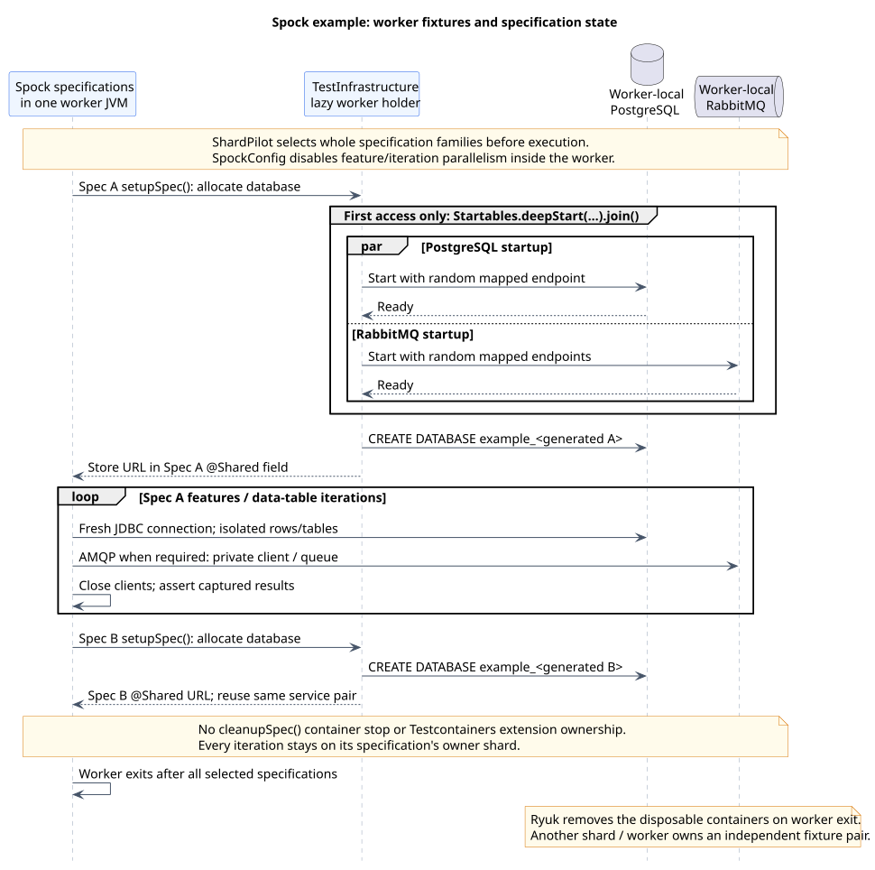

# Spock with PostgreSQL and RabbitMQ

[Documentation index](README.md) · [Runnable example](../examples/spock/testcontainers/README.md)

The [Spock example](../examples/spock/testcontainers/build.gradle) is an independent Groovy consumer
build with four specifications against real PostgreSQL and RabbitMQ. It mirrors the JDBC/AMQP
scenarios in the [JUnit Jupiter example](testcontainers-example.md), but uses Spock fixture methods,
conditions, exception expectations and a two-row data table.

## Build and fixture structure

The example resolves the checkout with `includeBuild('../../..')` and registers its own
`integrationTest` source set and task. It uses Groovy 5.1.3, Spock `2.5-groovy-5.0`, JUnit Platform
6.1.3, Testcontainers 2.0.5, PostgreSQL JDBC 42.7.14 and RabbitMQ client 5.37.0. Spock supplies the test
engine; the Jupiter engine is not required. These dependencies are confined to the example build.

| File or class | Responsibility |
| --- | --- |
| [build.gradle](../examples/spock/testcontainers/build.gradle) | Groovy compilation, Spock engine selection, task registration, sharding and live-test cache policy. |
| [SpockConfig.groovy](../examples/spock/testcontainers/src/integrationTest/resources/SpockConfig.groovy) | Sequential execution inside the worker and individual reporting of table iterations. |
| [TestInfrastructure](../examples/spock/testcontainers/src/integrationTest/groovy/example/shardpilot/TestInfrastructure.groovy) | Lazy worker-local PostgreSQL/RabbitMQ startup and generated databases. |
| [AbstractInfrastructureSpec](../examples/spock/testcontainers/src/integrationTest/groovy/example/shardpilot/AbstractInfrastructureSpec.groovy) | `setupSpec()`, the specification's `@Shared` database URL and feature-owned clients. |
| [IntegrationTestImages](../examples/spock/testcontainers/src/integrationTest/groovy/example/shardpilot/IntegrationTestImages.groovy) | Public image defaults and explicit test-JVM overrides. |
| [Timing history](../examples/spock/testcontainers/integration-test-durations.tsv) | Illustrative specification-level weights, not measured runtimes. |

The task includes concrete outer `*Spec.class` candidates and explicitly excludes the abstract base
from that selection. Otherwise a shard retaining only the abstract helper could fail Gradle's
no-discovered-tests check despite owning no real tests. The base and generated closure classes stay
on the runtime classpath for normal loading; no failure policy is disabled. ShardPilot distributes class families;
it does not need a Spock-specific runner or iteration scheduler.

## Lifecycle and isolation



[PlantUML source](diagrams/spock-testcontainers-lifecycle.puml)

The first `setupSpec()` call accesses the lazy fixture holder. `Startables.deepStart(...).join()`
starts PostgreSQL and RabbitMQ concurrently and waits for both. Subsequent specifications in that
worker reuse the running pair, while each `setupSpec()` allocates a new database. Only internally
generated, validated database names enter DDL on the disposable PostgreSQL instance.

The database URL is `@Shared` because features and data-table iterations have separate Spock
instances. Connections and channels are not shared: `withCloseable` closes them before assertions
on captured results. Server-named exclusive queues disappear when their connection closes; the
routing feature removes its own generated exchange. Features use separate tables, and table
iterations use distinct row codes rather than relying on execution order.

Do not add a `cleanupSpec()` that stops these shared containers, an `@AutoCleanup` container field
or the Testcontainers Spock extension to this holder pattern. Those would introduce the wrong
lifecycle owner for infrastructure used by later specifications. Ryuk removes the containers on
worker termination; reusable cross-run containers are not enabled. This differs from a perfectly
valid **specification-owned** `@Shared` container managed by the Testcontainers Spock extension.
See [Testcontainers' Spock integration](https://java.testcontainers.org/test_framework_integration/spock/)
and [manual singleton lifecycle](https://java.testcontainers.org/test_framework_integration/manual_lifecycle_control/).

`maxParallelForks = 1`, `forkEvery = 0` and `runner.parallel.enabled = false` retain sequential
features within one long-lived worker. Additional CI shards/workers get their own container pair;
static holders are not shared across JVMs. Jupiter's parallelism property is not a substitute for
Spock's own configuration. No retry extension or no-Docker skip condition is installed.

## Run the example

Use the parent Wrapper from the ShardPilot repository root, a compatible JDK and a working Docker
runtime. The code targets Java 17 bytecode; the [verified runtime scope](testing.md#verified-scope)
still applies. Uncached dependencies and images require Maven Central/registry access.

Full suite:

```shell
./gradlew -p examples/spock/testcontainers check -Pshardpilot.count=1 -Pshardpilot.index=1
```

Two isolated CI jobs, or two **sequential** local invocations:

```shell
./gradlew -p examples/spock/testcontainers integrationTest -Pshardpilot.count=2 -Pshardpilot.index=1
./gradlew -p examples/spock/testcontainers integrationTest -Pshardpilot.count=2 -Pshardpilot.index=2
```

PowerShell:

```powershell
.\gradlew.bat -p examples/spock/testcontainers check '-Pshardpilot.count=1' '-Pshardpilot.index=1'
.\gradlew.bat -p examples/spock/testcontainers integrationTest '-Pshardpilot.count=2' '-Pshardpilot.index=1'
.\gradlew.bat -p examples/spock/testcontainers integrationTest '-Pshardpilot.count=2' '-Pshardpilot.index=2'
```

For compilation without Docker, use `./gradlew -p examples/spock/testcontainers integrationTestClasses`.
Only the example's `check` depends on these tests; the parent plugin build remains Docker-independent.

## Specification ownership and test data

| Specification | Scenarios |
| --- | --- |
| `PostgresRoundTripSpec` | Two table iterations for JDBC round-trip, plus an independent aggregation feature. |
| `PostgresTransactionSpec` | Rollback and visibility of committed rows from another connection. |
| `RabbitRoutingSpec` | Direct routing and explicit negative-acknowledgment redelivery. |
| `MessagePersistenceSpec` | Persistence before acknowledgment and duplicate-key rejection through `thrown(SQLException)`. |

Both rows of the `where:` table stay on the owner of `PostgresRoundTripSpec`. Individual iteration
reporting does not make them independently shardable. Supply a weight for the specification's total
work, not one record per feature label or table row.
The eight feature definitions produce nine reported test cases because the table feature has two iterations.

With the supplied illustrative weights, two shards own:

| Index | Specifications | Illustrative load |
| --- | --- | --- |
| 1 | `PostgresRoundTripSpec`, `MessagePersistenceSpec` (five cases) | 14 + 6 = 20 seconds |
| 2 | `PostgresTransactionSpec`, `RabbitRoutingSpec` (four cases) | 10 + 8 = 18 seconds |

These are assignment examples, not timing measurements or promised speedups. Use the same plugin
revision, specification selection, history snapshot and count in all jobs. Container startup/image
pull costs are outside the recorded weights. The plugin does not update history automatically.

The persistence feature is not an atomic broker/database transaction or a production inbox. A crash
between commit and acknowledgment can redeliver; production consumers still need idempotency. The
negative acknowledgment in the routing spec tests broker semantics, not a failed-test retry.

## Images, cache and reports

Defaults match the Jupiter example: `postgres:18-alpine` and `rabbitmq:4.3.6-management-alpine`.
The PostgreSQL major tag can move; use a verified digest when immutable image contents are required.
Override compatible images through `-Pexample.postgresImage=...` and `-Pexample.rabbitmqImage=...`,
using identical values across all shards and quoting each dotted property in PowerShell.

Up-to-date/build-cache reuse is disabled for the live integration task. Configuration-cache reuse
remains enabled and must not be confused with reusing old test results. An empty shard may have
no test worker and therefore no containers.

JUnit XML and HTML reports live under `examples/spock/testcontainers/build/test-results/integrationTest/`
and `examples/spock/testcontainers/build/reports/tests/integrationTest/`. Keep each shard's artifacts
separately: sequential invocations replace the task's reports. Compare the full unsharded result set
with the union of shard results, including table iteration identities, and check for duplicates.
Use separate writable workspaces for concurrent jobs. See [CI integration](ci.md).

## Spock references

- [Spock primer](https://spockframework.org/spock/docs/2.5/spock_primer.html): fixture methods, shared state and conditions.
- [Data-driven testing](https://spockframework.org/spock/docs/2.5/data_driven_testing.html): table iterations and reporting.
- [Spock reference](https://spockframework.org/spock/docs/2.5/all_in_one.html#_parallel_execution): framework parallel execution.
