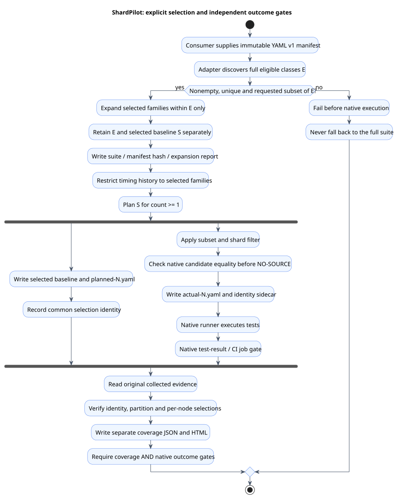

# Explicit test selection

[Documentation index](README.md)

An optional consumer-owned YAML manifest selects a class subset **before** shard assignment.
It applies with one node as well as multiple nodes. ShardPilot does not inspect source diffs,
choose smoke tests, infer impacted classes or decide whether a short suite is sufficient.
Keep those decisions and the independent native test-result gate in the consumer/CI.
This feature is prepared for **0.5.0, not yet published**. Try the Docker-free
[Gradle](../examples/gradle/junit-jupiter/test-selection/README.md) and
[Maven](../examples/maven/test-selection/README.md) consumers against this checkout.



[PlantUML source](diagrams/test-selection.puml)

## Manifest and validation

Use the existing strict [class-manifest v1 schema](shard-verification.md):

```yaml
schemaVersion: 1
classes:
  - example.AlphaTest$Nested
  - example.BetaTest
```

Supply binary names, including `$` for nested classes. Empty selections, duplicate names/keys,
unsupported schemas, unknown fields, invalid names and names outside full eligibility fail the
build. Missing/unreadable input also fails. There is no fallback to all tests on invalid input.
Choose full execution explicitly by omitting selection configuration.

The adapter first establishes full eligibility **E** using the consumer's discovery rules.
Every requested name must be in E. Selecting one eligible family member includes every eligible
member with the same outer name before the first `$`. Expansion never introduces a class outside
E: an excluded outer class is not invented when only a nested class is eligible. The resulting
set **S** is the planning/coverage baseline; E remains a separate legality baseline.

History is restricted to selected families before balancing, so an unselected expensive class
cannot occupy a bin. Without recorded timings, the existing deterministic hash fallback applies.
If there are fewer selected families than shards, reduce the count or explicitly allow empty
partitions in verification. Selection never changes native failure handling or retry settings.

## Gradle: Groovy DSL

Configure the sibling tasks outside deferred `tasks.named(...).configure` actions, as with
`verification` and `history`. Establish E independently; do not feed the filtered
`test.candidateClassFiles` back into `selection.eligibleClasses`.

```groovy
test {
    useJUnitPlatform()
    shardPilot {
        enabled = true
        durationsFile = layout.projectDirectory.file('durations.tsv')
    }
}
def eligible = sourceSets.test.output.classesDirs.asFileTree.matching {
    include '**/*Test.class', '**/*Test$*.class'
}
def pilot = tasks.named('test', Test).get().shardPilot
pilot.selection {
    manifestFile = layout.projectDirectory.file('selection.yaml')
    suite = 'smoke'
    eligibleClasses.from(eligible)
}
pilot.verification { eligibleClasses.from(eligible) }
```

Adapt the class patterns to the actual task; the example is a Jupiter convention, not a built-in
ShardPilot naming rule. `selection.classDirectories` defaults to `test.testClassesDirs`.
Configure selection once per task. Both `manifestFile` and `suite` are required; `enabled` must
remain true. Suite names are single safe path components, starting with an ASCII letter/digit,
followed by letters, digits, `.`, `_` or `-`; `full` is reserved case-insensitively.

`prepareTestSelection` validates the manifest and writes E, S and selection diagnostics.
The owning test and optional plan/actual producers depend on that snapshot. Source-set dependencies
compile eligible bytecode. The test excludes classes outside S even when `shardCount=1`.
`validateTestSelection` checks exact candidate equality before Gradle's `NO-SOURCE` shortcut;
native exclusions cannot silently skip the entire selected suite.
Selection can be used without `verification`; normal test failure handling still applies.
Enable verification to retain/aggregate candidate evidence across CI jobs.

```shell
./gradlew prepareTestShardManifests -Pshardpilot.count=2
./gradlew test -Pshardpilot.count=2 -Pshardpilot.index=1
./gradlew test -Pshardpilot.count=2 -Pshardpilot.index=2
./gradlew verifyTestShards -Pshardpilot.count=2
```

Use the same count, manifest bytes, full eligibility, suite and history on every job. Download the
original plan and every actual artifact before the final command. Verification alone does not
compile, generate a plan, validate a new selection or run tests. It checks the downloaded cohort.

The manifest contents, cohort identity and selected snapshot participate in task fingerprints.
A changed manifest at the same path invalidates the selection/test cache; even comment-only changes
change provenance. Strict Configuration Cache is supported. Existing behavior is preserved when
`selection` is absent.

## Gradle: Kotlin DSL

```kotlin
import io.github.sjacek.shardpilot.ShardPilotExtension

tasks.test { useJUnitPlatform() }
val eligible = sourceSets["test"].output.classesDirs.asFileTree.matching {
    include("**/*Test.class", "**/*Test\$*.class")
}
val pilot = tasks.test.get().extensions.getByType<ShardPilotExtension>()
pilot.enabled.set(true)
pilot.selection {
    manifestFile.set(layout.projectDirectory.file("selection.yaml"))
    suite.set("smoke")
    eligibleClasses.from(eligible)
}
pilot.verification { eligibleClasses.from(eligible) }
```

## Maven: Surefire and Failsafe

Keep native runner wiring explicit. This Surefire fragment adds selection to the
[complete Maven configuration](maven.md); use the checkout's existing plugin version.

```xml
<plugin>
  <groupId>io.github.sjacek</groupId>
  <artifactId>shardpilot-maven-plugin</artifactId>
  <version>${shardpilot.version}</version>
  <configuration>
    <selectionManifestFile>${project.basedir}/selection.yaml</selectionManifestFile>
    <selectionSuite>smoke</selectionSuite>
  </configuration>
  <executions><execution><id>select</id><goals><goal>select</goal></goals></execution></executions>
</plugin>
<plugin>
  <groupId>org.apache.maven.plugins</groupId>
  <artifactId>maven-surefire-plugin</artifactId>
  <version>3.5.4</version>
  <configuration>
    <excludesFile>${project.build.directory}/shardpilot/unit/selections/smoke/excludes.txt</excludesFile>
    <reportsDirectory>${project.build.directory}/shardpilot/unit/selections/smoke/test-results/${shardpilot.index}</reportsDirectory>
  </configuration>
</plugin>
```

Define `${shardpilot.version}` and a default `${shardpilot.index}` in the consumer POM. The equivalent
CLI inputs are `-Dshardpilot.selectionManifestFile=selection.yaml` and
`-Dshardpilot.selectionSuite=smoke`; pass them consistently to every goal when not configured in
the POM. A suite without a manifest, or a manifest without a valid selection suite, fails.

```shell
./mvnw test-compile shardpilot:prepare -Dshardpilot.count=2
./mvnw test -Dshardpilot.count=2 -Dshardpilot.index=1
./mvnw test -Dshardpilot.count=2 -Dshardpilot.index=2
./mvnw shardpilot:verify -Dshardpilot.count=2
```

For Failsafe, set `<runner>FAILSAFE</runner>`, use the `integration` namespace, wire the same
selection-specific exclusions and native report directory, and retain both `integration-test`
and `verify` bindings. Execute the Maven `verify` lifecycle for each node, then aggregate with
`shardpilot:verify`. The generated report directory must be below the effective selection
namespace's `test-results/`; default full-suite Surefire/Failsafe report locations are rejected.

Eligibility still uses the effective native class includes/excludes and maintained pattern files.
Surefire/Failsafe normally exclude nested class candidates; Jupiter can execute nested tests through
their selected owner. A nested binary name can appear in the request only if the consumer's native
rules make it eligible. The Invoker fixtures also exercise explicit eligible nested families.

## Filters and evidence boundaries

- Gradle rejects `--tests` and `TestFilter` include/exclude patterns with explicit selection.
  Native file discovery must match E; a class filter that narrows the selected candidates causes
  failure before the test worker. Keep class discovery restrictions in the eligibility definition.
- Maven retains its existing rejection of focused `-Dtest`/`-Dit.test`, method patterns, unsupported
  discovery sources, skip flags and overriding native include/exclude file properties.
- Framework tags, disabled tests and engine discovery remain native behavior. Candidate evidence
  cannot prove that all selected methods ran or passed. Require native XML/results and every CI job.
- The manifest must be immutable for one run. Do not generate or update it while nodes execute.
  Aggregation rejects different cohort identities even when the candidate class sets are equal.

## Separate artifacts and reports

Default Gradle root: `build/shardpilot/<task>/selections/<suite>/`.
Default Maven root: `target/shardpilot/<runner-suite>/selections/<selectionSuite>/`.

| Artifact | Meaning |
| --- | --- |
| `selection/eligible.yaml` | Complete legality baseline E. |
| `selection/selected.yaml` | Expanded selection S. |
| `selection/selection.json`, `selection/selection.html` | Separate selection diagnostics: suite, exact manifest SHA-256, full/requested/selected counts, added family members, measured families and estimated seconds. |
| `selection/selection.id` | SHA-256 identity binding suite, manifest bytes, full eligibility, history and shard count. |
| `plan/baseline.yaml`, `plan/planned-N.yaml` | Selected baseline S and its partition, using unchanged class-manifest v1. |
| `plan/selection.id`, `actual/selection-N.id` | Matching identities required for every selected node. Collect these sidecars with YAML artifacts. |
| `actual/actual-N.yaml` | Pre-worker candidate class selection; retained after native test failure. |
| `coverage.json`, `coverage.html` | Existing partition and plan/actual gate, now applied to S; mismatches report missing/unexpected classes or cohort identity failures. |
| `test-results/`, Gradle `test-report/` | Native execution reports isolated from full-suite outputs. Maven requires explicit native wiring. |

Estimated time includes recorded selected-family durations only. It excludes unmeasured tests,
JVM startup, Spring/application startup and containers; it is not a wall-clock prediction.
Invalid parsed selections replace selection diagnostics with failed reports and remove the reusable
selected snapshot. Build-tool input validation failures (for example a missing Gradle input file)
can occur before the report action; task/job status is authoritative.

Gradle verification path overrides are also namespaced: `<parent>/<name>` becomes
`<parent>/selections/<suite>/<name>`. Maven directory overrides gain `selections/<selectionSuite>/`;
explicit report/exclusion file overrides insert that namespace before the filename. Configure
Maven's native `excludesFile` to the resulting effective path. Do not pre-append the selection
namespace to ShardPilot's override values. The normal full-suite paths remain unchanged.
Consumer overrides of Gradle's native report directories remain consumer-owned; keep them distinct.

Run selection and full suites in separate CI workspaces, or use distinct native report paths for
each concurrent invocation. Suite namespaces prevent full/selected artifact collisions; they do
not allow independent build processes to share the same compiler/test output directory safely.
Do not replace a full-suite maintained history automatically with a candidate pruned to S.

## Verification in this repository

Core tests cover strict validation, family expansion bounded by E, selected-only history, cohort
hash changes, report replacement, input aliases and one/many-node partition completeness.
Gradle TestKit checks Groovy/Kotlin DSL, actual JUnit methods, Configuration Cache, build-cache input
invalidation, path isolation, focused-filter rejection, standalone aggregation and native failures.
Maven unit tests cover effective wiring and invalid configurations. The `selection-*` Invoker
fixtures run real Surefire and Failsafe executions with one and two nodes, nested families,
unknown/empty selections and retained evidence from intentional native failures.

```shell
./gradlew check assemble
./mvnw -B -ntp verify
```
