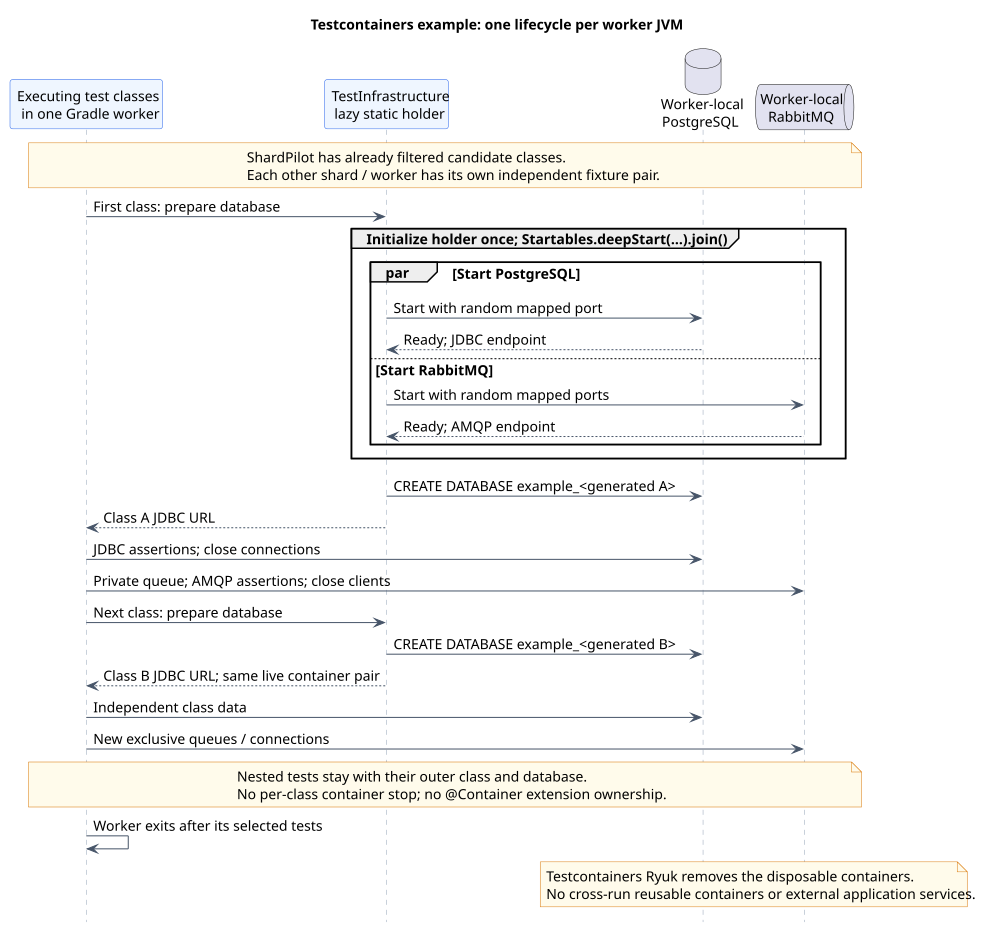

# PostgreSQL and RabbitMQ example

[Documentation index](README.md) · [Runnable example](../examples/testcontainers/README.md)

The [standalone example build](../examples/testcontainers/build.gradle) runs four integration-test
classes against real PostgreSQL and RabbitMQ containers. ShardPilot distributes the classes;
the test fixtures own container startup, data isolation and cleanup. No application server,
Spring context or external database/broker deployment is needed.

The fixture follows a worker-local infrastructure pattern: shared static service containers start
together through `Startables.deepStart(...).join()`, and test classes receive isolated databases.
For this framework-neutral example, the database boundary is a concrete JUnit class rather than a
Spring context cache key. Broker clients use endpoints from the running container and private queues.

## Requirements and layout

Use the parent Gradle Wrapper with a compatible JDK and a working Docker-compatible runtime.
The example targets Java 17 bytecode; the parent build's [verified runtime](testing.md#verified-scope)
still applies. Maven Central and the configured image registry must be reachable for uncached
dependencies/images. Missing Docker fails the integration tests instead of skipping them.

The example consumes the plugin using `includeBuild('../..')` in its own settings. It is not
included as a subproject in the plugin build, and does not depend on an unpublished Portal version.
The example creates its own `integrationTest` source set, task and `check` dependency. Those are
consumer choices, not behavior added by ShardPilot.

| File or class | Role |
| --- | --- |
| [build.gradle](../examples/testcontainers/build.gradle) | Dependencies, integration task, sharding opt-in, sequential workers and live-test cache policy. |
| [IntegrationTestImages](../examples/testcontainers/src/integrationTest/java/example/shardpilot/IntegrationTestImages.java) | Central defaults and explicit image overrides. |
| [TestInfrastructure](../examples/testcontainers/src/integrationTest/java/example/shardpilot/TestInfrastructure.java) | Lazy worker-local containers, parallel startup and generated databases. |
| [AbstractInfrastructureIT](../examples/testcontainers/src/integrationTest/java/example/shardpilot/AbstractInfrastructureIT.java) | Database per class, client factories and bounded message polling. |
| [Timing history](../examples/testcontainers/integration-test-durations.tsv) | Illustrative weights for a predictable two-shard demonstration. |

Dependencies include JUnit Jupiter 6.1.3, Testcontainers 2.0.5, PostgreSQL JDBC 42.7.14 and RabbitMQ
Java client 5.37.0. They belong to the example, not the published plugin's runtime. The tests exercise
JDBC/AMQP directly so container lifecycle remains visible without an application framework.

## Container lifecycle and isolation



[PlantUML source](diagrams/testcontainers-lifecycle.puml)

The first executing class calls the fixture and initializes its lazy static holder. PostgreSQL and
RabbitMQ start concurrently; initialization waits for both. Later classes in that worker use the
same running pair. Compiling the example does not start containers.

The fixture does not use `@Testcontainers`/`@Container`, because class-scoped extension teardown
would be the wrong owner for this shared suite infrastructure. Clients and channels are closed by
each test, and the normal Testcontainers Ryuk resource reaper removes the containers when the
worker exits. Cross-run reusable containers are not enabled. Keep Ryuk enabled for this example.
See Testcontainers' [singleton lifecycle documentation](https://java.testcontainers.org/test_framework_integration/manual_lifecycle_control/).

Each concrete class gets a generated database inside the disposable worker-owned PostgreSQL
container. Only a validated, internally generated identifier enters `CREATE DATABASE`; credentials
and URLs are never read from a real application datasource. The nested test shares its outer class's
database and shard. Methods use separate tables, so their order does not affect assertions.

RabbitMQ queues are server-named, exclusive and auto-deleted with their connection. The routing
test also creates and removes its own exchange. No test purges a global queue or assumes fixed host
ports. Publisher confirms and bounded polling handle broker delivery without a fixed startup sleep.

The task fixes `maxParallelForks = 1`, `forkEvery = 0` and disables JUnit method parallelism. One
active worker therefore uses one container pair across its classes. Each additional shard/job or
worker gets a separate pair; static fields are not shared between JVMs. Repeated sequential Gradle
invocations also start new workers and new fixtures. JVM reuse is not Docker cross-run reuse.

## Run the full suite

From the ShardPilot repository root:

```shell
./gradlew -p examples/testcontainers integrationTest -Pshardpilot.count=1 -Pshardpilot.index=1
```

PowerShell:

```powershell
.\gradlew.bat -p examples/testcontainers integrationTest '-Pshardpilot.count=1' '-Pshardpilot.index=1'
```

Quote dotted `-P` arguments when invoking the batch launcher from PowerShell. Without explicit
count/index values, both default to 1 unless another Gradle property source changes them.

The suite contains eight test cases across four outer class families:

| Class | Scenario |
| --- | --- |
| `PostgresRoundTripIT` and its nested `Totals` | Committed data round-trip and numeric aggregation. |
| `PostgresTransactionIT` | Rollback and visibility of committed rows to another connection. |
| `RabbitRoutingIT` | Direct exchange routing and explicit negative-acknowledgment redelivery. |
| `MessagePersistenceIT` | Persist a received event before acknowledgment and reject duplicate identifiers. |

The persistence scenario is a small demonstration, not an atomic database/broker transaction or a
complete outbox/inbox implementation. Redelivery is requested by the RabbitMQ test itself; ShardPilot
does not retry failed tests or change their failure policy.

For compilation only, without starting Docker:

```shell
./gradlew -p examples/testcontainers integrationTestClasses
```

`./gradlew -p examples/testcontainers check` includes the Docker-backed tests. The parent plugin's
plain `./gradlew check` deliberately does not.

## Run two shards

Use separate CI workspaces, or run these commands **sequentially** in a single local checkout:

```shell
./gradlew -p examples/testcontainers integrationTest -Pshardpilot.count=2 -Pshardpilot.index=1
./gradlew -p examples/testcontainers integrationTest -Pshardpilot.count=2 -Pshardpilot.index=2
```

PowerShell:

```powershell
.\gradlew.bat -p examples/testcontainers integrationTest '-Pshardpilot.count=2' '-Pshardpilot.index=1'
.\gradlew.bat -p examples/testcontainers integrationTest '-Pshardpilot.count=2' '-Pshardpilot.index=2'
```

The supplied TSV contains **illustrative, not measured** seconds. Nested weights are added to the
outer family. For count 2, the deterministic plan is:

| Index | Outer class families | Illustrative load |
| --- | --- | --- |
| 1 | `PostgresRoundTripIT` including `Totals`, `MessagePersistenceIT` | 12 + 2 + 6 = 20 seconds |
| 2 | `PostgresTransactionIT`, `RabbitRoutingIT` | 10 + 8 = 18 seconds |

These numbers are not expected job durations or a speedup measurement. Container startup, image
pulls and per-worker overhead matter especially for such a small suite. Replace the sample weights
with representative measurements for a real project, using the same snapshot in every shard.
ShardPilot does not generate or update that history.

The example disables up-to-date reuse and build-cache reuse for its integration task, so successful
invocations exercise current containers rather than reuse old test reports. Configuration-cache
reuse remains enabled and is a separate concern. A legitimately empty shard need not launch a worker
or any containers; do not turn that into a requirement that every shard have work.

## Images and reports

Default images are `postgres:18-alpine` and `rabbitmq:4.3.6-management-alpine`. PostgreSQL's major tag
can change its patch contents; pin a verified digest when immutable CI images are required. To select
other compatible public versions, pass explicit properties, for example:

```shell
./gradlew -p examples/testcontainers integrationTest -Pexample.postgresImage=postgres:18.6-alpine -Pexample.rabbitmqImage=rabbitmq:4.3.6-management-alpine
```

Use the same overrides in every shard and quote each `-P...` argument in PowerShell. The build
forwards these properties to the test JVM; the plugin does not manage images. Registry mirrors and
alternate runtimes remain standard Testcontainers configuration. Do not disable runtime checks or
Ryuk to make an unavailable Docker setup appear successful.

Reports are under `examples/testcontainers/build/test-results/integrationTest/` and
`examples/testcontainers/build/reports/tests/integrationTest/`. Sequential runs replace that task's
reports, so retain each run's artifacts separately when comparing the baseline with both shards.
The union of shard results should equal the baseline, with no repeated test cases. One successful
shard alone is not complete-suite verification.

For parallel CI execution, budget for one PostgreSQL and one RabbitMQ container per active worker,
plus Testcontainers cleanup infrastructure. Do not reuse a writable build directory between jobs,
and avoid hard-coded service names/ports. See [CI integration](ci.md) for matrix and artifact rules.

## Testcontainers references

- [PostgreSQL module](https://java.testcontainers.org/modules/databases/postgres/), including the separate JDBC driver requirement.
- [RabbitMQ module](https://java.testcontainers.org/modules/rabbitmq/).
- [Manual and singleton lifecycle](https://java.testcontainers.org/test_framework_integration/manual_lifecycle_control/).
- [Networking and mapped ports](https://java.testcontainers.org/features/networking/).
