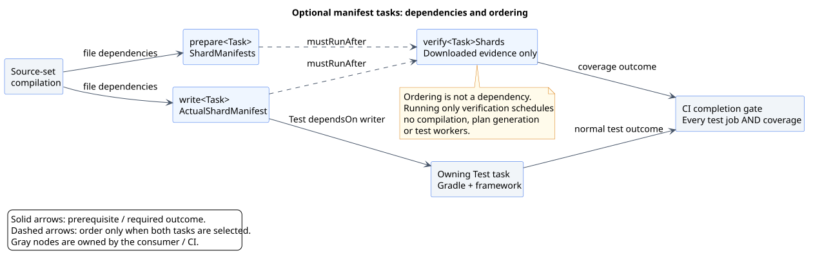

# Testing and compatibility

[Documentation index](README.md)

Run checks from the ShardPilot repository, not a consuming application's build. The Wrapper pins
the Gradle version; use a JDK supported by that Gradle runtime.

## Local verification

```shell
./gradlew check assemble
./mvnw -B -ntp verify
```

PowerShell:

```powershell
.\gradlew.bat check assemble
.\mvnw.cmd -B -ntp verify
```

Root Gradle `check` runs the shared-core and Gradle-adapter suites plus plugin validation.
Root Maven `verify` builds the same core and Maven adapter, then runs isolated native-runner
Invoker fixtures and runnable Maven examples. `assemble` builds the Gradle plugin, sources and
Javadoc artifacts. Functional tests use Gradle TestKit and temporary consumer builds, so the first
run needs Maven Central access for fixture dependencies. Keep TestKit execution sequential: nested
Gradle daemons and workers consume additional memory beyond the outer test worker.

For a focused iteration:

```shell
./gradlew :shardpilot-core:test --tests 'io.github.sjacek.shardpilot.ShardPlanTest'
./gradlew :shardpilot-gradle-plugin:test --tests 'io.github.sjacek.shardpilot.ShardPilotFunctionalTest'
./gradlew :shardpilot-core:test --tests 'io.github.sjacek.shardpilot.ClassManifestTest' --tests 'io.github.sjacek.shardpilot.ShardCoverageTest'
./gradlew :shardpilot-gradle-plugin:test --tests 'io.github.sjacek.shardpilot.HistoryRefreshExampleFunctionalTest' --tests 'io.github.sjacek.shardpilot.HistoryRefreshCiExamplesTest'
./mvnw -B -ntp verify -Dinvoker.test=junit-jupiter
```

The plugin's own test task is not configured to shard itself. These selectors run normal Gradle
tests. Run the complete `check assemble` before handing off a change.

The focused Maven command still runs core/adapter unit tests, but only the selected Jupiter
Invoker example. Its two native suites cover Surefire and Failsafe; it excludes the other
native fixtures and reactor example. Use full Maven `verify` for shared-core/Maven release checks.

Gradle reports live under each source module's `build/reports/tests/test/index.html` and
`build/test-results/test/`; distribution JARs are under `shardpilot-gradle-plugin/build/libs/`.
Maven unit reports are under each module's `target/surefire-reports`; Invoker logs and results are
under `shardpilot-maven-plugin/target/it`, `target/examples` and `target/invoker-reports`.
TestKit fixtures retain strict configuration-cache settings so unsupported captures
fail instead of being reduced to warnings.

## Test responsibilities

TestKit verifies that optional process configuration leaves untouched settings intact and works
with sharding disabled. Real worker probes check heap limits, sequential reuse, class-boundary
replacement, and two concurrent processes. The probes execute again after strict configuration-cache
restoration and verify invalidation when only the replacement limit changes. Groovy/provider and
Kotlin DSL configuration, invalid values and fatal test failures are covered. These small fixtures
do not reproduce an application's memory leak or prove that a configured heap prevents OOM.

| Test class | Behavior covered |
| --- | --- |
| `DurationHistoryTest` | Comments, blank lines, CRLF, nested names, immutable results, malformed metadata and safe error messages. |
| `JUnitXmlTimingsTest` | Secure suite/testcase metadata parsing, executed nested cases with zero header counts, retry/ambiguity markers, repeated paths and incomplete-read evidence. |
| `DurationHistoryRefreshTest` | Complete/disjoint/inclusive family normalization, duplicate policy, pruning, retained/replaced/dropped records, floor/rounding and coverage failures. |
| `HistoryRefreshFunctionalTest` | Real Gradle opt-in tasks, source precedence, both DSLs, no producer scheduling, failed artifacts, Configuration Cache/build cache and history-driven plan changes. |
| `HistoryRefreshExampleFunctionalTest` | Actual documented consumer sources, disjoint native nodes/nested methods, YAML/HTML, immutable history, cache reuse, missing-node XML rejection and deterministic recovery. |
| `HistoryRefreshCiExamplesTest` | Parsed Gradle/Maven GitLab examples retain every native gate, index their extracted XML paths, download all dependencies and keep producer-free aggregation/report namespaces separate. |
| `RefreshDurationsMojoTest`, `RefreshDurationsEvidenceTest`, `RefreshDurationsDescriptorTest` | Maven defaults, descriptor without lifecycle forks, project isolation, eligibility, conservative measurements, output/input protection and safe failure/I/O evidence. |
| `ShardPlanTest` | Deterministic packing/ties, nested aggregation, floating-point order, hash fallback, complete ownership, invalid settings and overflow. |
| `ClassManifestTest` | Canonical YAML round trips, schema/types/duplicate keys, CRLF/comments/flow sequences, nested/Unicode/default-package names, root normalization, collisions, empty-class policy and malformed-document rejection. |
| `ShardCoverageTest` | Complete/disjoint/index-matching evidence, canonical hashes, empty policy, missing/stale/duplicate/foreign records, plan-only mode and JSON escaping. |
| `ShardCoverageHtmlTest` | Sorted class assignments, wrong-node differences, partial evidence, plan-only labels, empty shards, Unicode/HTML escaping and a shared JSON/HTML snapshot with defensively copied public collections. |
| `ShardManifestsTest` | Shared preparation/selection across input orders, family ownership with empty partitions, preserved plans after invalid inputs, selective index cleanup, normalized report-path collisions and partial I/O failures. |
| `ShardPilotFunctionalTest` | Real Gradle tasks with Jupiter/Spock/native TestNG, weighted/hash-only partitions, provider-row ownership, opt-in, filters, custom tasks, empty results, fatal setup failures, Kotlin DSL, actual Gradle/JDK runtimes and configuration-cache reuse. |
| `NormalizeSvgTest` | Standalone preview normalization, text/geometry/link preservation, XML input safety, idempotence and committed SVG compatibility checks. |
| `ReleaseTagVerificationTest` | Actual Gradle guard script, stable/malformed/missing/mismatched tags, evaluated build versions and strict configuration-cache reuse. |
| `PublicationWorkflowTest` | Parsed YAML, complete matrix dependency gating, immutable checkout SHA, required jobs, credential isolation and disabled publisher caches. |
| `MavenAdapterTest` | Relative pattern files/regex, immutable effective-model merging, native Surefire/Failsafe eligibility, generated-output isolation, metadata exclusion, empty selections, safe wiring, property-origin/bypass rejection, preserved preparation evidence and selection/report I/O failures. |

Functional partition checks compare the union of shard results to an unsharded baseline and check
for duplicates. Configuration-cache checks reuse a build, then change timing contents to verify
that old test results are not accepted as unchanged. Empty-shard checks also guard against retaining
another shard's report files when rerunning a task sequentially in a fixture.

## Manifest verification tests

TestKit exercises the full artifact boundary with real compiled Jupiter/Spock fixtures and strict
Configuration Cache. The manifest scenarios cover:

- Native include/exclude patterns and custom file specs, with no helper `Test` task.
- Actual evidence written before normal execution and retained after a deliberately failed test.
  Selection verification can still pass, proving why CI needs both outcome gates.
- Reused configuration and unchanged-input up-to-date preparation, followed by a history change
  that changes the plan and is reflected in actual selections.
- Malformed history, zero count and empty eligibility failing before touching a previous valid plan.
- Count reduction removing numeric planned files while preserving unrelated metadata.
- Standalone aggregation failing for missing downloads without compiling, rerunning tests or
  replacing evidence; failed validation overwrites earlier green JSON and HTML reports.
- Groovy/Kotlin DSL, an explicitly realized lazy owner, custom output paths containing spaces and
  combined local producer/verification invocations with ordering rather than hidden dependencies.
- Standalone HTML on success and missing/mismatched evidence, including a separately configured
  HTML path restored through Configuration Cache.
- Coincident JSON/HTML output paths rejected without scheduling producers or serializing coverage.
  Gradle owns output cleanup; the core separately proves rejection before touching existing reports.
- Two owning tasks with independent cohorts through Configuration Cache reuse; corrupting one
  actual selection fails only that gate and leaves the other task's valid report/evidence intact.



The [manifest guide](shard-verification.md) defines file and report contracts. Its hashes describe
candidate-name sets rather than test outcomes, bytecode or artifact provenance.

## Maven integration fixtures

`./mvnw verify` uses Maven Invoker with an isolated repository, installing only test copies of
the candidate parent/core/plugin there. No global candidate installation or remote publication
is needed. Hook scripts parse YAML and native JUnit XML rather than trusting log counts alone.

- The [Jupiter POM](../examples/maven/junit-jupiter/pom.xml) prepares separate unit/integration plans,
  runs two nodes through real Surefire/Failsafe, checks nested methods and a custom `Spec` suffix,
  preserves a deliberately failing consumer exclusion and verifies both JSON/HTML reports.
- The [reactor POM](../examples/maven/reactor/pom.xml) runs two modules with `-T2`; identical class
  names remain isolated by module and each receives a complete/disjoint two-node partition.
- Negative fixtures prove rejection of focused class overrides, missing evidence with failure
  reports, actual evidence surviving a failed assertion, and a deny-all empty shard that cannot
  fall back to default Surefire selection.
- The custom-suite fixture runs two native nodes with a relative includes file, maintained
  exclusions, nested Jupiter methods, weighted history, paths containing spaces and independent
  JSON/HTML overrides. Failing sentinel tests detect accidental widening to native defaults or
  loss of consumer exclusions. YAML and native XML assert exact ownership and unique method execution.

Gradle TestKit also loads only the shipped Gradle JAR and SnakeYAML runtime to exercise shared
planning/verification, excluding development core-output paths. This guards distribution compatibility
after extraction, in addition to the existing Groovy/Kotlin DSL and Configuration Cache checks.

## History-refresh integration coverage

The Maven `refresh-surefire` and `refresh-failsafe` Invoker projects execute two real native
nodes, then refresh default/multi-root artifacts, compare deterministic JSON across Maven JVMs,
reject insufficient coverage and invalid configurations, and confirm refresh did not rerun tests
or mutate maintained history. `refresh-errors` exercises missing baseline, malformed/XXE XML,
duplicate FAIL/SUM and protected inputs. `refresh-reactor` checks identical class names with
different timings in two parallel, independent child namespaces without compiling/test execution.
These four fixtures join the five existing native fixtures and two runnable Maven examples.
The Jupiter example additionally refreshes both suite histories through its Invoker hook. The
hook checks every candidate value against native XML (including inclusive nested timing, the
default floor/precision), merge/coverage counters, suite isolation and unchanged maintained weights.

The [Docker-free Gradle example](../examples/gradle/junit-jupiter/duration-history/README.md)
demonstrates native outer/nested execution, two-node YAML/HTML verification and candidate TSV/JSON.
Its four-step sequence is also exercised automatically by `HistoryRefreshExampleFunctionalTest`,
which copies the actual example inputs and substitutes only plugin resolution through TestKit.
It removes one node's XML after success: selection coverage still passes, while history refresh
must reject incomplete measurements, remove the stale candidate and recover deterministically
when the same XML returns. The CI YAML has structural tests for dependency/failure/transport
boundaries; it still needs a configured consuming repository and live runner for GitLab execution.

The tested missing-download scenario is also documented as an
[operator recovery procedure](history-refresh.md#recover-a-missing-shard-download), with its own
[sequence diagram](diagrams/history-recovery.svg). TestKit substitutes plugin resolution for
the example's included build; ordinary example execution retains the documented included-build
entry point. The fixture asserts native testcase identities and class manifests separately,
uses the original XML to prove deterministic recovery and checks that maintained history stays
byte-for-byte unchanged. Those checks do not predict timings for a newly executed cohort.

## 0.4.0 release verification

The initial release-preparation results below used Gradle Wrapper 9.8.1 and Maven Wrapper 3.9.16
with Eclipse Temurin 25.0.4.1 on Windows. The subsequent [Wrapper upgrade](#gradle-982-wrapper-verification)
uses Gradle 9.8.2. Run `clean check assemble verifyReleaseTag -PreleaseTag=v0.4.0`, Maven `verify`
plus strict Javadoc, the disposable signed-bundle check and the 33 local Central-recovery tests.
Generate local implementation/marker POMs and module metadata without uploading. Also check the
Docker-free example, Markdown links, CI YAML, rendered/normalized diagrams and the updated wiki.

Local checks on 29 October 2026 passed:

| Check | Result |
| --- | --- |
| Gradle `check assemble`, metadata generation and `verifyReleaseTag` | 268 cases: 128 core + 140 Gradle/publication; no failures/errors/skips; plugin validation and binary/source/Javadoc assembly passed. |
| Maven `verify` and strict Javadoc | 250 cases: the same 128 core + 122 Maven; no failures/errors/skips; all 9 native Invoker projects and 2 runnable examples passed. |
| Disposable signed Maven release bundle | 9 artifacts, 9 valid signatures, 54 bundle entries; version/homepage/descriptor/checksum validation passed, upload disabled. |
| Gradle Portal `publishPlugins --validate-only` | Passed; no upload. |
| Central recovery tests | 33 unit/loopback HTTP cases passed without publication credentials. |
| Docker-free history example | Both native nodes, 3 unique testcases including nested execution, YAML/HTML coverage, 2 measured families, coverage 1.0, 1 removed old record; maintained history unchanged; strict Configuration Cache reused on repeated aggregation. |
| Documentation | Local links/anchors and both CI YAML examples checked; 4 diagram previews rendered, normalized and visually reviewed; wiki's 31 tests, strict MkDocs build and 287-page validator passed. |

The F4 follow-up added seven automated cases: six CI-structure checks and one actual consumer
flow with missing-node rejection and recovery. The complete Gradle suite then passed with
268 cases. Maven's 250 unit cases and the changed Jupiter Invoker example (both Surefire and
Failsafe) were rerun successfully with `-Dinvoker.test=junit-jupiter`; the earlier full native
fixture run remains recorded above. Follow-up evidence is in `output/shardpilot-f4-expanded-*`.

Core cases above run through both adapters; they are not distinct additional tests. Evidence
logs and the machine-readable summary are under the maintainer workspace's `output/shardpilot-f4-*`;
they are local records, not bundled runtime resources. A local JDK 25 run does not establish all
Linux targets: the exact release commit must pass the 12 required CI jobs
before a tag is created. Tag creation and publication remain separate maintainer actions. A
published-consumer smoke test can only run after both portals provide 0.4.0. Earlier verification
records below describe their own versions and do not replace this release gate.

## Gradle 9.8.2 Wrapper verification

The repository Wrapper pins Gradle 9.8.2. Its distribution SHA-256 is taken from the
[official versioned checksum](https://services.gradle.org/distributions/gradle-9.8.2-bin.zip.sha256)
and configured in both the `wrapper` task and generated properties. The JAR also matches its
[official checksum](https://services.gradle.org/distributions/gradle-9.8.2-wrapper.jar.sha256).
The Wrapper task is run twice so scripts/JAR are generated by the selected runtime as well.
Historical records below retain the versions they tested.

The Wrapper runs the plugin build locally and in CI. Without `testGradleVersion`, TestKit uses
that runtime too. The CI matrix now selects 9.8.2 for JDK 17/21/25, replacing the three 9.8.1
cells. It still has eight required combinations. Their changed status names must also match the
[repository ruleset](releases.md#keep-required-checks-aligned-with-the-matrix). The Wrapper upgrade
is verified locally with full `check assemble` and the release-tag guard.

On 29 October 2026, `check assemble verifyReleaseTag -PreleaseTag=v0.4.0` passed on Windows /
Temurin 25.0.4.1 with Gradle 9.8.2: **268 cases** (128 core + 140 Gradle/publication), zero
failures/errors/skips, plugin validation and binary/source/Javadoc assembly. Default TestKit
consumers also used 9.8.2. The regenerated Wrapper JAR and distribution pin were independently
checked against the official versioned SHA-256 files. The task regenerated all Wrapper files;
scripts/JAR remained byte-identical, while properties changed URL/checksum together. Evidence
is recorded locally in `output/shardpilot-gradle-9.8.2-verification.json`. This local run does
not replace the eight consumer CI targets or the exact release-commit publication gate.

## Gradle and JDK matrix

The [compatibility workflow](../.github/workflows/compatibility.yml) runs on branch pushes, pull
requests, manual dispatch and calls from the tag-publication workflow. Every cell runs the complete
Docker-free `check assemble`, not only plugin application or a compilation smoke test. All cells
are required; failures do not cancel the others.

| Consumer Gradle | JDK 17 | JDK 21 | JDK 25 |
| --- | --- | --- | --- |
| 9.0.0 | Required | Required | Not supported by Gradle |
| 9.1.0 | Required | Required | Required |
| 9.8.2 | Required | Required | Required |

These eight pairs are the compatibility targets for this version. A green workflow run for the
revision being released is required before claiming support. Intermediate releases, Gradle 8.x,
other JDK versions and other JDK vendors are not covered by this matrix.
Gradle 9.0.0 is the lower test boundary, 9.1.0 introduces JDK 25 runtime support, and 9.8.2 is the
newest pinned consumer matrix target, matching the repository Wrapper.
The JDK 25 exclusion follows the
[Gradle Java runtime compatibility table](https://docs.gradle.org/current/userguide/compatibility.html).

The same required reusable workflow also runs Maven Wrapper 3.9.16 on JDK 17, 21 and 25. Every
Maven job runs the complete native reactor verification, including Invoker/examples. Release
publication waits for the entire workflow, so a failed Maven job cannot be bypassed by successful
Gradle cells. These are declared CI targets; local results do not establish a green Linux matrix.

The Wrapper always builds and validates the plugin with Gradle 9.8.2. The `testGradleVersion`
property selects the distribution used by **every functional TestKit consumer**, independently
of the build Wrapper. CI installs the matrix Temurin JDK for the outer build, nested Gradle daemon
and test workers. A runtime regression test checks the actual consumer Gradle/JDK and worker JDK
so a fallback to the Wrapper or another Java installation cannot produce a misleading green cell.
Plugin bytecode remains Java 17 regardless of the selected runtime.

To reproduce one cell, select its JDK through `JAVA_HOME` and `PATH`, then run:

```shell
bash ./gradlew check assemble -PtestGradleVersion=9.0.0 -PtestJavaVersion=21
```

PowerShell, using your own JDK installation path:

```powershell
$env:JAVA_HOME = 'C:\path\to\jdk-21'
$env:PATH = "$env:JAVA_HOME\bin;$env:PATH"
.\gradlew.bat check assemble '-PtestGradleVersion=9.0.0' '-PtestJavaVersion=21'
```

Omitting the property uses the Gradle version building the plugin (the Wrapper by default);
direct IDE execution falls back to its TestKit distribution. Changing the property invalidates
the outer test task's inputs. Run local cells sequentially in one checkout, or use isolated
workspaces to prevent report/output collisions.
TestKit may download the selected Gradle distribution on first use. `testJavaVersion` asserts the
expected Java major version; it does not install or select a JDK. Without it, the expectation
defaults to the JDK building the plugin. CI always supplies both properties explicitly.

CI runs on Linux and retains uniquely named HTML/JUnit reports for every cell, including failures.
It validates the Wrapper, uses read-only repository permissions and does not publish the plugin or
require release credentials. The matrix does not run the Docker-backed examples.

The release-artifacts job also runs the offline standard-library tests in
`scripts/test_central_publication*.py` with Python 3.12. Unit tests exercise transient status errors,
timeouts, authentication failures, release identity checks and resume without a second upload.
The integration suite uses real checkpoint files and an ephemeral loopback HTTP server to check
first upload, timeout recovery and rejected redirects. Only Maven execution and clock waits are
simulated; no test contacts Central, launches a real Maven upload or reads publisher credentials.
The fixture shuts its HTTP server down and restores its temporary working directory on exit.
Run both suites locally with:

```shell
python3 -B -m unittest discover -s scripts -p 'test_central_publication*.py' -v
```

The [publication workflow](../.github/workflows/publish.yml) calls this same matrix at the tagged
commit, after checking its version, and publishes only if the entire call succeeds. Workflow
regressions are checked by parsing YAML 1.2 with SnakeYAML Engine, also used for manifest transport. Release
guard fixtures use the fixed publishing Wrapper; consumer fixtures use `testGradleVersion`.
Neither regression test publishes anything or needs Portal credentials.

## Publication artifact checks

The compatibility workflow also requires a twelfth job for signed Maven release artifacts:

```shell
bash scripts/verify-maven-release.sh
```

It requires Bash, GnuPG and a JDK, generates a disposable signing key and activates the actual
`central-release` profile with `central.skipUpload=true`. It checks all nine artifacts in the
parent/core/adapter cohort, effective and published POM metadata, license entries,
Java 17 bytecode, plugin descriptor, sources, Javadoc and checksums. GnuPG verifies every detached
signature. Temporary signing material is deleted on exit; only the success JSON is retained as
a CI artifact. This is a local package/signature check, not remote Central validation or publication.
Do not run it concurrently with another Maven reactor build because both write `target/`.

`PublicationArtifactsTest` checks actual generated Gradle implementation/marker POMs, module
metadata and distribution contents. `PublicationWorkflowTest` verifies tag/version gating, both
publishers' dependencies, scoped credentials and the explicit upload override. It also checks the
mutually exclusive tag-push/Gradle and manual/Maven routes, mandatory tag-ref guard and immutable
checkout SHA shared with version validation. The standalone
bundle checker's unit tests cover absent attachments, altered checksums, invalid metadata,
missing or incorrect direct homepage fields despite valid inherited URLs,
foreign entries, normalized ZIP paths/collisions and XML external-entity rejection. These tests
use synthetic signature fixtures; the separate GnuPG check supplies cryptographic verification.

See [Central setup](maven-central.md) for the real publisher's token and key. Neither the normal
test suites nor the signed-bundle gate needs that publisher's secrets.

## 0.3.1 local release verification

On 24 October 2026, the 0.3.1 preparation passed these checks on Windows with Eclipse Temurin
25.0.4.1, the Gradle 9.8.1 Wrapper and Maven 3.9.16:

| Check | Result |
| --- | --- |
| `clean check assemble verifyReleaseTag -PreleaseTag=v0.3.1` | 158 cases: 74 core and 84 Gradle/publication cases; plugin validation and binary/source/Javadoc assembly passed. |
| `mvnw -B -ntp verify` | 113 unit cases: the same 74 core cases and 39 Maven adapter cases; all five Invoker fixtures and both runnable example projects passed. |
| `bash scripts/verify-maven-release.sh` | Nine artifacts, nine successful GnuPG signature checks and 54 bundle entries; direct homepage fields and inherited effective metadata passed. |
| `publishPlugins --validate-only --no-configuration-cache --no-daemon` | Passed without uploading the release. |

All test outcomes above had zero failures, errors and skips. The signed-bundle check used a
disposable identity with upload disabled. These results do not constitute publication or replace
the complete Linux compatibility matrix for the release commit. The 0.3.0 published-consumer
smoke checks are evidence for that earlier version; repeat remote consumer resolution after 0.3.1
is published. See the [0.3.1 release notes](releases/0.3.1.md) for the maintainer's next steps.

## Verified scope

The 0.2.0 candidate's complete 67-test suite passed all eight target pairs locally on Linux amd64
in official Eclipse Temurin containers on 23 October 2026: 536 test executions, no failures or
skipped tests. Every cell ran `check assemble`, including release/workflow regressions, actual
runtime assertions and the test-process probes. All cells used the same source snapshot.
The 0.2.1 changes relative to that snapshot were limited to metadata/documentation. Version 0.3.0
adds runtime manifest/coverage tasks and needs its own complete matrix at the release revision.
On 23 October 2026, the initial modular 0.3.0 checkout passed `check assemble` locally on Windows with
Gradle 9.8.1 and Temurin 25.0.4.1: **121 tests** (69 core + 52 Gradle adapter), zero failures/errors/skips,
plugin validation and Javadoc/source artifacts. Native Maven 3.9.16/JDK 25 passed **87 unit tests**
(the same 69 core cases + 18 adapter cases), four negative/empty-selection Invoker fixtures and
the Jupiter/reactor examples. Both commands use the same core sources; those duplicated core
executions are not additional distinct cases. These local results do not replace the complete
release workflow or establish Maven 4/untested native-runner versions.
The same checkout also passed all 121 Gradle/core cases using TestKit consumers on Gradle 9.0.0
and Temurin 21.0.12.1 (built with the repository Wrapper), and the complete native Maven verification
on JDK 21. These two consumer/runtime pairs are additional local evidence, not the full CI matrix.

The subsequent regression expansion passed on Windows/Temurin 25.0.4.1 with Gradle 9.8.1 and
Maven 3.9.16: **128 Gradle/core cases** (74 core + 54 Gradle adapter), **113 Maven/core unit cases**
(the same 74 core + 39 Maven adapter) and **seven native Invoker/example projects**. All completed
without failures, errors or skips; Gradle plugin validation and source/Javadoc assembly passed.
The added cases cover report I/O and path collisions, public snapshot isolation, native filter/model
boundaries and independent task cohorts. These expanded local results are for JDK 25; the earlier
JDK 21 results above precede this regression expansion.

The publication expansion then passed **151 Gradle/core cases** (74 core + 77 Gradle adapter)
on the same Windows/JDK 25 runtime, together with `check assemble` and `publishPlugins --validate-only`.
The unchanged native regression suite again passed 113 unit cases and all seven Invoker/example
projects. The production Maven release profile also produced a complete local bundle: nine signed
artifacts, 54 entries, verified checksums/metadata and nine successful GnuPG signature checks.
That check used a disposable key and `central.skipUpload=true`; no remote publication was performed.

The original 46-test plugin suite also passed all eight target pairs locally on Windows.
Plugin classes target Java 17 bytecode. The fixtures currently use JUnit Jupiter 6.1.3, Spock 2.5 for Groovy 5.0, Groovy 5.1.3
and TestNG 7.12.0 through Gradle's native TestNG adapter.
These fixture versions document the test environment; they are not dependencies injected into
consuming builds or a promise of exhaustive framework-version coverage.

Groovy DSL, Kotlin DSL, Java Jupiter tests, nested Jupiter tests, Groovy Spock specifications and
Java TestNG classes/data-provider invocations have fixtures. Kotlin DSL coverage does not establish
coverage of Kotlin-authored test classes.
The automated matrix adds Linux coverage; a green run is required for release support.
Android, Kotlin Multiplatform, native-image tests, macOS and remote-build-cache
interoperability remain outside the verified scope.

## Runnable Testcontainers examples

The [PostgreSQL and RabbitMQ example](testcontainers-example.md) is a separate consumer build.
Compile it without Docker with `./gradlew -p examples/gradle/junit-jupiter/testcontainers integrationTestClasses`;
execute it with `./gradlew -p examples/gradle/junit-jupiter/testcontainers check` when Docker is available. Its tests
are not included in the parent plugin's `check`, and missing Docker is a failure rather than a skip.
The example has also been verified on the same Windows/Gradle/JDK target using Docker Desktop's
Linux engine, with a full run, both non-overlapping shards, configuration-cache reuse and an empty shard.

The [Spock counterpart](spock-testcontainers-example.md) is independently runnable with
`./gradlew -p examples/gradle/spock/testcontainers check`. Use `integrationTestClasses` for compilation
without Docker, and select count/index as described in its guide. Its `setupSpec()`/`@Shared`
boundary is a specification, and data-table iteration reporting does not split specification ownership.
It has been checked on the same Docker Desktop/Windows runtime: nine cases in the baseline, five
and four in the two non-overlapping shards, both data-table iterations together, configuration-cache
reuse and an empty shard with no stale reports.

The [TestNG counterpart](testng-testcontainers-example.md) runs through
`./gradlew -p examples/gradle/testng/testcontainers check`, with `integrationTestClasses` available without
Docker. It has been checked on the same Docker Desktop/Windows runtime: nine cases in the baseline,
five and four in disjoint shards, both provider rows together, one PostgreSQL/RabbitMQ startup per
worker, configuration-cache reuse and an empty shard with no stale XML. Separate Docker-free
TestKit fixtures check weighted/hash-only coverage, cache reuse and propagation of `@BeforeClass`
failures rather than accepting a successful build containing only skipped dependent tests.

## Extending coverage

For assignment changes, preserve determinism across input orders and prove exactly one owner per
family across all indices. Include equal weights, missing measurements, nested classes, negative
hashes, zero durations and arithmetic overflow. Check changes against an unsharded baseline rather
than merely counting successful jobs.

For Gradle integration changes, exercise both DSLs, delayed task registration, opt-in, existing
file restrictions, explicit `--tests`, empty shards, ordinary test failures and strict configuration
cache. Do not weaken the consumer's failure policy to make a fixture pass. Test new advertised
compatibility combinations before adding them to the supported scope.

For documentation-only changes, validate relative links and regenerate affected diagrams using
the [PlantUML workflow](diagrams/README.md). The rendered image must tell the same story as its
editable source and the current implementation.
