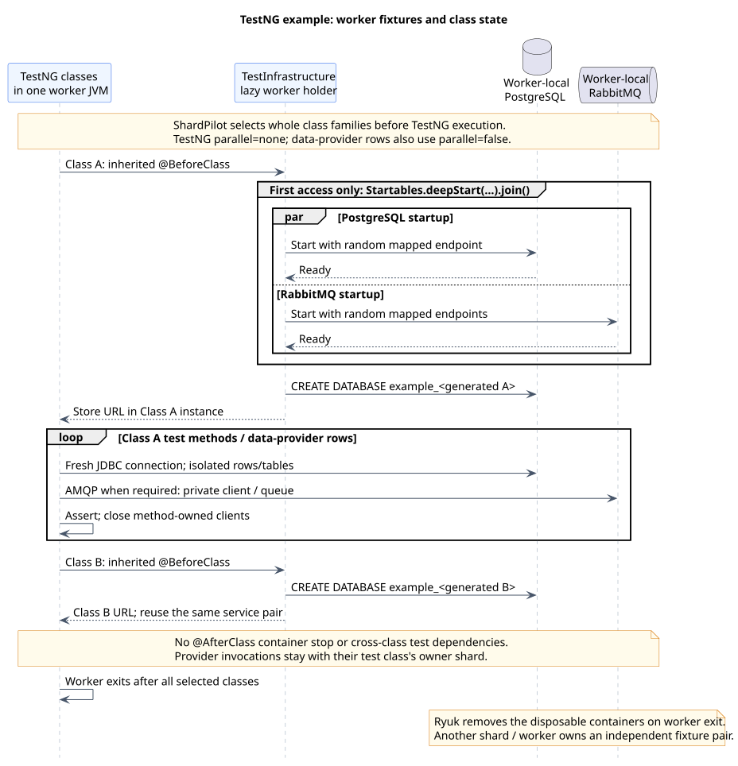

# TestNG with PostgreSQL and RabbitMQ

[Documentation index](README.md) · [Runnable example](../examples/testng/testcontainers/README.md)

The [TestNG example](../examples/testng/testcontainers/build.gradle) is an independent Java consumer
build with four classes against real PostgreSQL and RabbitMQ containers. It mirrors the scenarios
in the [JUnit Jupiter](testcontainers-example.md) and [Spock](spock-testcontainers-example.md)
examples, using TestNG's inherited `@BeforeClass`, assertions and a two-row `@DataProvider`.

## Build and fixture structure

The example resolves the plugin checkout with `includeBuild('../../..')`. It registers its own
`integrationTest` source set, `Test` task and `check` dependency. Gradle's native `useTestNG()`
adapter runs TestNG 7.12.0; no JUnit Platform engine, Jupiter extension or custom ShardPilot runner
is involved. Dependencies include Testcontainers 2.0.5, PostgreSQL JDBC 42.7.14, RabbitMQ client
5.37.0 and SLF4J Simple 2.0.20. They belong to this example, not the published plugin's runtime.

| File or class | Responsibility |
| --- | --- |
| [build.gradle](../examples/testng/testcontainers/build.gradle) | TestNG selection, source set/task registration, sharding, sequential execution and live-test cache policy. |
| [AbstractInfrastructureIT](../examples/testng/testcontainers/src/integrationTest/java/example/shardpilot/AbstractInfrastructureIT.java) | Inherited `@BeforeClass` database allocation, method-owned clients and bounded message polling. |
| [TestInfrastructure](../examples/testng/testcontainers/src/integrationTest/java/example/shardpilot/TestInfrastructure.java) | Lazy worker-local PostgreSQL/RabbitMQ startup and generated databases. |
| [IntegrationTestImages](../examples/testng/testcontainers/src/integrationTest/java/example/shardpilot/IntegrationTestImages.java) | Public image defaults and explicit test-JVM overrides. |
| [Timing history](../examples/testng/testcontainers/integration-test-durations.tsv) | Illustrative class-level weights, not measured performance. |

Only outer `*IT.class` candidates are selected, and the abstract fixture is explicitly excluded.
The base stays on the runtime classpath for inheritance; a shard with no concrete tests does not
retain an abstract helper as its only candidate. Gradle's normal failure checks remain enabled.

## Lifecycle and isolation



[PlantUML source](diagrams/testng-testcontainers-lifecycle.puml)

TestNG inherits `prepareDatabase()` from the abstract base. Its `@BeforeClass(alwaysRun = true)`
allocates a new database before each concrete class's test methods. The first allocation initializes
the lazy service holder: `Startables.deepStart(...).join()` starts PostgreSQL and RabbitMQ concurrently
and waits for readiness. Later classes reuse the pair but receive their own generated database URLs.
No connection or transaction is shared across method invocations or data-provider rows.

Only a generated, validated identifier enters `CREATE DATABASE` on the disposable container's
autocommit connection. The URL retains the container's mapped endpoint and JDBC options. The fixture
never reads credentials or a datasource URL from a real application. Methods use separate tables;
the two round-trip rows use unique codes, so no method depends on another method's execution order.

RabbitMQ clients and channels close after each invocation. Server-named exclusive queues disappear
with their owning connection; the routing method explicitly removes its own generated exchange.
Publisher confirms and bounded empty-queue polling do not retry a failed test or hide a broker error.

Do not stop these containers in `@AfterClass`: a later class in the worker still needs them. Ryuk
removes the pair on worker exit; cross-run reusable containers are not enabled. Missing Docker or
failed startup propagates as a setup failure, not a `SkipException`. See Testcontainers'
[manual singleton lifecycle](https://java.testcontainers.org/test_framework_integration/manual_lifecycle_control/).

The task uses one long-lived Gradle worker (`maxParallelForks = 1`, `forkEvery = 0`). TestNG's
`parallel = 'none'` disables its own method/class parallelism, and the provider explicitly declares
`parallel = false`. Additional shards/workers get independent service pairs. ShardPilot does not
set these concurrency policies or provision containers.

## Run the example

Use the parent Wrapper from the ShardPilot repository root, a compatible JDK and a working Docker
runtime. Sources target Java 17 bytecode; the [verified runtime scope](testing.md#verified-scope)
applies. Uncached dependencies and images require Maven Central/registry access.

Full suite:

```shell
./gradlew -p examples/testng/testcontainers check -Pshardpilot.count=1 -Pshardpilot.index=1
```

Two isolated CI jobs, or two **sequential** local invocations:

```shell
./gradlew -p examples/testng/testcontainers integrationTest -Pshardpilot.count=2 -Pshardpilot.index=1
./gradlew -p examples/testng/testcontainers integrationTest -Pshardpilot.count=2 -Pshardpilot.index=2
```

PowerShell:

```powershell
.\gradlew.bat -p examples/testng/testcontainers check '-Pshardpilot.count=1' '-Pshardpilot.index=1'
.\gradlew.bat -p examples/testng/testcontainers integrationTest '-Pshardpilot.count=2' '-Pshardpilot.index=1'
.\gradlew.bat -p examples/testng/testcontainers integrationTest '-Pshardpilot.count=2' '-Pshardpilot.index=2'
```

Quote dotted `-P` arguments with the batch launcher. Use `integrationTestClasses` to compile without
Docker. The parent plugin's `check` remains Docker-independent. For IDE source roots and dependencies,
[import the example build](../examples/README.md#import-into-intellij-idea), not just the parent.
Local SQL inspection suppressions cover only absent IDE datasources and runtime-created tables in
the three SQL test classes; other SQL inspections remain enabled.

## Class ownership and data providers

| Class | Cases |
| --- | --- |
| `PostgresRoundTripIT` | Two `entries` provider rows for JDBC round-trip, plus an independent numeric aggregation test. |
| `PostgresTransactionIT` | Rollback and visibility of committed rows from another connection. |
| `RabbitRoutingIT` | Direct routing and explicit negative-acknowledgment redelivery. |
| `MessagePersistenceIT` | Persistence before acknowledgment and duplicate-key rejection through `expectThrows`. |

Eight annotated test methods produce nine reported cases because `storesAndReadsEntry` receives
two data-provider rows. Both invocations stay with `PostgresRoundTripIT`; they are not separate
sharding keys. Record the whole class's work in TSV, not invocation labels or provider row names.
The provider sets `propagateFailureAsTestFailure = true`, so provider errors are not accepted as skips.

With the supplied synthetic history, two shards own:

| Index | Classes | Illustrative load |
| --- | --- | --- |
| 1 | `PostgresRoundTripIT`, `MessagePersistenceIT` (five cases) | 14 + 6 = 20 seconds |
| 2 | `PostgresTransactionIT`, `RabbitRoutingIT` (four cases) | 10 + 8 = 18 seconds |

These weights demonstrate deterministic assignment, not job durations or measured speedups.
Startup/image-pull costs are outside them. Use identical selection, plugin revision, history and
count across every job. ShardPilot does not update the file or schedule individual methods.

The example has no `@Factory`, retry analyzer or cross-class method/group dependencies. Tests must
remain independent across class boundaries: ShardPilot does not move a dependency onto the requesting
class's shard or coordinate execution between workers.

Persistence-before-ack is not an atomic database/broker transaction or a complete inbox. A crash
after commit can still cause redelivery; production consumers need idempotency. The duplicate-key
scenario demonstrates a database constraint, and the nack test deliberately exercises broker requeue.

## Images, cache and reports

Defaults are `postgres:18-alpine` and `rabbitmq:4.3.6-management-alpine`. The major PostgreSQL tag can
move; choose a verified digest when immutable CI image contents are required. Override compatible
images through `-Pexample.postgresImage=...` and `-Pexample.rabbitmqImage=...`, quoting the properties
in PowerShell and using identical values in every shard. Keep normal runtime checks and Ryuk enabled.

Live integration results never use up-to-date/build-cache reuse. Configuration-cache reuse remains
enabled and is separate from reusing test results. An empty shard may launch no worker or containers.

Gradle writes JUnit XML under `examples/testng/testcontainers/build/test-results/integrationTest/`
and HTML under `examples/testng/testcontainers/build/reports/tests/integrationTest/`. TestNG's default
reporters are disabled so they do not create overlapping outputs. Preserve each run's reports before
the next sequential invocation replaces them. Compare the baseline's invocation identities with the
union of all shards, including both provider rows, and check that the shards do not overlap.
Use isolated writable workspaces for concurrent jobs. See [CI integration](ci.md).

## TestNG references

- [TestNG annotations](https://testng.org/#_annotations): inherited configuration methods and class lifecycle.
- [Parameters with data providers](https://testng.org/#_parameters_with_dataproviders): invocation parameters and provider concurrency.
- [Gradle TestNG options](https://docs.gradle.org/current/javadoc/org/gradle/api/tasks/testing/testng/TestNGOptions.html): native adapter and reporting settings.
